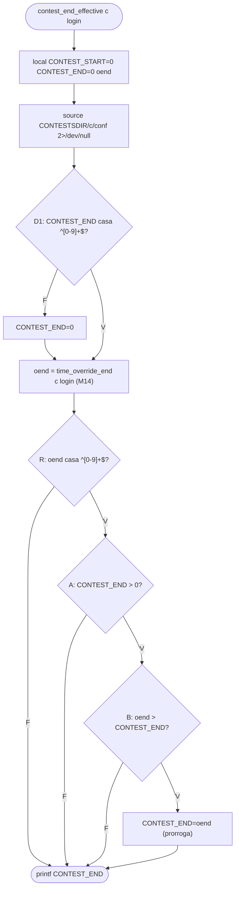

# M15 — `contest_end_effective` (cdmoj) · Testes de Software G11 · Eduardo

## 1. Identificação

| Item | Valor |
|---|---|
| Método | M15 `contest_end_effective`. Testado **integrado** com o M14 `time_override_end` real, sem stub (os defeitos X1/X2 estão na composição dos dois) |
| Arquivo | `server/api/v1/lib/contest-gate.sh`: `contest_end_effective` nas linhas 35–42 (comentário nas linhas 32–34) |
| Commit | `ec13d5cc` (`master`) |
| Branch | `test/eduardo-m15` |
| Ferramentas | GNU bash 5.3.20(1)-release · jq-1.8.2 · Python 3.14.8 (oráculo do porteiro) · kcov 43 · ImageMagick 7.1.2-34 · Arch Linux, kernel 6.18.57-2-lts |
| Data | 2026-11-01 |
| Script | `Test_Eduardo/contest-end-effective.sh`: teste de unidade, offline, com fixture em `mktemp -d` |

Para reproduzir, rode na raiz do `cdmoj`:

```bash
./Test_Eduardo/contest-end-effective.sh                 # execução normal (exit 0 = nenhum caso E falhou)
./Test_Eduardo/contest-end-effective.sh --trace         # grava evidencias/traces/<ID>.trace (xtrace)
python3 -I Test_Eduardo/oraculo-porteiro.py             # oráculo: o espelho em Python (porteiro) nas entradas dos XFAIL
kcov --include-path="$PWD/server/api/v1/lib/contest-gate.sh" Test_Eduardo/evidencias/cobertura ./Test_Eduardo/contest-end-effective.sh
```

O script carrega `lib/common.sh` e `lib/contest-gate.sh` com `MOJ_CONF` apontando para um arquivo que não existe e `CONTESTSDIR` na fixture. Nenhuma configuração nem dado real da máquina é lido. Cada contest da fixture tem um `conf` próprio (`CONTEST_END`, `CONTEST_MODULES=sedes`) e, quando o caso pede, um `time-overrides.json`. Cada caso roda num subshell, porque a função faz `source` do `conf`.

## 2. Contrato

O contrato vem do comentário acima da função (linhas 32–34), da função irmã `contest_end_all`, que diz *"Espelha contest_end_effective"*, e do espelho em Python (`server/porteiro/moj-porteiro.py`, `end_effective`).

- *"contest_end_effective <contest> <login> -> fim EFETIVO (epoch; 0 = sem limite): CONTEST_END do conf, PRORROGADO pela regra do time-overrides.json que casar (o override só ESTENDE — nunca encurta — e só vale quando há um fim definido no conf)."*
- **Espelho (porteiro)**: `end = conf_int(CONTEST_END)` (`int(v) if v.isdigit() else 0`, ou seja, **decimal**), `o = override_end()` (devolve `int(e)`, aceita float) e estende se `o is not None and end > 0 and o > end`.
- **Writers**: o `time-overrides.json` da API tem `end = floor(número) > 0` (por isso float e exponencial só chegam por arquivo editado fora da API). O `CONTEST_END` é gravado com `printf %q` de um epoch na criação (`lib/contest-create.sh`). O `POST /contest/admin/settings` valida `end` só com `^[0-9]+$` sobre o `jq -r .end` do corpo (seção 6, X3/X4).
- **Chamadores**: `handlers/contest/basic.sh:26` (countdown), `handlers/contest/offline-submit.sh:40` e `contest_phase` (M16, que decide o `/submit`, o `can_see_problems` e o `competitor_write_guard`).

## 3. Caixa-preta: partições e limites

Login: `L = sede1-alfa`. `END = CONTEST_END=1700000000`. `rule(x)` = `[{"regex":"^sede1-","end":x}]`.

| Entrada | Partições válidas | Partições inválidas |
|---|---|---|
| F1 `CONTEST_END` (conf) | V1 epoch > 0 · V2 `0` (sem fim) | I1 ausente · I2 não numérico (`abc`) · I3 conf ausente · I8 zero à esquerda (`0100`, `09`) |
| F2 override (saída do M14) | V3 vazio · V4 inteiro > END · V5 inteiro == END · V6 inteiro < END | I4 float · I5 negativo · I6 exponencial |
| F3 login | V7 presente | I7 ausente (1 argumento) |

Valor limite (há ordem entre `oend` e `END`): `oend = END−1` (não estende), `oend = END` (não estende), `oend = END+1` (estende). E `END = 0` × `END = 1` com `oend` grande.

| ID | Partição / limite | Classe |
|---|---|---|
| E01 | V1 V3 V7 | válida |
| E02 | V4 | válida |
| E03 | V5, limite `oend = END` | limite |
| E04 | limite `oend = END+1` | limite |
| E05 | V6, limite `oend = END−1` | limite |
| E06 | V2 | válida |
| E07 | limite `END = 1` | limite |
| E08 | I1 | inválida |
| E09 | I2 | inválida |
| E10 | I3 (contest sem diretório) | inválida |
| E11 | I7 | inválida |
| E12 | módulo `sedes` desligado + override maior (via M14) | inválida |
| E13 | I5 (1ª regra `end -1`, 2ª regra maior que END) | inválida |
| X1 | I6 (`1.7000001e9`, valor inteiro) | inválida → XFAIL |
| X2 | I4 (1ª regra `1700000100.5`, 2ª `1700000200`) | inválida → XFAIL |
| X3 | I8 (`CONTEST_END=0100`, override 99) | inválida → XFAIL |
| X4 | I8 (`CONTEST_END=09`, override 1700000100) | inválida → XFAIL |

## 4. Caixa-branca

### Decisões e condições

| Decisão | Linha | Expressão |
|---|---|---|
| **D1** | 38 | `[[ "$CONTEST_END" =~ ^[0-9]+$ ]] \|\| CONTEST_END=0` |
| **D2** | 40 | `R && (( A && B )) && CONTEST_END=$oend`. R = `[[ "$oend" =~ ^[0-9]+$ ]]`, A = `CONTEST_END > 0`, B = `oend > CONTEST_END` |

Não há decisão dentro de jq no M15 (as do jq são do M14). O `source … 2>/dev/null` da linha 37 com conf ausente cai nos `local` (E10).

Cobertura de decisão (V/F), com resultado real:

| Decisão | V | F |
|---|---|---|
| D1 | E01–E08, E10–E13, X1–X4 (`0` e `0100`/`09` também casam; em E08 vale o `local` `0`) | E09 (`abc`) |
| D2 (estende) | E02, E04, E07, X3 (aqui ela **encurta**, ver seção 6) | E01, E11, E12 (R=F, oend vazio); E13, X1, X2 (R=F, formato); E06, E08, E09, E10 (A=F); E03, E05 (B=F); X4 (erro no `(( ))`) |

**Curto-circuito.** Com R=F o bash não avalia o `(( ))` (o trace de E01 vai de `[[ '' =~ … ]]` direto para o `printf`). Dentro do `(( A && B ))`, com A=F, B não é avaliado (E06): o `&&` aritmético também curto-circuita, então A=F **mascara** B.

**Inviabilidade.** "A=F e B=V com R=V" é o par E06 (`END=0`, `oend=1700000100`). "A=V, B=V, R=F" só existe com `oend` não inteiro, que é justamente o defeito X1/X2.

### Fluxo de `contest_end_effective`



### MC/DC de D2 = R ∧ (A ∧ B)

| Par | Condição | R | A | B | D2 | Saída |
|---|---|---|---|---|---|---|
| **E02** × E01 | R | **V** | V | V | V | `1700000100` |
| E02 × **E01** | R | **F** (oend vazio) | – | – | F | `1700000000` |
| **E02** × E06 | A | V | **V** | V | V | `1700000100` |
| E02 × **E06** | A | V | **F** (END=0) | – | F | `0` |
| **E02** × E03 | B | V | V | **V** | V | `1700000100` |
| E02 × **E03** | B | V | V | **F** (oend == END) | F | `1700000000` |

"–" = não avaliado (curto-circuito). Par de D1: E01 (V) × E09 (F, `abc` vira `0`).

O xtrace mostra o R numa linha própria (`contest_end_effective:40: [[ 1700000100 =~ ^[0-9]+$ ]]`), mas o `(( CONTEST_END > 0 && oend > CONTEST_END ))` aparece **inteiro** numa linha só. O par de A e o de B são vistos pela linha seguinte: aparece `CONTEST_END=…` (D2=V) ou ela não aparece (D2=F). A separação entre A e B vem dos dados (E06 tem `END=0`; E03 tem `oend == END`), não do trace.

## 5. Resultados

Execução de 2026-11-01 (`evidencias/saida-2026-11-01.txt`, com `--trace`): **`RESULT: 13 passed, 0 failed, 4 xfail`**, exit 0. A execução sem `--trace` e a execução sob kcov deram o mesmo resultado.

| ID | Entrada (conf · override · login) | Esperado | Obtido | Status | Critério |
|---|---|---|---|---|---|
| E01 | END=1700000000 · sem arquivo · L | `1700000000` | rc0 `1700000000` | ok | V1 V3; MC/DC R=F; D1=V |
| E06 | END=0 · rule(1700000100) · L | `0` | rc0 `0` | ok | V2: sem fim não ganha fim; MC/DC A=F |
| E08 | sem `CONTEST_END` · rule(1700000100) · L | `0` | rc0 `0` | ok | I1 |
| E09 | END=abc · rule(1700000100) · L | `0` | rc0 `0` | ok | I2; D1=F |
| E10 | contest sem diretório · L | `0` | rc0 `0` | ok | I3 |
| E02 | END · rule(1700000100) · L | `1700000100` | rc0 `1700000100` | ok | V4: estende; MC/DC base |
| E03 | END · rule(1700000000) · L | `1700000000` | rc0 `1700000000` | ok | V5, limite `==`; MC/DC B=F |
| E04 | END · rule(1700000001) · L | `1700000001` | rc0 `1700000001` | ok | limite END+1 |
| E05 | END · rule(1699999999) · L | `1700000000` | rc0 `1700000000` | ok | V6, limite END−1: nunca encurta |
| E07 | END=1 · rule(1700000100) · L | `1700000100` | rc0 `1700000100` | ok | limite END 0 × 1 |
| E11 | END · rule(1700000100) · (sem login) | `1700000000` | rc0 `1700000000` | ok | I7 (`set -u`) |
| E12 | END · `CONTEST_MODULES=coortes` · rule(1700000100) · L | `1700000000` | rc0 `1700000000` | ok | módulo desligado: override não vale |
| E13 | END · `[end -1, end 1700000100]` · L | `1700000000` | rc0 `1700000000` | ok | I5: a 1ª que casa vence (bash = porteiro) |
| X1 | END · rule(1.7000001e9) · L | `1700000100` | rc0 `1700000000` | XFAIL | só estende; paridade com o porteiro |
| X2 | END · `[1700000100.5, 1700000200]` · L | `1700000100` | rc0 `1700000000` | XFAIL | idem |
| X3 | END=0100 · rule(99) · L | `100` | rc0 `99` | XFAIL | **nunca encurta** |
| X4 | END=09 · rule(1700000100) · L | `1700000100` | rc0 `09` + stderr `value too great for base` | XFAIL | só estende; epoch |


### Traces dos pares MC/DC


### Cobertura de linhas (kcov)

Comando: `kcov --include-path="$PWD/server/api/v1/lib/contest-gate.sh" Test_Eduardo/evidencias/cobertura ./Test_Eduardo/contest-end-effective.sh`. O kcov roda **o script** (executável, com shebang), e não `bash <script>`. O relatório fica em `evidencias/cobertura/contest-end-effective.sh.b4f6d613e03ef3f5/` (`cobertura.xml`, `coverage.json`, `index.html`). O symlink que o kcov cria na raiz da pasta (caminho absoluto da máquina) foi apagado.

| Linha | Hits | Observação |
|---|---|---|
| 35 (`contest_end_effective() {`) | não instrumentada | definição de função |
| 36, 37, 38, 39, 40, 41 | 17, 17, 18, 34, 31, 17 | todas cobertas: **6 de 6** linhas instrumentadas do M15 |

As linhas do M14 (23–29) também aparecem nesse relatório, porque o M15 o chama. Elas são avaliadas no relatório do M14. O kcov mede **linha**, não decisão nem MC/DC: as três condições de D2 estão na linha 40, que ele marca como coberta com qualquer caso.


*Renderização via ImageMagick dos dados do `cobertura.xml` do kcov (linhas 35–41); não é captura de tela.*

## 6. Defeitos e hipóteses (XFAIL)

O oráculo é o contrato da seção 2. A paridade com o espelho do porteiro foi conferida **executando** a função Python `end_effective` sobre as mesmas entradas (`python3 -I Test_Eduardo/oraculo-porteiro.py`, saída em `evidencias/oraculo-porteiro-2026-11-01.txt`):

```
M15 E13 end -1         porteiro.end_effective = 1700000000
M15 X1 1.7000001e9     porteiro.end_effective = 1700000100
M15 X2 float           porteiro.end_effective = 1700000100
M15 X3 END=0100        porteiro.end_effective = 100
M15 X4 END=09          porteiro.end_effective = 1700000100
```

Nos quatro XFAIL, o bash e o porteiro **divergem**. A mesma prova tem fins diferentes conforme a rota cair no porteiro ou no bash.

### X1 e X2: override numérico que não é inteiro "puro" é descartado

- **Obtido:** X1 `end = 1.7000001e9` → `1700000000`. O M14 ecoa o literal `1.7000001E+9` (o jq 1.8.2 preserva o literal), e a regex `^[0-9]+$` da linha 40 o rejeita. X2 `end = 1700000100.5` → `1700000000` pela mesma causa. Como a 1ª regra é a que casa, a 2ª (`1700000200`) também não vale.
- **Por que viola o contrato:** a regra casa o login e o fim dela é maior que o `CONTEST_END`, então o fim deveria ser **prorrogado**. O espelho faz `int(e)` e prorroga para `1700000100`. A conferência de formato vem do bash e não existe no contrato nem no porteiro.
- **Como acontece em produção:** só com `time-overrides.json` editado fora da API (o writer aplica `floor`, e `floor` devolve um número novo, que o jq 1.8.2 imprime sem expoente abaixo de 1e16). Efeito: a sede prorrogada perde os minutos extras nas rotas servidas pelo bash (`/submit`) e os mantém nas servidas pelo porteiro (countdown).
- **Correção sugerida (não aplicada):** fazer o M14 devolver o inteiro, como o porteiro (`int(e)`):

```diff
--- a/server/api/v1/lib/contest-gate.sh
+++ b/server/api/v1/lib/contest-gate.sh
@@ time_override_end
           | select($rr != "" and ($e|type=="number") and (try ($l | test($rr)) catch false))
-          | $e) // empty' "$f" 2>/dev/null
+          | $e | floor) // empty' "$f" 2>/dev/null
```

`floor` e o `int()` do Python só diferem para negativos (`int(-1.5) = -1`, `floor = -2`), e negativo nunca prorroga (B=F). A correção mexe na linha do M14, porque é lá que o formato nasce. A alternativa no próprio M15 custaria um processo a mais por chamada.


### X3 e X4: `CONTEST_END` com zero à esquerda é lido em octal

- **Obtido:** X3 `CONTEST_END=0100`, override `99` → `99`. O `(( ))` lê `0100` como octal (64), vê `99 > 64` e troca o fim por 99: o fim **encolheu** de 100 para 99. X4 `CONTEST_END=09` → saída `09` e, no stderr, `contest-gate.sh: line 40: ((: 09: value too great for base (error token is "09")`. O override não é aplicado.
- **Por que viola o contrato:** *"o override só ESTENDE — nunca encurta"*. A D1 (linha 38) aceita `0100` porque `^[0-9]+$` casa, mas a comparação da linha 40 usa outra base. O espelho lê em decimal (`int("0100") = 100`) e dá `100` e `1700000100`.
- **Como acontece em produção:** na criação, o `CONTEST_END` é gravado com `printf %q` de um epoch, sem zero à esquerda. Pela **leitura do código** (não executado ponta a ponta), o `POST /contest/admin/settings` aceita `{"end":"0100"}`: ele valida `jq -r .end` com `^[0-9]+$`, e uma string JSON `"0100"` passa e é gravada como `CONTEST_END=0100`. Um JSON com número `0100` não chega assim (o jq normaliza para `100`). Também acontece com conf editado à mão. Um epoch real com zero à esquerda é absurdo, mas o resultado (encurtar) é exatamente o que o contrato proíbe, e o erro do X4 vai parar no error.log do nginx.
- **Correção sugerida (não aplicada):**

```diff
--- a/server/api/v1/lib/contest-gate.sh
+++ b/server/api/v1/lib/contest-gate.sh
@@ contest_end_effective
   source "$CONTESTSDIR/$1/conf" 2>/dev/null
-  [[ "$CONTEST_END" =~ ^[0-9]+$ ]] || CONTEST_END=0
+  [[ "$CONTEST_END" =~ ^[0-9]+$ ]] && CONTEST_END=$((10#$CONTEST_END)) || CONTEST_END=0
```

`10#` força a base decimal e reproduz o `int()` do porteiro. As duas correções desta seção, junto com a do M14, foram validadas numa **cópia descartável** da lib, fora do repo: `RESULT: 13 passed, 0 failed, 0 xfail`, com X1–X4 em XPASS. O script do M14 na mesma cópia deu `28 passed, 0 failed`. O código de produção não foi alterado.


### Hipóteses do planejamento revistas

- **`end: -1` (E13) não é defeito.** O bash ignora o `-1` (R=F), e o porteiro faz `int(-1) = -1`, que não é maior que o END. Os dois ficam em `1700000000`. Nos dois a 1ª regra que casa vence, e a 2ª não é consultada. É caso que passa.
- **Octal.** O planejamento registrava como observado `09 → 1700000100 sem erro` e `0100 → 0100`. A execução real (bash 5.3.20) deu outra coisa (X3/X4 acima). Valem os resultados medidos aqui.

## 7. Lacunas e limitações

- **`(( A && B ))` numa linha só.** O xtrace não separa A de B. A independência delas vem dos dados (seção 4).
- **Overflow de 64 bits.** Fora dos casos. Sondagem real com o bash 5.3.20: `end = 99999999999999999999` (20 dígitos) → a função devolveu `99999999999999999999` (prorrogou); `end = 9223372036854775808` (2^63) → devolveu `1700000000` (o valor vira negativo no `(( ))` e não prorroga). Pela API esses valores chegam com expoente (depois do `floor`, o jq 1.8.2 imprime `1e+16` em diante), e aí caem no X1. São epochs absurdos (anos acima de 3×10⁹), então ficam só como nota.
- **Alcance do X3/X4 pela API.** Foi deduzido da leitura do `admin/settings.sh` e do comportamento do `jq -r`, sem rodar o handler. Um teste de rota (fora do escopo de unidade) confirmaria.
- **`CONTEST_START` não é usado** pela função (o `local` só o isola do chamador). O `source` do conf poderia redefinir outras variáveis do chamador. O teste não cobre esse vazamento, porque a função roda em subshell nos chamadores (`$(…)`).
- **Integração com o M14.** O M15 foi testado com o M14 real. As partições do M14 (arquivo, módulo, regex) não foram repetidas aqui: E12 cobre só o módulo desligado.
- **Caminhos temporários nos traces.** Os traces trazem caminhos do `mktemp` (`/tmp/tmp.XXXX`), que mudam a cada execução.
- **Cobertura.** O kcov mede só linha. Não há medida automática de decisão nem de MC/DC.

## 8. Uso de Inteligência Artificial

- **Ferramentas:** Claude (chat) e Claude Code (agente no terminal).
- **Análise e planejamento:** a análise do código, as partições, os pares MC/DC e as hipóteses X1/X2 foram feitos com apoio de IA e registrados no planejamento (`planejamento-m15.txt`).
- **Implementação e evidências (Claude Code):** a escrita e a execução do `contest-end-effective.sh` e do `oraculo-porteiro.py`. A geração das evidências: saída, traces, imagens e cobertura com o kcov. A redação deste relatório, incluindo as correções sugeridas em diff. O X3/X4 surgiu nessa etapa: a sondagem real contradisse a observação do planejamento sobre octal.
- **Revisão e decisões (Eduardo):** a revisão do material e as decisões sobre os oráculos e sobre o que entra neste relatório.
- **Autorização:** a professora da disciplina autorizou o uso de IA neste trabalho.
