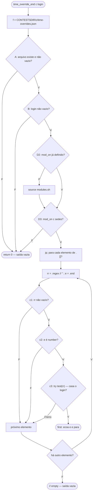
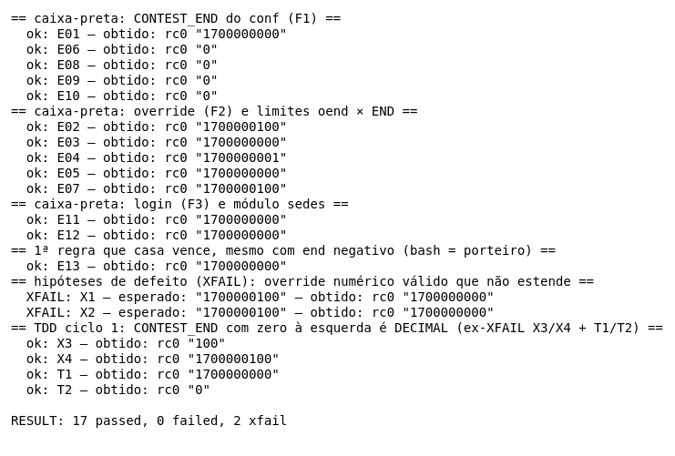
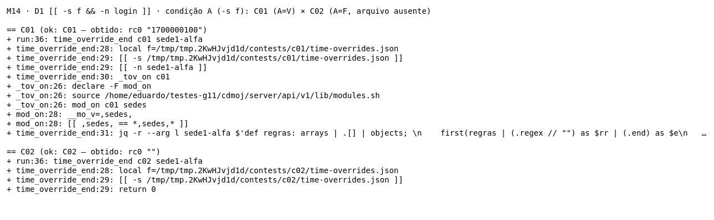
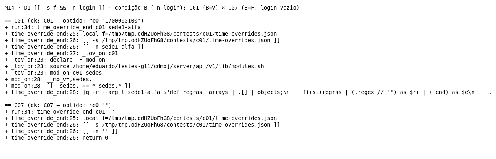
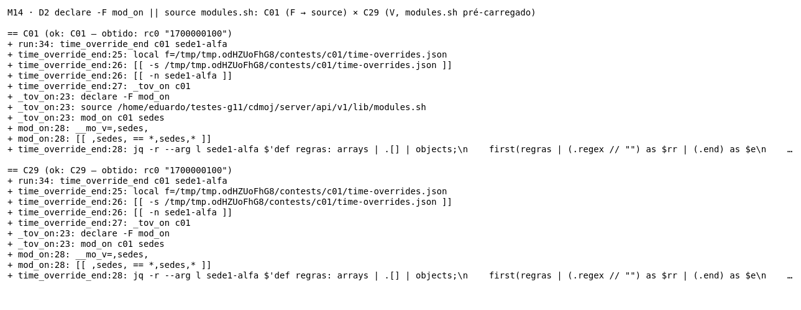
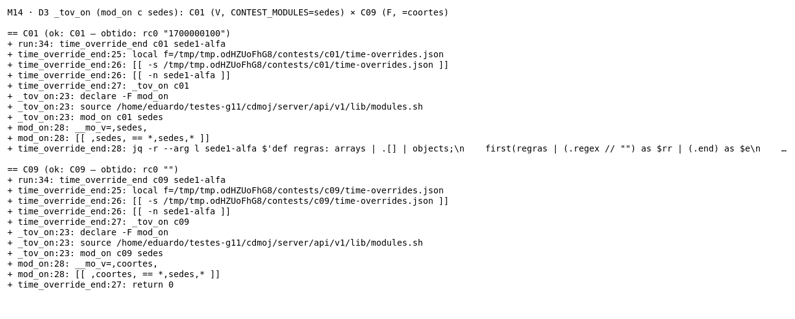
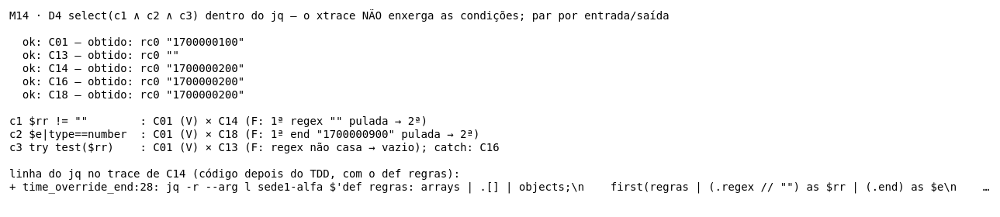
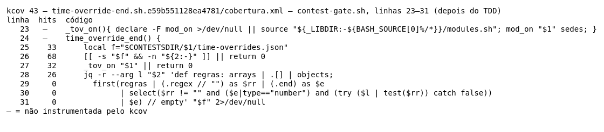
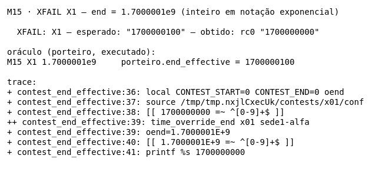
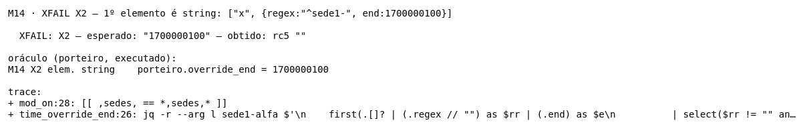

# M14 — `time_override_end` (cdmoj) · Testes de Software G11 · Eduardo

## 1. Identificação

| Item | Valor |
|---|---|
| Método | M14 `time_override_end`. Também exercita a auxiliar `_tov_on` (módulo `sedes`) e o `mod_on` real de `lib/modules.sh` |
| Arquivo | `server/api/v1/lib/contest-gate.sh`: `_tov_on` na linha 21, `time_override_end` nas linhas 22–30 |
| Commit | `ec13d5cc` (`master`) |
| Branch | `test/eduardo-m14` |
| Ferramentas | GNU bash 5.3.20(1)-release · jq-1.8.2 · Python 3.14.8 (oráculo do porteiro) · kcov 43 · ImageMagick 7.1.2-34 · Arch Linux, kernel 6.18.57-2-lts |
| Data | 2026-11-01 |
| Script | `Test_Eduardo/time-override-end.sh`: teste de unidade, offline, com fixture em `mktemp -d` |

Para reproduzir, rode na raiz do `cdmoj`:

```bash
./Test_Eduardo/time-override-end.sh                     # execução normal (exit 0 = nenhum caso C falhou)
./Test_Eduardo/time-override-end.sh --trace             # grava evidencias/traces/<ID>.trace (xtrace)
python3 -I Test_Eduardo/oraculo-porteiro.py             # oráculo: o espelho em Python (porteiro) nas entradas dos XFAIL
kcov --include-path="$PWD/server/api/v1/lib/contest-gate.sh" Test_Eduardo/evidencias/cobertura ./Test_Eduardo/time-override-end.sh
```

O script carrega `lib/common.sh` e `lib/contest-gate.sh` com `MOJ_CONF` apontando para um arquivo que não existe e `CONTESTSDIR` na fixture. Nenhuma configuração nem dado real da máquina é lido. O `mod_on` **não** é stubado: cada contest da fixture tem `CONTEST_MODULES=…` no `conf`, e o `modules.sh` real é carregado pelo próprio `_tov_on`.

## 2. Contrato

O contrato vem do comentário acima da função (linhas 13–20), do writer da API (`handlers/contest/admin/time-overrides.sh`) e do espelho em Python (`server/porteiro/moj-porteiro.py`, `override_end`, cuja docstring diz *"Espelho do time_override_end"*).

- *"time_override_end <contest> <login> -> ecoa o `end` (epoch) da 1ª regra de contests/<c>/time-overrides.json cujo regex casa com o login; vazio se nenhuma."*
- *"Formato: [{regex, end, reason?}, …] — 1ª que casa vence."*
- *"try/catch protege de regex inválido."*
- *"A prorrogação por sede é do módulo `sedes`: DESLIGADO, o arquivo não vale (decisão do Ribas, 03/10/2026). O teste do módulo vem DEPOIS do do arquivo."*
- **Writer** (`admin/time-overrides.sh`): grava só uma lista de objetos (`map(select(type=="object"))`), com regex string não vazia, de até 200 caracteres e compilável, e `end = floor(número) > 0`, com no máximo 50 regras. O comentário do writer explica a regra: *"regra quebrada silenciaria as demais no gate"*. Por isso arquivo-objeto, elemento que não é objeto, `end` não numérico e regex que não é string **só chegam** por um `time-overrides.json` editado fora da API (à mão, restaurado ou migrado).
- **Espelho (porteiro)**: exige lista (`isinstance(data, list)`), pula elemento que não é `dict`, aceita `end` int/float (não bool) e devolve `int(e)`. Uma exceção não prevista vai para o `except Exception` do porteiro, que declina, e quem responde é o bash.
- **Chamadores**: `contest_end_effective` (M15) e, por ele, o `/submit`, o countdown do `/contest/basic` e o `contest_phase`.

## 3. Caixa-preta: partições e limites

Login usado na maioria dos casos: `L = sede1-alfa`. Regra válida que casa `L`: `{"regex":"^sede1-","end":1700000100}`.

| Entrada | Partições válidas | Partições inválidas |
|---|---|---|
| E1 arquivo | V1 lista válida · V2 `[]` | I1 ausente · I2 0 bytes · I3 JSON inválido · I4 objeto no lugar de lista · I17 lista com elemento que não é objeto |
| E2 login | V3 não vazio | I5 `""` · I6 ausente (1 argumento só) |
| E3 módulo `sedes` | V4 ligado (`sedes`, `coortes,sedes`) | I7 desligado (`coortes`) · I8 sem `CONTEST_MODULES` · I9 `sedesX` |
| E4 regex | V5 casa · V6 não casa | I10 `""` · I11 ausente · I12 inválida `(` · I13 não string (`5`) |
| E5 end | V7 inteiro > 0 · V8 `0` | I14 string · I15 bool · I16 null |
| E6 posição | V9 1ª casa · V10 só a última casa · V11 várias casam (vence a 1ª) · V12 nenhuma casa | — |

Valor limite só onde há ordem: `end` 0 × 1; posição 1ª × última regra; fronteira do casamento com `^t1\.` (`t1.a` casa, `t1a` e `xt1.a` não) e busca **não ancorada** (`sede1` casa `xsede1y`).

| ID | Partição / limite | Classe |
|---|---|---|
| C01 | V1 V3 V4 V5 V7 V9 | válida (caso base) |
| C02 | I1 | inválida |
| C03 | I2 | inválida |
| C04 | I3 | inválida |
| C05 | V2 | válida |
| X1 | I4 (era o C06 do planejamento) | inválida → XFAIL |
| X2 | I17 | inválida → XFAIL |
| C07 | I5 | inválida |
| C08 | I6 | inválida |
| C09 | I7 | inválida |
| C10 | I8 | inválida |
| C11 | I9 | inválida (limite do casamento `,sedes,`) |
| C12 | V4 (`coortes,sedes`) | válida |
| C13 | V6 V12 | válida |
| C14 | I10 (1ª regra), 2ª válida | inválida |
| C15 | I11 (1ª regra), 2ª válida | inválida |
| C16 | I12 (1ª regra), 2ª válida | inválida |
| C17 | I13 (1ª regra), 2ª válida | inválida |
| C18 | I14 (1ª regra), 2ª válida | inválida |
| C19 | I15 (1ª regra), 2ª válida | inválida |
| C20 | I16 (1ª regra), 2ª válida | inválida |
| C21 | V8, limite `end = 0` | limite |
| C22 | limite `end = 1` | limite |
| C23 | V11 | válida |
| C24 | V10 (3 regras, só a última casa) | limite de posição |
| C25 / C26 / C27 | `^t1\.` × `t1.a` / `t1a` / `xt1.a` | limite do casamento |
| C28 | `sede1` × `xsede1y` | busca não ancorada |
| C29 | C01 com `modules.sh` já carregado | caixa-branca (D2) |

Uma inválida por vez: nos casos C14–C20 só a 1ª regra é inválida, e a 2ª (válida, `end 1700000200`) mostra que a inválida foi **pulada**, e não que a função parou.

## 4. Caixa-branca

### Decisões e condições

| Decisão | Linha | Expressão |
|---|---|---|
| **D1** | 24 | `[[ -s "$f" && -n "${2:-}" ]] \|\| return 0`. A = `-s "$f"`, B = `-n "$2"` |
| **D2** | 21 | `declare -F mod_on \|\| source …/modules.sh`: o `mod_on` já está definido? |
| **D3** | 25 | `_tov_on "$1" \|\| return 0`: o `mod_on <c> sedes` deu 0? |
| **D4** | 28 (jq) | `select(c1 and c2 and c3)`. c1 = `$rr != ""`, c2 = `$e\|type=="number"`, c3 = `try ($l\|test($rr)) catch false` |
| **D5** | 27 (jq) | `.regex // ""`: regex ausente ou null vira `""` |
| **D6** | 27 (jq) | `first(…)`: 0 elementos, a 1ª que passa, só a última passa |
| **D7** | 29 (jq) | `… // empty`: nenhuma regra passou → saída vazia |

Cobertura de decisão (V/F), com resultado real:

| Decisão | V | F |
|---|---|---|
| D1 (segue) | C01, C04, C05, C09–C29, X1, X2 | C02, C03 (A=F); C07, C08 (B=F) |
| D2 (já carregado) | C29 | todos os outros (cada caso roda num subshell novo) |
| D3 (sedes ligado) | C01, C04, C05, C12–C29, X1, X2 | C09, C10, C11 |
| D4 (1ª regra passa) | C01, C12, C21–C23, C25, C28 | C14 (c1), C18–C20 (c2), C13, C26, C27 (c3), C16 (c3 pelo `catch`) |
| D5 (`//` usado) | C15 | demais |
| D6 | C23 (1ª de várias), C24 (última) | C05 (lista vazia) |
| D7 (`empty`) | C05, C13, C26, C27 | C01 e demais com saída |

**Curto-circuito.** Em D1, com A=F o bash não avalia B (C02, C03: o trace vai de `[[ -s … ]]` direto para `return 0`). Em D4, o `and` do jq também curto-circuita: com c1=F, c2 e c3 não são avaliados (C14), e com c2=F, c3 não é (C18). Por isso o `test()` nunca roda com `$rr` vazio.

**Mascaramento e inviabilidade.** D3 só é alcançada com D1 = V, porque o teste do módulo vem **depois** do teste do arquivo, como o contrato pede. Assim, "módulo desligado e arquivo ausente" não distingue D3. Isso é por projeto, não lacuna. Em D4, c3 com regex não string (C17) cai no `catch false`. No porteiro a mesma entrada levanta `TypeError` (seção 6, oráculo), mas o resultado final é o mesmo, porque o porteiro declina e o bash responde.

### Fluxo de `time_override_end`



### MC/DC

| Par | Condição | A | B | M (D2) | sedes (D3) | c1 | c2 | c3 | Resultado |
|---|---|---|---|---|---|---|---|---|---|
| **C01** × C02 | A | **V** | V | F | V | V | V | V | `1700000100` |
| C01 × **C02** | A | **F** | – | – | – | – | – | – | vazio (`return 0`) |
| **C01** × C07 | B | V | **V** | F | V | V | V | V | `1700000100` |
| C01 × **C07** | B | V | **F** | – | – | – | – | – | vazio |
| **C01** × C29 | M | V | V | **F** (source) | V | V | V | V | `1700000100` |
| C01 × **C29** | M | V | V | **V** (sem source) | V | V | V | V | `1700000100` |
| **C01** × C09 | D3 | V | V | F | **V** | V | V | V | `1700000100` |
| C01 × **C09** | D3 | V | V | F | **F** | – | – | – | vazio |
| C01 × **C14** | c1 (1ª regra) | V | V | F | V | **F** | – | – | 1ª pulada → `1700000200` |
| C01 × **C18** | c2 (1ª regra) | V | V | F | V | V | **F** | – | 1ª pulada → `1700000200` |
| C01 × **C13** | c3 | V | V | F | V | V | V | **F** | vazio |

"–" = não avaliado (curto-circuito). D2 é uma condição só, e as duas saídas dão o mesmo resultado: o par mostra que o `source` só acontece quando o `mod_on` não existe (decisão V/F, não independência sobre a saída). Em c1 e c2 o par é por **elemento**: a 1ª regra do C14/C18 teria ganhado se passasse (`end 1700000900`), e o resultado `1700000200` mostra que ela foi descartada.

O xtrace enxerga D1, D2 e D3 termo a termo (`time_override_end:24: [[ -s … ]]`, `[[ -n … ]]`, `_tov_on:21: declare -F mod_on`, `mod_on:28: [[ ,coortes, == *,sedes,* ]]`). As condições c1–c3 ficam **dentro do jq** e não aparecem no trace (seção 7). Para elas, o par se apoia na entrada e na saída.

## 5. Resultados

Execução de 2026-11-01 (`evidencias/saida-2026-11-01.txt`, com `--trace`): **`RESULT: 28 passed, 0 failed, 2 xfail`**, exit 0. A execução sem `--trace` e a execução sob kcov deram o mesmo resultado.

| ID | Entrada (contest · login) | Esperado | Obtido | Status | Critério |
|---|---|---|---|---|---|
| C01 | 1 regra `^sede1-` end 1700000100, sedes · `sede1-alfa` | `1700000100` | rc0 `1700000100` | ok | caso base; MC/DC base |
| C02 | sem arquivo | vazio | rc0 vazio | ok | I1; MC/DC A=F |
| C03 | arquivo de 0 bytes | vazio | rc0 vazio | ok | I2 (`-s` falso) |
| C04 | JSON truncado | vazio | rc5 vazio | ok | I3 (rc 5 do jq: ver seção 7) |
| C05 | `[]` | vazio | rc0 vazio | ok | V2; D6 lista vazia |
| C07 | login `""` | vazio | rc0 vazio | ok | I5; MC/DC B=F |
| C08 | só 1 argumento (`set -u`) | vazio, sem erro | rc0 vazio | ok | I6 |
| C09 | `CONTEST_MODULES=coortes` | vazio | rc0 vazio | ok | I7; MC/DC D3=F |
| C10 | sem `CONTEST_MODULES` | vazio | rc0 vazio | ok | I8 |
| C11 | `CONTEST_MODULES=sedesX` | vazio | rc0 vazio | ok | I9 |
| C12 | `CONTEST_MODULES=coortes,sedes` | `1700000100` | rc0 `1700000100` | ok | V4 |
| C13 | regex `^sede2-` | vazio | rc0 vazio | ok | V6/V12; MC/DC c3=F; D7 |
| C14 | 1ª regex `""`, 2ª válida | `1700000200` | rc0 `1700000200` | ok | I10; MC/DC c1=F |
| C15 | 1ª sem regex, 2ª válida | `1700000200` | rc0 `1700000200` | ok | I11; D5 |
| C16 | 1ª regex `(`, 2ª válida | `1700000200` | rc0 `1700000200` | ok | I12; `catch false` |
| C17 | 1ª regex `5`, 2ª válida | `1700000200` | rc0 `1700000200` | ok | I13 |
| C18 | 1ª end `"1700000900"`, 2ª válida | `1700000200` | rc0 `1700000200` | ok | I14; MC/DC c2=F |
| C19 | 1ª end `true`, 2ª válida | `1700000200` | rc0 `1700000200` | ok | I15 |
| C20 | 1ª end `null`, 2ª válida | `1700000200` | rc0 `1700000200` | ok | I16 |
| C21 | end `0` | `0` | rc0 `0` | ok | V8, limite |
| C22 | end `1` | `1` | rc0 `1` | ok | limite |
| C23 | duas casam (100, 200) | `100` | rc0 `100` | ok | V11: 1ª vence |
| C24 | 3 regras, só a última casa | `300` | rc0 `300` | ok | V10 |
| C25 | `^t1\.` · `t1.a` | `1700000100` | rc0 `1700000100` | ok | limite do casamento |
| C26 | `^t1\.` · `t1a` | vazio | rc0 vazio | ok | limite (o `.` é literal) |
| C27 | `^t1\.` · `xt1.a` | vazio | rc0 vazio | ok | limite (âncora) |
| C28 | `sede1` · `xsede1y` | `1700000100` | rc0 `1700000100` | ok | busca não ancorada |
| C29 | C01 com `modules.sh` pré-carregado | `1700000100` | rc0 `1700000100` | ok | D2=V |
| X1 | `{"a":{regex,end}}` (objeto) | vazio | rc0 `1700000100` | XFAIL | formato `[…]`; paridade com o porteiro |
| X2 | `["x", {regex,end}]` | `1700000100` | rc5 vazio | XFAIL | "1ª que casa vence"; regra quebrada não silencia as demais |



### Traces dos pares MC/DC











### Cobertura de linhas (kcov)

Comando: `kcov --include-path="$PWD/server/api/v1/lib/contest-gate.sh" Test_Eduardo/evidencias/cobertura ./Test_Eduardo/time-override-end.sh`. O kcov roda **o script** (executável, com shebang), e não `bash <script>`. O relatório fica em `evidencias/cobertura/time-override-end.sh.e59b551128ea4781/` (`cobertura.xml`, `coverage.json`, `index.html`). O symlink que o kcov cria na raiz da pasta (caminho absoluto da máquina) foi apagado.

Este relatório considera **só** as linhas 21–29. O resto de `contest-gate.sh` não é alvo deste teste.

| Linha | Hits | Observação |
|---|---|---|
| 21 (`_tov_on`) | não instrumentada | função de uma linha; o xtrace mostra que roda (`_tov_on:21: declare -F mod_on`) |
| 22 (`time_override_end() {`) | não instrumentada | definição de função |
| 23, 24, 25, 26 | 30, 62, 29, 23 | todas cobertas |
| 27, 28, 29 | 0 | **artefato**: são a continuação da string do programa jq (aspas simples abertas na linha 26). Não há comando bash nelas, e elas executam junto com a linha 26 |

Das linhas com comando bash (23–26), 4 de 4 foram cobertas. O kcov conta 7 linhas instrumentadas (4 cobertas), mas as 3 que faltam são o texto do programa jq, não código bash. O kcov mede **linha**, não decisão nem MC/DC: as condições de D4 estão todas na linha 28, que ele marca como 0.



*Renderização via ImageMagick dos dados do `cobertura.xml` do kcov (linhas 21–29); não é captura de tela.*

## 6. Defeitos e hipóteses (XFAIL)

O oráculo é o contrato da seção 2. A paridade com o espelho do porteiro foi conferida **executando** as funções Python (`python3 -I Test_Eduardo/oraculo-porteiro.py`, saída em `evidencias/oraculo-porteiro-2026-11-01.txt`):

```
M14 X1 objeto          porteiro.override_end = None
M14 X2 elem. string    porteiro.override_end = 1700000100
M14 C17 regex 5        porteiro levanta TypeError: first argument must be string or compiled pattern  -> except Exception -> fallback p/ o bash
```

Os dois XFAIL só são alcançáveis com um `time-overrides.json` **editado fora da API**: o writer grava só lista de objetos.

### X1: arquivo-objeto é aceito como se fosse lista

- **Obtido:** `{"a":{"regex":"^sede1-","end":1700000100}}` → rc0 `1700000100`.
- **Por que viola o contrato:** o formato é `[{regex, end, reason?}, …]` e a ordem ("1ª que casa vence") só existe numa lista. O `.[]?` do jq itera também os **valores de um objeto**, cuja ordem é a das chaves. O espelho exige lista e devolve `None`. Bash e porteiro **divergem** para a mesma entrada: a rota servida pelo porteiro não prorroga, e a servida pelo bash prorroga.
- **Como acontece em produção:** arquivo restaurado de backup, editado à mão ou gerado por script fora da API.
- **Correção sugerida (não aplicada):** ver o diff depois do X2 (a mesma linha resolve os dois).



### X2: um elemento que não é objeto silencia todas as regras

- **Obtido:** `["x", {"regex":"^sede1-","end":1700000100}]` → rc5, saída vazia. O jq aborta com `Cannot index string with string ("regex")` (o stderr é descartado pelo `2>/dev/null`).
- **Por que viola o contrato:** a regra válida casa o login e deveria valer ("1ª que casa vence"). O `try/catch` protege só o `test()` da regex, e não o acesso `.regex`/`.end` sobre um elemento que não é objeto. O próprio writer explica por que isso importa: *"regra quebrada silenciaria as demais no gate"*. O espelho pula o elemento e devolve `1700000100`.
- **Como acontece em produção:** uma sede inteira perde a prorrogação. Os times dela recebem `403 contest_ended` no `/submit` durante os minutos extras, e o countdown mostra o fim global. Basta uma entrada malformada no arquivo. `null` não dispara o erro (`null.regex` é `null`), mas string, número e lista disparam.
- **Correção sugerida (não aplicada):**

```diff
--- a/server/api/v1/lib/contest-gate.sh
+++ b/server/api/v1/lib/contest-gate.sh
@@ time_override_end
   jq -r --arg l "$2" '
-    first(.[]? | (.regex // "") as $rr | (.end) as $e
+    first((if type == "array" then .[] else empty end) | objects | (.regex // "") as $rr | (.end) as $e
           | select($rr != "" and ($e|type=="number") and (try ($l | test($rr)) catch false))
           | $e) // empty' "$f" 2>/dev/null
```

`if type == "array"` reproduz o `isinstance(data, list)` do porteiro (X1), e `objects` reproduz o `if not isinstance(ent, dict): continue` (X2). A correção foi validada numa **cópia descartável** da lib, fora do repo, junto com as correções do M15 (`| $e | floor` e `10#`): `RESULT: 28 passed, 0 failed, 0 xfail`, com X1 e X2 em XPASS. O código de produção não foi alterado. A função vizinha `contest_end_all` usa o mesmo `.[]?` sem `objects` (fora do escopo, não testada).



### Hipóteses do planejamento que não viraram defeito

- **`end` float, negativo ou exponencial.** O M14 só ecoa o número, como o contrato diz ("ecoa o `end`"). A quebra aparece no M15, que recebe esse texto (`1700000100.5`, `1.7000001E+9`). Por isso esses casos estão no relatório do M15.
- **Regex não string (C17).** O porteiro levanta `TypeError` (não é `re.error`), cai no `except Exception` e declina, e o bash responde. O resultado final é o mesmo, então é caso que passa.

## 7. Lacunas e limitações

- **Condições dentro do jq.** O xtrace não enxerga D4–D7 (c1, c2, c3, `//`, `first`). A independência delas foi mostrada por entrada e saída (a 1ª regra é pulada e a 2ª vence), não pelo trace. O kcov também não enxerga: as linhas 27–29 aparecem com 0 hits.
- **Código de saída.** Com JSON inválido (C04) e no X2, a função sai com rc 5 (o rc do jq). O contrato só fala da saída, e os chamadores usam `$(…)`. O rc foi registrado, mas não é critério de aprovação.
- **Dialeto de regex.** O bash usa o Oniguruma do jq, e o porteiro usa o `re` do Python. Diferenças de dialeto (lookbehind, classes Unicode, `\d`) não foram testadas.
- **Leitura do conf.** O `mod_on` usa o `conf_value_to` real. Formatos exóticos de `CONTEST_MODULES` (aspas, `\,` do `printf %q`, espaços) não foram testados. O porteiro faz `strip()` nos itens, e o bash não: `coortes, sedes` com espaço daria resultados diferentes (não testado; o writer grava sem espaço).
- **Oráculo do porteiro.** O `oraculo-porteiro.py` importa as funções do porteiro, mas não sobe o servidor FastCGI. O caminho "exceção → declina → bash responde" foi lido no código, não executado.
- **Caminhos temporários nos traces.** Os traces trazem caminhos do `mktemp` (`/tmp/tmp.XXXX`), que mudam a cada execução.
- **Cobertura.** O kcov mede só linha. Não há medida automática de decisão nem de MC/DC.

## 8. Uso de Inteligência Artificial

- **Ferramentas:** Claude (chat) e Claude Code (agente no terminal).
- **Análise e planejamento:** a análise do código, as partições, os pares MC/DC e as hipóteses foram feitos com apoio de IA e registrados no planejamento (`planejamento-m14.txt`).
- **Implementação e evidências (Claude Code):** a escrita e a execução do `time-override-end.sh` e do `oraculo-porteiro.py`. A geração das evidências: saída, traces, imagens e cobertura com o kcov. A redação deste relatório, incluindo a correção sugerida em diff. O X2 foi encontrado nessa etapa, ao sondar o filtro jq com um elemento que não é objeto.
- **Revisão e decisões (Eduardo):** a revisão do material e as decisões sobre os oráculos. Por exemplo, o arquivo-objeto virou XFAIL (X1) por decisão do Eduardo.
- **Autorização:** a professora da disciplina autorizou o uso de IA neste trabalho.
