# M14 — `time_override_end` (cdmoj) · Testes de Software G11 · Eduardo

## 1. Identificação

| Item | Valor |
|---|---|
| Método | M14 `time_override_end`. Também exercita a auxiliar `_tov_on` (módulo `sedes`) e o `mod_on` real de `lib/modules.sh` |
| Arquivo | `server/api/v1/lib/contest-gate.sh`, depois dos 2 ciclos de TDD: `TOV_RULES_JQ` (o filtro `regras`, ciclo 2) na linha 25, `_tov_on` na linha 26, `time_override_end` nas linhas 27–35 e `contest_end_all` (ciclo 2) nas linhas 55–64. Depois do ciclo 1 eram 23 e 24–32; antes do TDD, 21 e 22–30 |
| Commit | `ec13d5cc` (`master`) como base dos testes; os 2 ciclos de TDD (seção 7) alteram `contest-gate.sh` nesta branch |
| Branch | `test/eduardo-m14` |
| Ferramentas | GNU bash 5.3.20(1)-release · jq-1.8.2 · Python 3.14.8 (oráculo, 2026-11-01) e 3.14.9 (oráculo, 2026-11-02) · kcov 43 · ImageMagick 7.1.2-34 · Arch Linux, kernel 6.18.57-2-lts |
| Data | 2026-11-01 (testes) · 2026-11-02 (2 ciclos de TDD e evidências regeradas) |
| Script | `Test_Eduardo/time-override-end.sh`: teste de unidade, offline, com fixture em `mktemp -d` |

Para reproduzir, rode na raiz do `cdmoj`:

```bash
./Test_Eduardo/time-override-end.sh                     # execução normal (exit 0 = nenhum caso C falhou)
./Test_Eduardo/time-override-end.sh --trace             # grava evidencias/traces/<ID>.trace (xtrace)
python3 -I Test_Eduardo/oraculo-porteiro.py             # oráculo: o espelho em Python (porteiro) nas entradas de X1, X2, T1–T3 e A1–A4
bash server/test/smoke-time-overrides.sh                # regressão do TDD (teste do upstream, não alterado)
kcov --include-path="$PWD/server/api/v1/lib/contest-gate.sh" Test_Eduardo/evidencias/cobertura ./Test_Eduardo/time-override-end.sh
```

O script carrega `lib/common.sh` e `lib/contest-gate.sh` com `MOJ_CONF` apontando para um arquivo que não existe e `CONTESTSDIR` na fixture. Nenhuma configuração nem dado real da máquina é lido. O `mod_on` **não** é stubado: cada contest da fixture tem `CONTEST_MODULES=…` no `conf`, e o `modules.sh` real é carregado pelo próprio `_tov_on`.

## 2. Contrato

O contrato vem do comentário acima da função (linhas 13–24; as linhas 21–24 foram acrescentadas nos Refactors do TDD), do writer da API (`handlers/contest/admin/time-overrides.sh`) e do espelho em Python (`server/porteiro/moj-porteiro.py`, `override_end`, cuja docstring diz *"Espelho do time_override_end"*).

- *"time_override_end <contest> <login> -> ecoa o `end` (epoch) da 1ª regra de contests/<c>/time-overrides.json cujo regex casa com o login; vazio se nenhuma."*
- *"Formato: [{regex, end, reason?}, …] — 1ª que casa vence."*
- *"try/catch protege de regex inválido."*
- *"A prorrogação por sede é do módulo `sedes`: DESLIGADO, o arquivo não vale (decisão do Ribas, 03/10/2026). O teste do módulo vem DEPOIS do do arquivo."*
- **Writer** (`admin/time-overrides.sh`): grava só uma lista de objetos (`map(select(type=="object"))`), com regex string não vazia, de até 200 caracteres e compilável, e `end = floor(número) > 0`, com no máximo 50 regras. O comentário do writer explica a regra: *"regra quebrada silenciaria as demais no gate"*. Por isso arquivo-objeto, elemento que não é objeto, `end` não numérico e regex que não é string **só chegam** por um `time-overrides.json` editado fora da API (à mão, restaurado ou migrado).
- **Espelho (porteiro)**: exige lista (`isinstance(data, list)`), pula elemento que não é `dict`, aceita `end` int/float (não bool) e devolve `int(e)`. Uma exceção não prevista vai para o `except Exception` do porteiro, que declina, e quem responde é o bash.
- **Chamadores**: `contest_end_effective` (M15) e, por ele, o `/submit`, o countdown do `/contest/basic` e o `contest_phase`.

## 3. Caixa-preta: partições e limites

Login usado na maioria dos casos: `L = sede1-alfa`. Regra válida que casa `L`: `{"regex":"^sede1-","end":1700000100}`.

| Entrada | Partições válidas | Partições inválidas |
|---|---|---|
| E1 arquivo | V1 lista válida · V2 `[]` | I1 ausente · I2 0 bytes · I3 JSON inválido · I4 objeto no lugar de lista · I17 lista com elemento que não é objeto |
| E2 login | V3 não vazio | I5 `""` · I6 ausente (1 argumento só) |
| E3 módulo `sedes` | V4 ligado (`sedes`, `coortes,sedes`) | I7 desligado (`coortes`) · I8 sem `CONTEST_MODULES` · I9 `sedesX` |
| E4 regex | V5 casa · V6 não casa | I10 `""` · I11 ausente · I12 inválida `(` · I13 não string (`5`) |
| E5 end | V7 inteiro > 0 · V8 `0` | I14 string · I15 bool · I16 null |
| E6 posição | V9 1ª casa · V10 só a última casa · V11 várias casam (vence a 1ª) · V12 nenhuma casa | — |

Valor limite só onde há ordem: `end` 0 × 1; posição 1ª × última regra; fronteira do casamento com `^t1\.` (`t1.a` casa, `t1a` e `xt1.a` não) e busca **não ancorada** (`sede1` casa `xsede1y`).

| ID | Partição / limite | Classe |
|---|---|---|
| C01 | V1 V3 V4 V5 V7 V9 | válida (caso base) |
| C02 | I1 | inválida |
| C03 | I2 | inválida |
| C04 | I3 | inválida |
| C05 | V2 | válida |
| X1 | I4 (era o C06 do planejamento) | inválida (XFAIL até o TDD; obrigatório desde o Red do ciclo 1) |
| X2 | I17 (elemento string) | inválida (XFAIL até o TDD; obrigatório desde o Red) |
| T1 | I17 (elemento número), criado no TDD | inválida |
| T2 | I17 (elemento lista), criado no TDD | inválida |
| T3 | I4 (uma regra sem os colchetes), criado no TDD | inválida |
| A1–A4 | as mesmas partições do arquivo, lidas pela `contest_end_all` (ciclo 2): A1 lista válida (V1), A2 elemento string (I17), A3 objeto (I4), A4 elemento número (I17) | A1 válida; A2–A4 inválidas |

A1–A4 testam a função vizinha `contest_end_all`, que lê o **mesmo** `time-overrides.json` (fim para todos, gate da cerimônia). Não é método do roteiro do M14: entrou no ciclo 2 do TDD, por decisão do Eduardo, porque tinha o mesmo `.[]?` do M14 antes do ciclo 1.
| C07 | I5 | inválida |
| C08 | I6 | inválida |
| C09 | I7 | inválida |
| C10 | I8 | inválida |
| C11 | I9 | inválida (limite do casamento `,sedes,`) |
| C12 | V4 (`coortes,sedes`) | válida |
| C13 | V6 V12 | válida |
| C14 | I10 (1ª regra), 2ª válida | inválida |
| C15 | I11 (1ª regra), 2ª válida | inválida |
| C16 | I12 (1ª regra), 2ª válida | inválida |
| C17 | I13 (1ª regra), 2ª válida | inválida |
| C18 | I14 (1ª regra), 2ª válida | inválida |
| C19 | I15 (1ª regra), 2ª válida | inválida |
| C20 | I16 (1ª regra), 2ª válida | inválida |
| C21 | V8, limite `end = 0` | limite |
| C22 | limite `end = 1` | limite |
| C23 | V11 | válida |
| C24 | V10 (3 regras, só a última casa) | limite de posição |
| C25 / C26 / C27 | `^t1\.` × `t1.a` / `t1a` / `xt1.a` | limite do casamento |
| C28 | `sede1` × `xsede1y` | busca não ancorada |
| C29 | C01 com `modules.sh` já carregado | caixa-branca (D2) |

Uma inválida por vez: nos casos C14–C20 só a 1ª regra é inválida, e a 2ª (válida, `end 1700000200`) mostra que a inválida foi **pulada**, e não que a função parou.

## 4. Caixa-branca

### Decisões e condições

| Decisão | Linha | Expressão |
|---|---|---|
| **D1** | 29 | `[[ -s "$f" && -n "${2:-}" ]] \|\| return 0`. A = `-s "$f"`, B = `-n "$2"` |
| **D2** | 26 | `declare -F mod_on \|\| source …/modules.sh`: o `mod_on` já está definido? |
| **D3** | 30 | `_tov_on "$1" \|\| return 0`: o `mod_on <c> sedes` deu 0? |
| **D4** | 33 (jq) | `select(c1 and c2 and c3)`. c1 = `$rr != ""`, c2 = `$e\|type=="number"`, c3 = `try ($l\|test($rr)) catch false` |
| **D5** | 32 (jq) | `.regex // ""`: regex ausente ou null vira `""` |
| **D6** | 32 (jq) | `first(…)`: 0 elementos, a 1ª que passa, só a última passa |
| **D7** | 34 (jq) | `… // empty`: nenhuma regra passou → saída vazia |
| **D8** | 25 (jq, TDD; usado nas linhas 31 e 60) | `arrays` no `def regras`: o arquivo é uma lista? |
| **D9** | 25 (jq, TDD; usado nas linhas 31 e 60) | `objects` no `def regras`: o elemento é um objeto? |

Cobertura de decisão (V/F), com resultado real:

| Decisão | V | F |
|---|---|---|
| D1 (segue) | C01, C04, C05, C09–C29, X1, X2, T1–T3 | C02, C03 (A=F); C07, C08 (B=F) |
| D2 (já carregado) | C29 | todos os outros (cada caso roda num subshell novo) |
| D3 (sedes ligado) | C01, C04, C05, C12–C29, X1, X2, T1–T3 | C09, C10, C11 |
| D4 (1ª regra passa) | C01, C12, C21–C23, C25, C28 | C14 (c1), C18–C20 (c2), C13, C26, C27 (c3), C16 (c3 pelo `catch`) |
| D5 (`//` usado) | C15 | demais |
| D6 | C23 (1ª de várias), C24 (última) | C05 (lista vazia) |
| D7 (`empty`) | C05, C13, C26, C27, X1, T3 | C01 e demais com saída |
| D8 (é lista) | C01 e demais; na `contest_end_all`, A1, A2, A4 | X1, T3; na `contest_end_all`, A3 |
| D9 (é objeto) | C01 e demais; A1 | X2 (string), T1 (número), T2 (lista); na `contest_end_all`, A2 (string), A4 (número) |

**Curto-circuito.** Em D1, com A=F o bash não avalia B (C02, C03: o trace vai de `[[ -s … ]]` direto para `return 0`). Em D4, o `and` do jq também curto-circuita: com c1=F, c2 e c3 não são avaliados (C14), e com c2=F, c3 não é (C18). Por isso o `test()` nunca roda com `$rr` vazio.

**Mascaramento e inviabilidade.** D3 só é alcançada com D1 = V, porque o teste do módulo vem **depois** do teste do arquivo, como o contrato pede. Assim, "módulo desligado e arquivo ausente" não distingue D3. Isso é por projeto, não lacuna. Em D4, c3 com regex não string (C17) cai no `catch false`. No porteiro a mesma entrada levanta `TypeError` (seção 6, oráculo), mas o resultado final é o mesmo, porque o porteiro declina e o bash responde.

### Fluxo de `time_override_end` (código depois dos 2 ciclos de TDD)

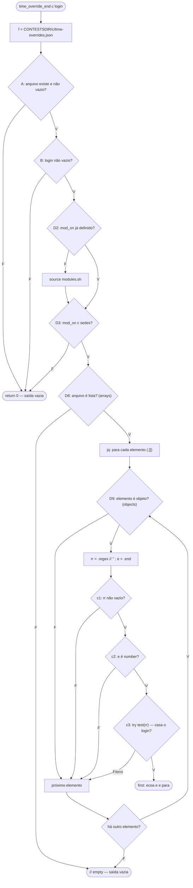

### MC/DC

| Par | Condição | A | B | M (D2) | sedes (D3) | c1 | c2 | c3 | Resultado |
|---|---|---|---|---|---|---|---|---|---|
| **C01** × C02 | A | **V** | V | F | V | V | V | V | `1700000100` |
| C01 × **C02** | A | **F** | – | – | – | – | – | – | vazio (`return 0`) |
| **C01** × C07 | B | V | **V** | F | V | V | V | V | `1700000100` |
| C01 × **C07** | B | V | **F** | – | – | – | – | – | vazio |
| **C01** × C29 | M | V | V | **F** (source) | V | V | V | V | `1700000100` |
| C01 × **C29** | M | V | V | **V** (sem source) | V | V | V | V | `1700000100` |
| **C01** × C09 | D3 | V | V | F | **V** | V | V | V | `1700000100` |
| C01 × **C09** | D3 | V | V | F | **F** | – | – | – | vazio |
| C01 × **C14** | c1 (1ª regra) | V | V | F | V | **F** | – | – | 1ª pulada → `1700000200` |
| C01 × **C18** | c2 (1ª regra) | V | V | F | V | V | **F** | – | 1ª pulada → `1700000200` |
| C01 × **C13** | c3 | V | V | F | V | V | V | **F** | vazio |

D8 e D9 (criadas no ciclo 1 do TDD e, desde o ciclo 2, compartilhadas com a `contest_end_all`) também ficam dentro do jq. Na `contest_end_all` os pares são A1 × A3 (D8) e A1 × A2 (D9). Os pares são por entrada/saída: **C01 × X1** para D8 (a mesma regra dentro de uma lista vale; dentro de um objeto, não) e **C01 × X2** para D9 (a mesma regra válida vale sozinha e continua valendo depois de um elemento que não é objeto, que é pulado).

"–" = não avaliado (curto-circuito). D2 é uma condição só, e as duas saídas dão o mesmo resultado: o par mostra que o `source` só acontece quando o `mod_on` não existe (decisão V/F, não independência sobre a saída). Em c1 e c2 o par é por **elemento**: a 1ª regra do C14/C18 teria ganhado se passasse (`end 1700000900`), e o resultado `1700000200` mostra que ela foi descartada.

O xtrace enxerga D1, D2 e D3 termo a termo (`time_override_end:26: [[ -s … ]]`, `[[ -n … ]]`, `_tov_on:23: declare -F mod_on`, `mod_on:28: [[ ,coortes, == *,sedes,* ]]`). As condições c1–c3 ficam **dentro do jq** e não aparecem no trace (seção 8). Para elas, o par se apoia na entrada e na saída.

## 5. Resultados

**Execução atual, depois dos 2 ciclos de TDD** (2026-11-02, `evidencias/saida-2026-11-02.txt`, regerada depois do ciclo 2): **`RESULT: 37 passed, 0 failed, 0 xfail`**, exit 0. A execução com `--trace` (que regerou os 37 traces) e a execução sob kcov deram o mesmo resultado. Depois do ciclo 1 o resultado era `33 passed, 0 failed, 0 xfail` (`evidencias/tdd/ciclo1-3-refactor.txt`).

**Execução anterior ao TDD**, mantida como histórico (2026-11-01, `evidencias/saida-2026-11-01.txt`): `RESULT: 28 passed, 0 failed, 2 xfail`, exit 0, com X1 e X2 em XFAIL. Os casos T1–T3 ainda não existiam.

A coluna "Obtido" abaixo é a da execução atual. Para X1 e X2, o obtido antes do TDD está entre parênteses.

| ID | Entrada (contest · login) | Esperado | Obtido | Status | Critério |
|---|---|---|---|---|---|
| C01 | 1 regra `^sede1-` end 1700000100, sedes · `sede1-alfa` | `1700000100` | rc0 `1700000100` | ok | caso base; MC/DC base |
| C02 | sem arquivo | vazio | rc0 vazio | ok | I1; MC/DC A=F |
| C03 | arquivo de 0 bytes | vazio | rc0 vazio | ok | I2 (`-s` falso) |
| C04 | JSON truncado | vazio | rc5 vazio | ok | I3 (rc 5 do jq: ver seção 8) |
| C05 | `[]` | vazio | rc0 vazio | ok | V2; D6 lista vazia |
| C07 | login `""` | vazio | rc0 vazio | ok | I5; MC/DC B=F |
| C08 | só 1 argumento (`set -u`) | vazio, sem erro | rc0 vazio | ok | I6 |
| C09 | `CONTEST_MODULES=coortes` | vazio | rc0 vazio | ok | I7; MC/DC D3=F |
| C10 | sem `CONTEST_MODULES` | vazio | rc0 vazio | ok | I8 |
| C11 | `CONTEST_MODULES=sedesX` | vazio | rc0 vazio | ok | I9 |
| C12 | `CONTEST_MODULES=coortes,sedes` | `1700000100` | rc0 `1700000100` | ok | V4 |
| C13 | regex `^sede2-` | vazio | rc0 vazio | ok | V6/V12; MC/DC c3=F; D7 |
| C14 | 1ª regex `""`, 2ª válida | `1700000200` | rc0 `1700000200` | ok | I10; MC/DC c1=F |
| C15 | 1ª sem regex, 2ª válida | `1700000200` | rc0 `1700000200` | ok | I11; D5 |
| C16 | 1ª regex `(`, 2ª válida | `1700000200` | rc0 `1700000200` | ok | I12; `catch false` |
| C17 | 1ª regex `5`, 2ª válida | `1700000200` | rc0 `1700000200` | ok | I13 |
| C18 | 1ª end `"1700000900"`, 2ª válida | `1700000200` | rc0 `1700000200` | ok | I14; MC/DC c2=F |
| C19 | 1ª end `true`, 2ª válida | `1700000200` | rc0 `1700000200` | ok | I15 |
| C20 | 1ª end `null`, 2ª válida | `1700000200` | rc0 `1700000200` | ok | I16 |
| C21 | end `0` | `0` | rc0 `0` | ok | V8, limite |
| C22 | end `1` | `1` | rc0 `1` | ok | limite |
| C23 | duas casam (100, 200) | `100` | rc0 `100` | ok | V11: 1ª vence |
| C24 | 3 regras, só a última casa | `300` | rc0 `300` | ok | V10 |
| C25 | `^t1\.` · `t1.a` | `1700000100` | rc0 `1700000100` | ok | limite do casamento |
| C26 | `^t1\.` · `t1a` | vazio | rc0 vazio | ok | limite (o `.` é literal) |
| C27 | `^t1\.` · `xt1.a` | vazio | rc0 vazio | ok | limite (âncora) |
| C28 | `sede1` · `xsede1y` | `1700000100` | rc0 `1700000100` | ok | busca não ancorada |
| C29 | C01 com `modules.sh` pré-carregado | `1700000100` | rc0 `1700000100` | ok | D2=V |
| X1 | `{"a":{regex,end}}` (objeto) | vazio | rc0 vazio (antes: rc0 `1700000100`, XFAIL) | ok | formato `[…]`; paridade com o porteiro; D8=F |
| X2 | `["x", {regex,end}]` | `1700000100` | rc0 `1700000100` (antes: rc5 vazio, XFAIL) | ok | "1ª que casa vence"; regra quebrada não silencia as demais; D9=F |
| T1 | `[5, {regex,end}]` | `1700000100` | rc0 `1700000100` | ok | I17 (número); criado no Red; falhou no Red (rc5 vazio) |
| T2 | `[["x"], {regex,end}]` | `1700000100` | rc0 `1700000100` | ok | I17 (lista); criado no Red; falhou no Red (rc5 vazio) |
| T3 | `{regex,end}` sem colchetes | vazio | rc0 vazio | ok | I4; criado no Red; **passava no Red por acidente** (rc5: o jq abortava). Ver seção 7 |
| A1 | `contest_end_all`: `[regra end 1700000100]`, END 1700000000 | `1700000100` | rc0 `1700000100` | ok | ciclo 2; base; D8=V, D9=V |
| A2 | `contest_end_all`: `["x", regra]` | `1700000100` | rc0 `1700000100` (Red: rc0 `1700000000`) | ok | ciclo 2; D9=F: elemento pulado |
| A3 | `contest_end_all`: `{"a": regra}` | `1700000000` | rc0 `1700000000` (Red: rc0 `1700000100`) | ok | ciclo 2; D8=F: objeto não vale |
| A4 | `contest_end_all`: `[5, regra]` | `1700000100` | rc0 `1700000100` (Red: rc0 `1700000000`) | ok | ciclo 2; D9=F |

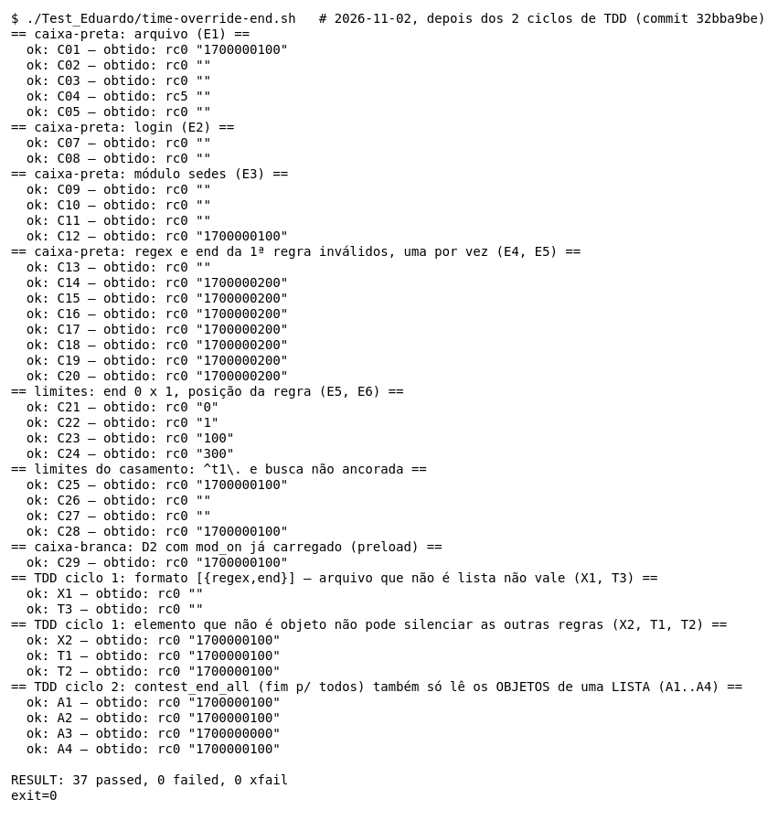

### Traces dos pares MC/DC

Traces regerados em 2026-11-02, sobre o código depois dos 2 ciclos de TDD (as linhas do trace já são as novas: D1 na 29, `_tov_on` na 26, o `jq` na 31; na `contest_end_all`, o `jq` na 60).

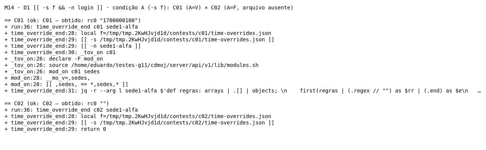

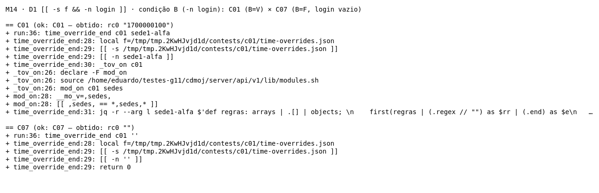

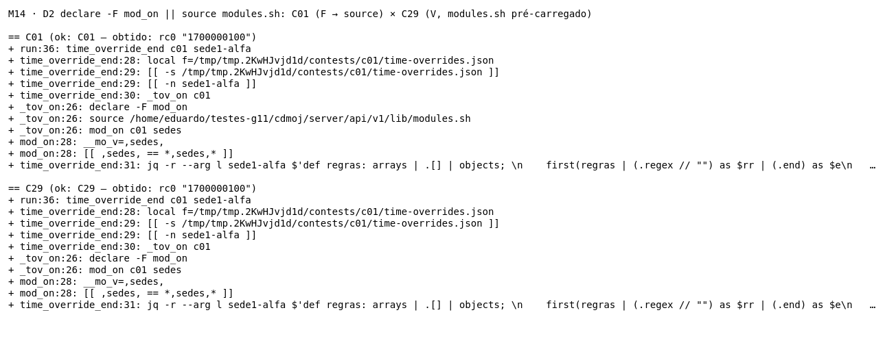

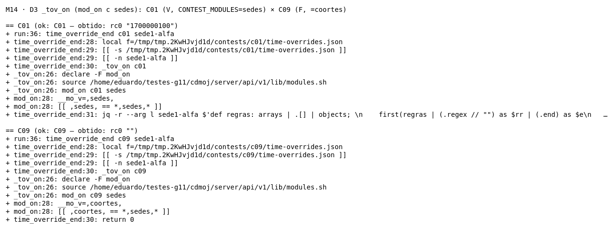

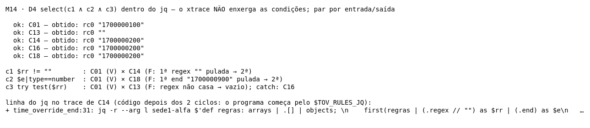

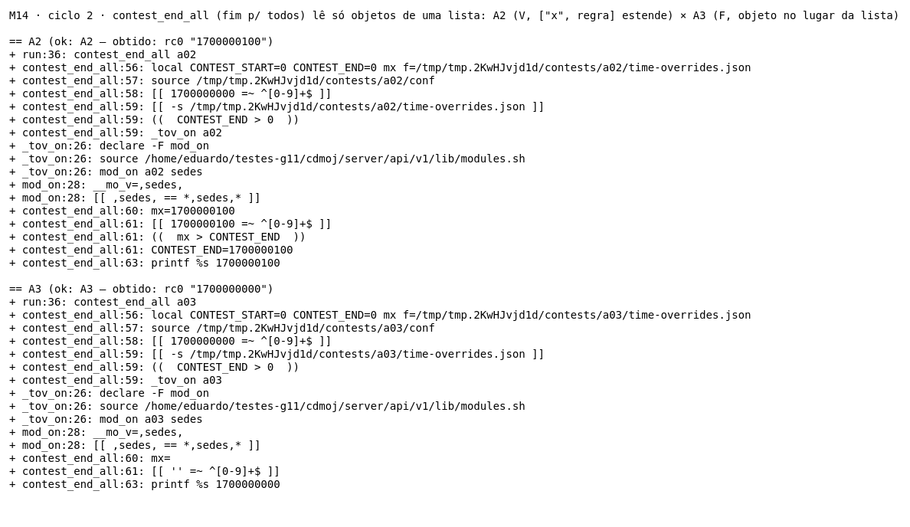

### Cobertura de linhas (kcov)

Comando: `kcov --include-path="$PWD/server/api/v1/lib/contest-gate.sh" Test_Eduardo/evidencias/cobertura ./Test_Eduardo/time-override-end.sh`. O kcov roda **o script** (executável, com shebang), e não `bash <script>`. O relatório fica em `evidencias/cobertura/time-override-end.sh.e59b551128ea4781/` (`cobertura.xml`, `coverage.json`, `index.html`). O symlink que o kcov cria na raiz da pasta (caminho absoluto da máquina) foi apagado.

O kcov foi rodado de novo em 2026-11-02, sobre o código **depois dos 2 ciclos de TDD**. Este relatório considera as linhas 25–35 (o M14 e o filtro `regras`) e, desde o ciclo 2, as linhas 55–64 (`contest_end_all`). O resto de `contest-gate.sh` não é alvo deste teste.

| Linha | Hits | Observação |
|---|---|---|
| 25 (`TOV_RULES_JQ=…`) | 1 | coberta (roda uma vez, quando a lib é carregada) |
| 26 (`_tov_on`) | não instrumentada | função de uma linha; o xtrace mostra que roda (`_tov_on:26: declare -F mod_on`) |
| 27 (`time_override_end() {`) | não instrumentada | definição de função |
| 28, 29, 30, 31 | 33, 68, 32, 26 | todas cobertas |
| 32, 33, 34 | 0 | **artefato**: são a continuação da string do programa jq (aspas simples abertas na linha 31). Não há comando bash nelas, e elas executam junto com a linha 31 |
| 55 (`contest_end_all() {`), 62 (`fi`), 64 (`}`) | não instrumentadas | definição de função e fechamentos |
| 56, 57, 58, 59, 60, 61, 63 | 4, 4, 4, 12, 8, 10, 4 | todas cobertas (A1–A4) |

Das linhas com comando bash do M14 (25, 28–31), 5 de 5 foram cobertas; as 3 com 0 são o texto do programa jq, não código bash. Das linhas da `contest_end_all`, 7 de 7 foram cobertas. O kcov mede **linha**, não decisão nem MC/DC: as condições de D4, D8 e D9 estão dentro dos programas jq, e ele não as distingue. Antes do ciclo 2 o quadro do M14 era o mesmo, com outros números de linha (25–28 cobertas com 33, 68, 32, 26 hits, e 29–31 com 0), e a `contest_end_all` não era exercitada pela suíte. Antes do TDD: 23–26 cobertas (30, 62, 29, 23 hits) e 27–29 com 0.

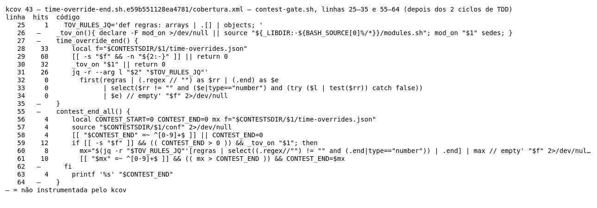

*Renderização via ImageMagick dos dados do `cobertura.xml` do kcov (linhas 25–35 e 55–64, depois dos 2 ciclos de TDD); não é captura de tela.*

## 6. Defeitos e hipóteses (XFAIL)

> **Situação atual:** X1 e X2 foram **corrigidos no ciclo 1 de TDD** de 2026-11-02 (seção 7) e hoje são casos obrigatórios que passam. Esta seção registra o defeito como foi encontrado: o "obtido" abaixo é o de **antes** do TDD, e as imagens `xfail-X1.png` e `xfail-X2.png` foram mantidas de propósito, porque mostram o "antes".

O oráculo é o contrato da seção 2. A paridade com o espelho do porteiro foi conferida **executando** as funções Python (`python3 -I Test_Eduardo/oraculo-porteiro.py`, saída em `evidencias/oraculo-porteiro-2026-11-01.txt`; a de 2026-11-02 inclui T1–T3):

```
M14 X1 objeto          porteiro.override_end = None
M14 X2 elem. string    porteiro.override_end = 1700000100
M14 T1 elem. número    porteiro.override_end = 1700000100      (2026-11-02)
M14 T2 elem. lista     porteiro.override_end = 1700000100      (2026-11-02)
M14 T3 regra sem []    porteiro.override_end = None            (2026-11-02)
M14 C17 regex 5        porteiro levanta TypeError: first argument must be string or compiled pattern  -> except Exception -> fallback p/ o bash
```

Os dois defeitos só são alcançáveis com um `time-overrides.json` **editado fora da API**: o writer grava só lista de objetos.

### X1: arquivo-objeto é aceito como se fosse lista

- **Obtido (antes do TDD):** `{"a":{"regex":"^sede1-","end":1700000100}}` → rc0 `1700000100`. **Hoje:** rc0 vazio.
- **Por que viola o contrato:** o formato é `[{regex, end, reason?}, …]` e a ordem ("1ª que casa vence") só existe numa lista. O `.[]?` do jq itera também os **valores de um objeto**, cuja ordem é a das chaves. O espelho exige lista e devolve `None`. Bash e porteiro **divergem** para a mesma entrada: a rota servida pelo porteiro não prorroga, e a servida pelo bash prorroga.
- **Como acontece em produção:** arquivo restaurado de backup, editado à mão ou gerado por script fora da API.
- **Correção:** aplicada no ciclo de TDD (seção 7); ver o diff depois do X2 (a mesma linha resolve os dois).

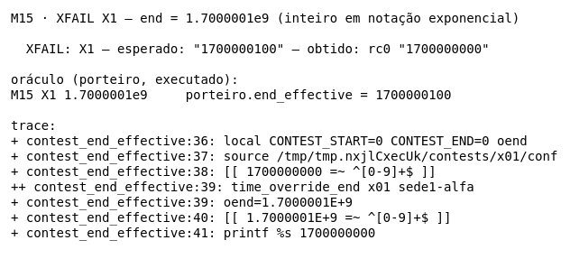

### X2: um elemento que não é objeto silencia todas as regras

- **Obtido (antes do TDD):** `["x", {"regex":"^sede1-","end":1700000100}]` → rc5, saída vazia. **Hoje:** rc0 `1700000100`. O jq aborta com `Cannot index string with string ("regex")` (o stderr é descartado pelo `2>/dev/null`).
- **Por que viola o contrato:** a regra válida casa o login e deveria valer ("1ª que casa vence"). O `try/catch` protege só o `test()` da regex, e não o acesso `.regex`/`.end` sobre um elemento que não é objeto. O próprio writer explica por que isso importa: *"regra quebrada silenciaria as demais no gate"*. O espelho pula o elemento e devolve `1700000100`.
- **Como acontece em produção:** uma sede inteira perde a prorrogação. Os times dela recebem `403 contest_ended` no `/submit` durante os minutos extras, e o countdown mostra o fim global. Basta uma entrada malformada no arquivo. `null` não dispara o erro (`null.regex` é `null`), mas string, número e lista disparam.
- **Correção sugerida** (era a sugestão antes do TDD; foi aplicada tal qual no Green e depois refatorada, seção 7):

```diff
--- a/server/api/v1/lib/contest-gate.sh
+++ b/server/api/v1/lib/contest-gate.sh
@@ time_override_end
   jq -r --arg l "$2" '
-    first(.[]? | (.regex // "") as $rr | (.end) as $e
+    first((if type == "array" then .[] else empty end) | objects | (.regex // "") as $rr | (.end) as $e
           | select($rr != "" and ($e|type=="number") and (try ($l | test($rr)) catch false))
           | $e) // empty' "$f" 2>/dev/null
```

`if type == "array"` reproduz o `isinstance(data, list)` do porteiro (X1), e `objects` reproduz o `if not isinstance(ent, dict): continue` (X2). Antes do TDD, a correção foi validada numa **cópia descartável** da lib, fora do repo, junto com as correções do M15 (`| $e | floor` e `10#`): `RESULT: 28 passed, 0 failed, 0 xfail`, com X1 e X2 em XPASS. Em 2026-11-02, com autorização do Eduardo, ela entrou no código de produção desta branch pelo ciclo de TDD (seção 7). A função vizinha `contest_end_all` usava o mesmo `.[]?` sem `objects` e tinha o mesmo defeito. Ela foi corrigida no ciclo 2 (seção 7), e hoje as duas funções usam o mesmo filtro `regras`.

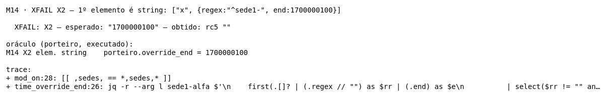

### Hipóteses do planejamento que não viraram defeito

- **`end` float, negativo ou exponencial.** O M14 só ecoa o número, como o contrato diz ("ecoa o `end`"). A quebra aparece no M15, que recebe esse texto (`1700000100.5`, `1.7000001E+9`). Por isso esses casos estão no relatório do M15.
- **Regex não string (C17).** O porteiro levanta `TypeError` (não é `re.error`), cai no `except Exception` e declina, e o bash responde. O resultado final é o mesmo, então é caso que passa.

## 7. Aplicação de TDD (2 ciclos)

Dois ciclos Red → Green → Refactor, cada fase com um commit próprio, com autorização do Eduardo para alterar `server/api/v1/lib/contest-gate.sh` nesta branch.

| Ciclo | Fase | Commit | Resultado real |
|---|---|---|---|
| 1 (X1/X2, `time_override_end`) | Red | `0b09b88c` | `29 passed, 4 failed, 0 xfail`, exit 1 |
| 1 | Green | `13dfd0e5` | `33 passed, 0 failed, 0 xfail` |
| 1 | Refactor | `344fc223` | `33 passed, 0 failed, 0 xfail` |
| 2 (`contest_end_all`) | Red | `b74e15f6` | `34 passed, 3 failed, 0 xfail`, exit 1 |
| 2 | Green | `ae124130` | `37 passed, 0 failed, 0 xfail` |
| 2 | Refactor | `32bba9be` | `37 passed, 0 failed, 0 xfail` |

### Ciclo 1: arquivo que não é lista e elemento que não é objeto

**O que foi desenvolvido:** a correção dos defeitos X1 e X2 (seção 6). Antes, o `time_override_end` aceitava um objeto no lugar da lista (X1), e um único elemento que não fosse objeto abortava o jq e **silenciava todas as regras** (X2). Escolhi esses defeitos por quatro motivos:
- violam frases explícitas do contrato (*"Formato: [{regex, end, reason?}, …]"*, *"1ª que casa vence"*) e o comentário do writer (*"regra quebrada silenciaria as demais no gate"*);
- o efeito do X2 é grave: uma sede inteira perde a prorrogação por causa de uma entrada ruim;
- há um oráculo independente e executável (o porteiro, `override_end`);
- a correção cabe numa linha e deixa espaço para um Refactor real.

Evidências em `evidencias/tdd/ciclo1-*`: a saída `.txt` de cada fase e o `.diff` do que mudou nela.

| Fase | O que mudou | Resultado real | Evidência |
|---|---|---|---|
| **Red** | Só o teste. X1 e X2 passaram de XFAIL a casos obrigatórios. T1, T2 e T3 foram criados. O oráculo do porteiro ganhou T1–T3. | `29 passed, 4 failed, 0 xfail`, exit 1 | `ciclo1-1-red.txt`, `ciclo1-1-red.diff` |
| **Green** | 1 linha em `contest-gate.sh`: `.[]?` virou `(if type == "array" then .[] else empty end) \| objects` | `33 passed, 0 failed, 0 xfail`, exit 0. 4 smokes do upstream com 0 falhas | `ciclo1-2-green.txt`, `ciclo1-2-green.diff`, `ciclo1-2-green-regressao.txt` |
| **Refactor** | A regra virou o filtro jq com nome `def regras: arrays \| .[] \| objects;`, e o comentário da função explica por quê | `33 passed, 0 failed, 0 xfail`, exit 0. 4 smokes do upstream com 0 falhas; `jq-portability.sh` sem incompatibilidade | `ciclo1-3-refactor.txt`, `ciclo1-3-refactor.diff`, `ciclo1-3-refactor-regressao.txt` |

#### Evolução dos testes (Red)

- **X1 e X2 mudaram de tipo** (`caso X` → `caso C`). O esperado **não mudou**: continua sendo o que o contrato e o porteiro dizem (vazio e `1700000100`). O que mudou é que a falha agora quebra o exit code.
- **T1 (novo):** `[5, {regra válida}]`, esperado `1700000100`. O X2 usa um elemento string; T1 mostra que o defeito não é da string, e sim de **qualquer** elemento que não é objeto (no Red: rc5, vazio).
- **T2 (novo):** `[["x"], {regra válida}]`, esperado `1700000100`. Mesmo defeito com uma lista aninhada (no Red: rc5, vazio). Com T1 e T2, a partição I17 passou a ter string, número e lista, que eram os três tipos que a seção 6 já dizia disparar o erro.
- **T3 (novo):** `{"regex":"^sede1-","end":1700000100}`, uma regra válida **sem os colchetes**, que é o erro mais provável de quem edita o arquivo à mão. Esperado vazio (o porteiro devolve `None`: não é lista). **No Red, T3 já passava, mas por acidente:** o `.[]?` iterava os valores do objeto, o `.regex` sobre a string `"^sede1-"` abortava o jq (rc5), e a saída vazia "acertava". T3 é um caso de proteção: prende que a correção recusa o formato **pelo motivo certo** (rc0, sem erro) e que uma correção ingênua (por exemplo, aceitar um objeto solto como se fosse uma regra) seria pega.
- **Oráculo:** antes de rodar o Red, executei o porteiro com T1–T3 (`python3 -I Test_Eduardo/oraculo-porteiro.py`). Ele deu `1700000100`, `1700000100` e `None`, os mesmos esperados do teste (`evidencias/oraculo-porteiro-2026-11-02.txt`).

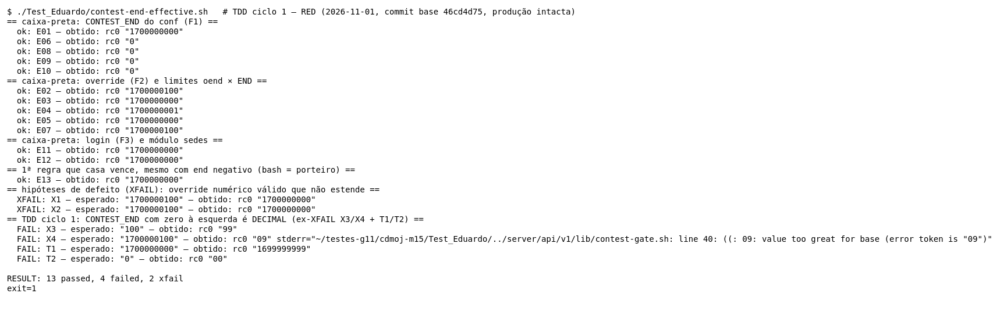

#### Evolução da implementação

**Green, a correção mínima.** Uma linha: só itera se a entrada for lista, e só olha os elementos que são objetos. É a correção sugerida na seção 6, aplicada sem mudança.

```diff
@@ time_override_end
   jq -r --arg l "$2" '
-    first(.[]? | (.regex // "") as $rr | (.end) as $e
+    first((if type == "array" then .[] else empty end) | objects | (.regex // "") as $rr | (.end) as $e
           | select($rr != "" and ($e|type=="number") and (try ($l | test($rr)) catch false))
           | $e) // empty' "$f" 2>/dev/null
```

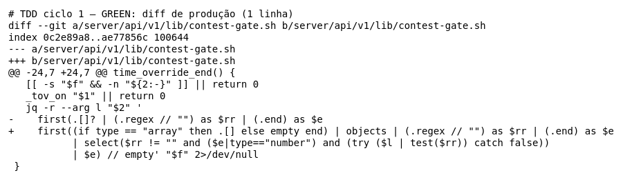

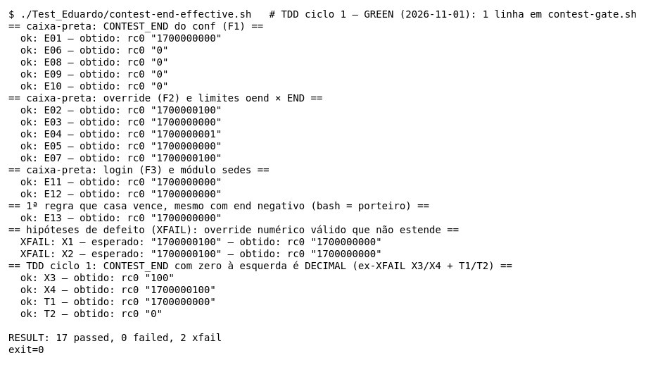

**Refactor, a regra com nome.**

```diff
+# `regras` = só os OBJETOS de uma LISTA, como o espelho do porteiro (override_end): arquivo que não é lista
+# não vale, e elemento que não é objeto é pulado em vez de abortar o jq e silenciar as regras válidas.
 _tov_on(){ … }
 time_override_end() {
@@
-  jq -r --arg l "$2" '
-    first(.[]? | (.regex // "") as $rr | (.end) as $e
+  jq -r --arg l "$2" 'def regras: arrays | .[] | objects;
+    first(regras | (.regex // "") as $rr | (.end) as $e
```

(Diff acumulado contra o `HEAD`, em `ciclo1-3-refactor.diff`.)

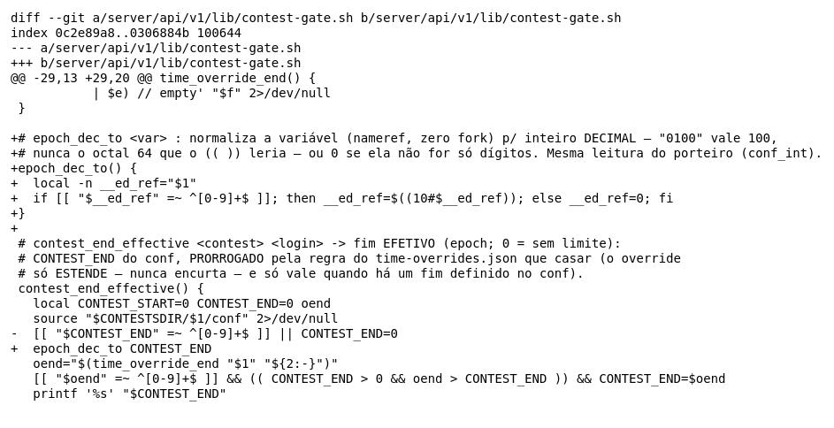

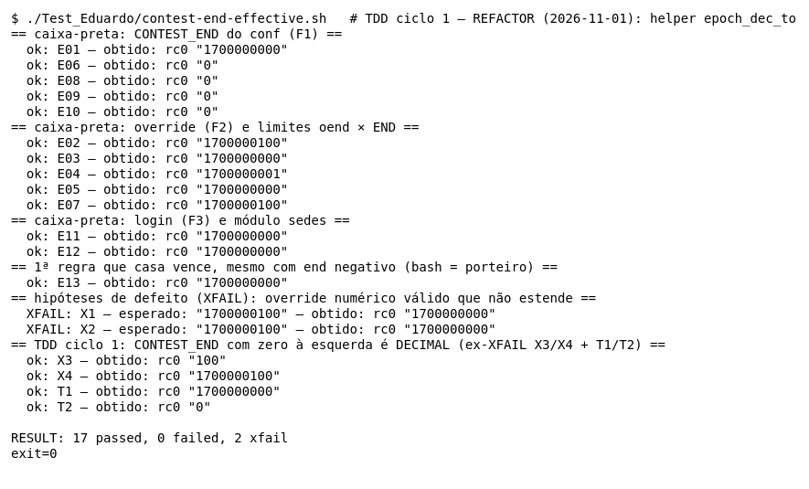

#### Refatorações realizadas

1. **Saiu o `if … then … else empty end`.** O jq já tem o filtro `arrays`, que deixa passar só listas. `arrays | .[] | objects` diz a mesma coisa em três palavras, todas no mesmo idioma de filtros por tipo (`arrays`, `objects`).
2. **A regra ganhou nome** (`def regras`). A linha do `first(…)` voltou a ler como antes ("a primeira regra que…"), e a validação do formato ficou separada da escolha da regra.
3. **O comentário diz por que a regra existe:** paridade com o espelho do porteiro e o efeito do defeito antigo (silenciar as regras válidas). Sem isso, um leitor futuro poderia "simplificar" de volta para `.[]?`.
4. **O que NÃO foi feito no Refactor:** aplicar o mesmo filtro na `contest_end_all` (linha 57 na época), que usa o mesmo `.[]?`. Isso **muda o comportamento** dela: naquele momento, com `["x", {regra válida}]`, o jq dela aborta (sondagem real: rc5, saída vazia) e a prorrogação **não** estende o fim-para-todos. Mudar comportamento pede um ciclo novo, começando por um teste vermelho. Virou o ciclo 2 (abaixo).

Regressão: os testes do upstream que exercitam essa lib foram rodados **sem alteração** depois do Green e depois do Refactor:
- `smoke-time-overrides.sh` (rota `/submit` e countdown com prorrogação): 12 passed;
- `smoke-porteiro.sh` (paridade com o espelho): 54 passed;
- `smoke-modules-off-rules.sh` (módulo `sedes` desligado): 14 passed;
- `smoke-contest-rounds.sh` (guarda do freeze, que usa o `contest_end_all`): 92 passed;
- `jq-portability.sh` (compila todo programa jq do servidor, incluindo o novo `def regras`): 0 incompatibilidades.

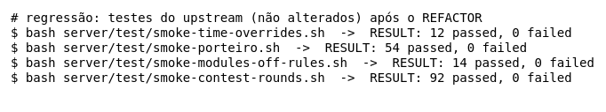

#### Dificuldades

- **Um caso novo passou no Red.** O esperado era que todo caso novo nascesse vermelho, e o T3 nasceu verde. Em vez de descartá-lo, investiguei o motivo: ele passava porque o jq **abortava** (rc5), não porque o formato era recusado. Ficou como caso de proteção, com a explicação registrada, e o Red continua mostrando 4 vermelhos (X1, X2, T1, T2).
- **O xtrace e o kcov não enxergam a correção.** As duas decisões novas (D8 `arrays`, D9 `objects`) ficam dentro da string do jq. A cobertura delas foi mostrada por entrada e saída (C01 × X1, C01 × X2), como já era feito para D4–D7.
- **Escolher o mínimo do Green.** O primeiro impulso era já escrever o `def regras` e mexer também na `contest_end_all`. Segurar o nome para o Refactor, e a função irmã para um ciclo próprio, deixou cada fase com um diff pequeno e explicável.
- **Portabilidade do jq.** O jq da imagem de produção é o 1.7, e o da máquina de teste é o 1.8. `arrays`, `objects` e `def` existem nas duas versões, e o `jq-portability.sh` passou, mas ele rodou com o jq 1.8 daqui (seção 8).

#### Benefícios observados

- **Teste antes da correção = prova de que o teste detecta o defeito.** Os 4 vermelhos do Red mostram que, se a correção for revertida, a suíte avisa.
- **T1 e T2 transformaram uma frase em teste.** A seção 6 dizia que "string, número e lista disparam" o erro, mas só a string tinha caso. Escrever o teste antes obrigou a cobrir os três.
- **T3 mostrou um "verde falso".** Sem pensar no teste primeiro, a regra sem colchetes teria parecido já tratada. O TDD revelou que o acerto era por acidente, e o caso agora garante o motivo certo.
- **Refatorar sem medo.** O filtro mudou de forma (`if/else` → `arrays`), e o mesmo `33 passed` antes e depois, mais a regressão do upstream, mostram que o comportamento ficou igual.
- **A refatoração revelou o próximo defeito.** Ao procurar onde reutilizar o filtro apareceu a `contest_end_all` com o mesmo problema, já confirmado por execução. Ele foi corrigido no ciclo 2.

### Ciclo 2: a `contest_end_all` também só lê os objetos de uma lista

**O que foi desenvolvido:** a mesma proteção do ciclo 1, na outra função que lê o `time-overrides.json`. A `contest_end_all` calcula o fim **para todos** (o maior `end` válido), que é o gate da cerimônia de revelação por sede. Ela usava o mesmo `.[]?` que o M14 tinha antes do ciclo 1. Com `["x", {regra válida}]`, o jq dela abortava e a prorrogação **não** estendia o fim para todos: a revelação poderia abrir com uma sede ainda competindo. Com um objeto no lugar da lista, ela estendia, e o porteiro (`end_all`) não. O Eduardo escolheu este alvo para o 2º ciclo, entre as opções apresentadas. Ele não é método do roteiro do M14, mas lê o mesmo arquivo, com o mesmo contrato de formato.

Evidências em `evidencias/tdd/ciclo2-*`.

| Fase | O que mudou | Resultado real | Evidência |
|---|---|---|---|
| **Red** | Só o teste. O script ganhou um runner para a `contest_end_all` (variável `FN`) e os casos A1–A4. O oráculo do porteiro ganhou A1–A4 (função `end_all`). | `34 passed, 3 failed, 0 xfail`, exit 1 | `ciclo2-1-red.txt`, `ciclo2-1-red.diff` |
| **Green** | 1 linha na `contest_end_all`: `[.[]? \| …]` virou `[arrays \| .[] \| objects \| …]` | `37 passed, 0 failed, 0 xfail`, exit 0. 4 smokes do upstream com 0 falhas | `ciclo2-2-green.txt`, `ciclo2-2-green.diff`, `ciclo2-2-green-regressao.txt` |
| **Refactor** | O `def regras` virou a variável `TOV_RULES_JQ`, compartilhada pelos dois programas jq | `37 passed, 0 failed, 0 xfail`, exit 0. 4 smokes do upstream com 0 falhas; `jq-portability.sh` sem incompatibilidade | `ciclo2-3-refactor.txt`, `ciclo2-3-refactor.diff`, `ciclo2-3-refactor-regressao.txt` |

#### Evolução dos testes (Red)

- **Runner novo, sem mudar os casos antigos.** A função `run` passou a chamar `"${FN:-time_override_end}"`. Os 33 casos do M14 rodam como antes; a seção nova põe `FN=contest_end_all` e depois `unset FN`.
- **A1 (novo, base):** `[regra válida]` com `end 1700000100` e `CONTEST_END=1700000000`. Esperado `1700000100`. Já passava no Red; é o caso de referência para os pares.
- **A2 (novo):** `["x", regra válida]`. Esperado `1700000100` (no Red: `1700000000`, o jq abortava).
- **A3 (novo):** `{"a": regra válida}` (objeto). Esperado `1700000000`, o fim do conf (no Red: `1700000100`, o `.[]?` iterava os valores do objeto).
- **A4 (novo):** `[5, regra válida]`. Esperado `1700000100` (no Red: `1700000000`).
- **Oráculo:** antes do Red, executei o `end_all` do porteiro com A1–A4. Ele deu `1700000100`, `1700000100`, `1700000000` e `1700000100`, os mesmos esperados do teste (`evidencias/oraculo-porteiro-2026-11-02.txt`).

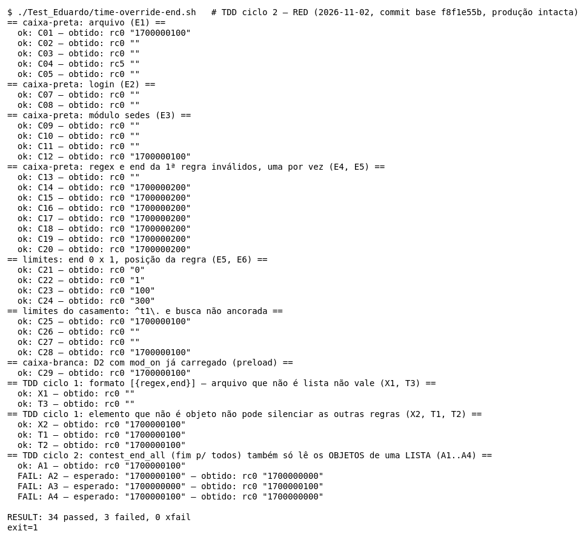

#### Evolução da implementação

**Green.** Uma linha, com o mesmo filtro do Refactor do ciclo 1, escrito por extenso:

```diff
@@ contest_end_all
-    mx="$(jq -r '[.[]? | select((.regex//"") != "" and (.end|type=="number")) | .end] | max // empty' "$f" 2>/dev/null)"
+    mx="$(jq -r '[arrays | .[] | objects | select((.regex//"") != "" and (.end|type=="number")) | .end] | max // empty' "$f" 2>/dev/null)"
```

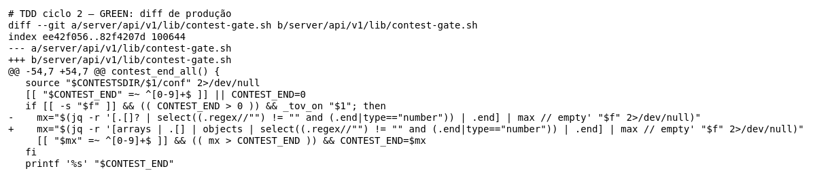

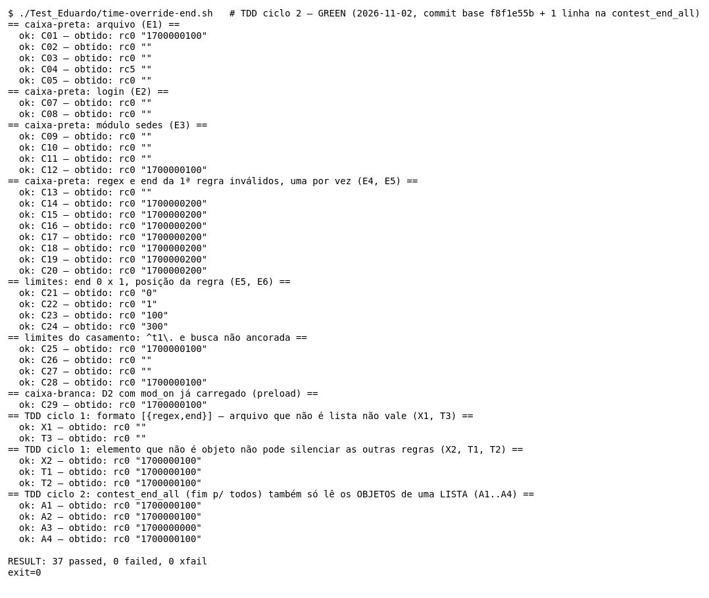

**Refactor.** O filtro passou a ter **uma** definição para os dois leitores do arquivo:

```diff
+TOV_RULES_JQ='def regras: arrays | .[] | objects; '
@@ time_override_end
-  jq -r --arg l "$2" 'def regras: arrays | .[] | objects;
+  jq -r --arg l "$2" "$TOV_RULES_JQ"'
     first(regras | (.regex // "") as $rr | (.end) as $e
@@ contest_end_all
-    mx="$(jq -r '[arrays | .[] | objects | select(…) | .end] | max // empty' …)"
+    mx="$(jq -r "$TOV_RULES_JQ"'[regras | select(…) | .end] | max // empty' …)"
```

(Diff acumulado do ciclo, em `ciclo2-3-refactor.diff`.)

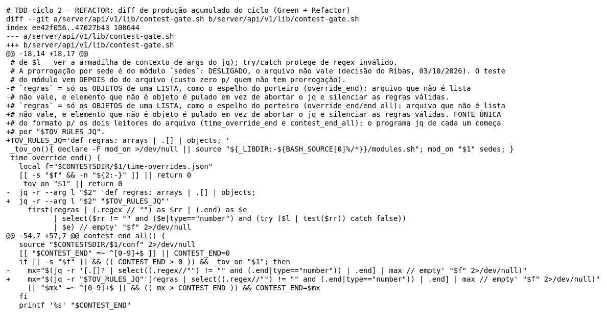

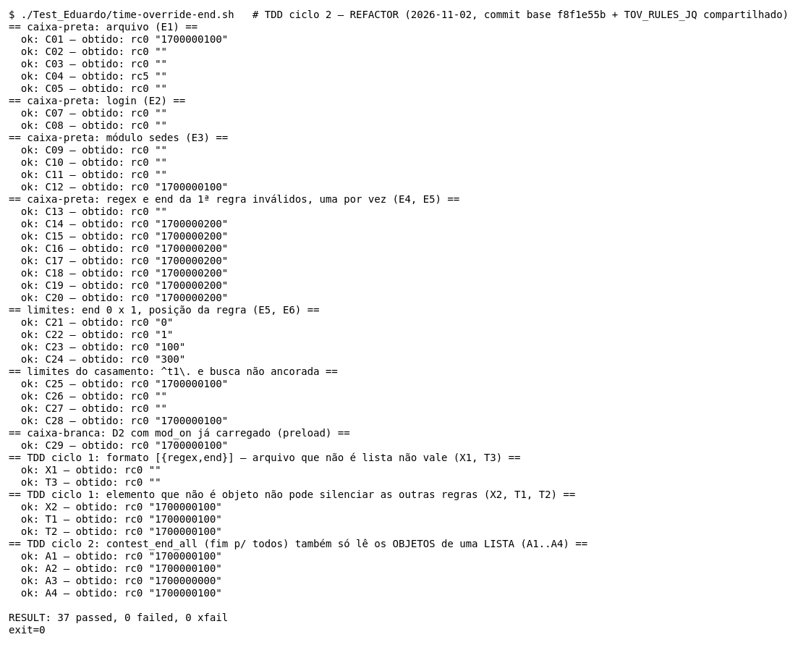

#### Refatorações realizadas

1. **Fonte única do formato.** O Green do ciclo 2 deixou a mesma regra escrita duas vezes (`def regras` no M14 e `arrays | .[] | objects` na `contest_end_all`). Agora as duas funções começam o programa jq por `"$TOV_RULES_JQ"`, e mudar o formato aceito exige mudar um lugar só.
2. **Mesmo padrão do upstream.** O `cdmoj` já monta programas jq por concatenação com variável de shell (por exemplo, `"$VERDICT_CANON_JQ"'…'`), e o `jq-portability.sh` documenta esse caso.
3. **O comentário diz quem usa o filtro** ("FONTE ÚNICA do formato p/ os dois leitores do arquivo") e qual espelho do porteiro ele reproduz (`override_end`/`end_all`).
4. **O que NÃO foi feito:** tratar na `contest_end_all` o octal do `CONTEST_END` e o `end` float (achados do M15). Isso muda comportamento e ficaria para outro ciclo.

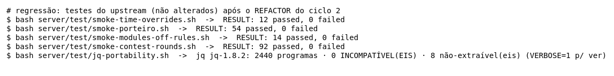

#### Dificuldades

- **Testar uma função nova no mesmo script.** O runner foi generalizado com uma variável (`FN`) para não duplicar a fixture nem mudar os casos antigos. Os 33 casos do M14 continuaram com o mesmo resultado em todas as fases.
- **A escolha do alvo.** Os dois defeitos do M14 já estavam corrigidos. A outra opção para o 2º ciclo era fazer o M14 devolver o `end` inteiro (`floor`), mas o contrato diz que ele *ecoa* o `end`, e o relatório já tinha decidido que float não é defeito do M14. O Eduardo escolheu a `contest_end_all`.
- **Ferramenta parcial.** Com o programa concatenado, o `jq-portability.sh` não compila os dois programas inteiros (seção 8). A suíte, que roda as duas funções, fecha essa lacuna.

#### Benefícios observados

- **O ciclo 1 preparou o ciclo 2.** O filtro com nome do Refactor do ciclo 1 foi o que mostrou onde mais a regra faltava, e o Green do ciclo 2 já sabia a correção.
- **O teste escrito antes pegou os dois lados do defeito:** A2/A4 (o fim para todos não estendia) e A3 (estendia quando não devia).
- **Refatorar sem medo.** A troca para a variável compartilhada mudou os dois programas jq, e os mesmos `37 passed`, mais a regressão do upstream, mostram que o comportamento ficou igual.

### Próximos ciclos possíveis (não feitos)

- **`contest_end_all` com octal e float:** os mesmos defeitos que o M15 corrigiu no `contest_end_effective` (`CONTEST_END=0100`, `end` float ou exponencial).
- **Paridade com o jq 1.7:** rodar a suíte e o `jq-portability.sh` com o jq da imagem de produção (`make check-jq`).

## 8. Lacunas e limitações

- **Condições dentro do jq.** O xtrace não enxerga D4–D7 (c1, c2, c3, `//`, `first`). A independência delas foi mostrada por entrada e saída (a 1ª regra é pulada e a 2ª vence), não pelo trace. O kcov também não enxerga: as linhas do programa jq (29–31 depois do TDD) aparecem com 0 hits. Vale também para D8 e D9, criadas no TDD.
- **Código de saída.** Com JSON inválido (C04), a função sai com rc 5 (o rc do jq); antes do TDD, o X2 e o T1–T3 também saíam com rc 5. O contrato só fala da saída, e os chamadores usam `$(…)`. O rc foi registrado, mas não é critério de aprovação.
- **Dialeto de regex.** O bash usa o Oniguruma do jq, e o porteiro usa o `re` do Python. Diferenças de dialeto (lookbehind, classes Unicode, `\d`) não foram testadas.
- **Leitura do conf.** O `mod_on` usa o `conf_value_to` real. Formatos exóticos de `CONTEST_MODULES` (aspas, `\,` do `printf %q`, espaços) não foram testados. O porteiro faz `strip()` nos itens, e o bash não: `coortes, sedes` com espaço daria resultados diferentes (não testado; o writer grava sem espaço).
- **Oráculo do porteiro.** O `oraculo-porteiro.py` importa as funções do porteiro, mas não sobe o servidor FastCGI. O caminho "exceção → declina → bash responde" foi lido no código, não executado.
- **Caminhos temporários nos traces.** Os traces trazem caminhos do `mktemp` (`/tmp/tmp.XXXX`), que mudam a cada execução.
- **Cobertura.** O kcov mede só linha. Não há medida automática de decisão nem de MC/DC.
- **TDD e versão do jq.** O ciclo de TDD e o `jq-portability.sh` rodaram com o jq 1.8.2 desta máquina; o jq da imagem de produção é o 1.7 e não foi exercitado.
- **Regressão do TDD.** Foram rodados os 4 smokes do upstream que exercitam esta lib e o `jq-portability.sh`, não a suíte inteira do `server/test/` (que tem testes que não são offline nem rápidos).
- **`contest_end_all`.** Não é método do M14. Entrou no ciclo 2 do TDD, e os casos A1–A4 cobrem só as partições do **arquivo** (lista, objeto, elemento ruim). As outras partições dela (módulo desligado, `CONTEST_END` zero ou ausente, regra com regex que não casa ninguém) não têm caso aqui. Ela também lê `CONTEST_END` com zero à esquerda em octal (achado do M15) e descarta `end` float; esses defeitos não foram tratados nesta branch.
- **`jq-portability.sh` e programa concatenado.** Desde o Refactor do ciclo 2, os dois programas jq começam por `"$TOV_RULES_JQ"`. O `jq-portability.sh` do upstream só extrai a parte entre aspas simples, então compila o resto sem o `def regras` e trata o "não definida" como falso positivo (é o comportamento documentado no próprio script). A compilação completa dos dois programas foi verificada pela suíte, que roda os dois.
- **Branches separadas.** O ciclo 2 do M15 (branch `test/eduardo-m15`) também mexe em `contest-gate.sh`. Esta branch não tem as mudanças de lá, e a do M15 não tem as daqui. Juntar as duas no repositório da equipe vai exigir resolver o merge desse arquivo.

## 9. Uso de Inteligência Artificial

- **Ferramentas:** Claude (chat) e Claude Code (agente no terminal).
- **Análise e planejamento:** a análise do código, as partições, os pares MC/DC e as hipóteses foram feitos com apoio de IA e registrados no planejamento (`planejamento-m14.txt`).
- **Implementação e evidências (Claude Code):** a escrita e a execução do `time-override-end.sh` e do `oraculo-porteiro.py`. A geração das evidências: saída, traces, imagens e cobertura com o kcov. A redação deste relatório, incluindo a correção sugerida em diff. O X2 foi encontrado nessa etapa, ao sondar o filtro jq com um elemento que não é objeto.
- **Ciclo 2 de TDD (Claude Code, 2026-11-02):** o Eduardo escolheu, entre opções apresentadas pela IA, corrigir a `contest_end_all` no 2º ciclo. A IA escreveu os casos A1–A4, a correção do Green, o Refactor (filtro compartilhado), as evidências, e rodou a regressão.
- **Ciclo 1 de TDD (Claude Code, 2026-11-02):** a escrita dos casos do Red (T1–T3), a aplicação da correção no Green, o Refactor, a regressão e a regeração das evidências, sob pedido e autorização do Eduardo para alterar `contest-gate.sh` nesta branch.
- **Revisão e decisões (Eduardo):** a revisão do material e as decisões sobre os oráculos. Por exemplo, o arquivo-objeto virou XFAIL (X1) por decisão do Eduardo.
- **Autorização:** a professora da disciplina autorizou o uso de IA neste trabalho.
