# M15 — `contest_end_effective` (cdmoj) · Testes de Software G11 · Eduardo

## 1. Identificação

| Item | Valor |
|---|---|
| Método | M15 `contest_end_effective`. Testado **integrado** com o M14 `time_override_end` real, sem stub (os defeitos X1/X2 estão na composição dos dois) |
| Arquivo | `server/api/v1/lib/contest-gate.sh`. Na análise (seções 3–6): `contest_end_effective` nas linhas 35–42 (comentário nas linhas 32–34). Depois do ciclo 1 do TDD: helper `epoch_dec_to` nas linhas 32–37 e `contest_end_effective` nas linhas 42–49. **Hoje, depois do ciclo 2** (seção 7): `epoch_dec_to` nas linhas 32–37, helper `num_trunc_to` nas linhas 39–49 e `contest_end_effective` nas linhas 55–63 (comentário nas linhas 51–54) |
| Commit | Análise: `ec13d5cc` (`master`). TDD ciclo 1: feito sobre `46cd4d75`, a ponta da branch com os testes. TDD ciclo 2: feito sobre `d50eb4bb` (seção 7) |
| Branch | `test/eduardo-m15` |
| Ferramentas | GNU bash 5.3.20(1)-release · jq-1.8.2 · Python 3.14.8 (oráculo, 2026-11-01) e 3.14.9 (oráculo, 2026-11-02) · kcov 43 · ImageMagick 7.1.2-34 · Arch Linux, kernel 6.18.57-2-lts |
| Data | 2026-11-01 (testes e TDD ciclo 1) · 2026-11-02 (TDD ciclo 2; saída, traces, imagens e kcov gerados de novo sobre o código depois dos 2 ciclos) |
| Script | `Test_Eduardo/contest-end-effective.sh`: teste de unidade, offline, com fixture em `mktemp -d` |

Para reproduzir, rode na raiz do `cdmoj`:

```bash
./Test_Eduardo/contest-end-effective.sh                 # execução normal (exit 0 = nenhum caso E falhou)
./Test_Eduardo/contest-end-effective.sh --trace         # grava evidencias/traces/<ID>.trace (xtrace)
python3 -I Test_Eduardo/oraculo-porteiro.py             # oráculo: o espelho em Python (porteiro) nas entradas dos XFAIL e do TDD
bash server/test/smoke-time-overrides.sh                # regressão do TDD: testes do upstream, não alterados (seção 7)
kcov --include-path="$PWD/server/api/v1/lib/contest-gate.sh" Test_Eduardo/evidencias/cobertura ./Test_Eduardo/contest-end-effective.sh
```

O script carrega `lib/common.sh` e `lib/contest-gate.sh` com `MOJ_CONF` apontando para um arquivo que não existe e `CONTESTSDIR` na fixture. Nenhuma configuração nem dado real da máquina é lido. Cada contest da fixture tem um `conf` próprio (`CONTEST_END`, `CONTEST_MODULES=sedes`) e, quando o caso pede, um `time-overrides.json`. Cada caso roda num subshell, porque a função faz `source` do `conf`.

## 2. Contrato

O contrato vem do comentário acima da função (linhas 32–34), da função irmã `contest_end_all`, que diz *"Espelha contest_end_effective"*, e do espelho em Python (`server/porteiro/moj-porteiro.py`, `end_effective`).

- *"contest_end_effective <contest> <login> -> fim EFETIVO (epoch; 0 = sem limite): CONTEST_END do conf, PRORROGADO pela regra do time-overrides.json que casar (o override só ESTENDE — nunca encurta — e só vale quando há um fim definido no conf)."*
- **Espelho (porteiro)**: `end = conf_int(CONTEST_END)` (`int(v) if v.isdigit() else 0`, ou seja, **decimal**), `o = override_end()` (devolve `int(e)`, aceita float) e estende se `o is not None and end > 0 and o > end`.
- **Writers**: o `time-overrides.json` da API tem `end = floor(número) > 0` (por isso float e exponencial só chegam por arquivo editado fora da API). O `CONTEST_END` é gravado com `printf %q` de um epoch na criação (`lib/contest-create.sh`). O `POST /contest/admin/settings` valida `end` só com `^[0-9]+$` sobre o `jq -r .end` do corpo (seção 6, X3/X4).
- **Chamadores**: `handlers/contest/basic.sh:26` (countdown), `handlers/contest/offline-submit.sh:40` e `contest_phase` (M16, que decide o `/submit`, o `can_see_problems` e o `competitor_write_guard`).

## 3. Caixa-preta: partições e limites

Login: `L = sede1-alfa`. `END = CONTEST_END=1700000000`. `rule(x)` = `[{"regex":"^sede1-","end":x}]`.

| Entrada | Partições válidas | Partições inválidas |
|---|---|---|
| F1 `CONTEST_END` (conf) | V1 epoch > 0 · V2 `0` (sem fim) | I1 ausente · I2 não numérico (`abc`) · I3 conf ausente · I8 zero à esquerda (`0100`, `09`) |
| F2 override (saída do M14) | V3 vazio · V4 inteiro > END · V5 inteiro == END · V6 inteiro < END | I4 float · I5 negativo · I6 exponencial |
| F3 login | V7 presente | I7 ausente (1 argumento) |

Valor limite (há ordem entre `oend` e `END`): `oend = END−1` (não estende), `oend = END` (não estende), `oend = END+1` (estende). E `END = 0` × `END = 1` com `oend` grande.

| ID | Partição / limite | Classe |
|---|---|---|
| E01 | V1 V3 V7 | válida |
| E02 | V4 | válida |
| E03 | V5, limite `oend = END` | limite |
| E04 | limite `oend = END+1` | limite |
| E05 | V6, limite `oend = END−1` | limite |
| E06 | V2 | válida |
| E07 | limite `END = 1` | limite |
| E08 | I1 | inválida |
| E09 | I2 | inválida |
| E10 | I3 (contest sem diretório) | inválida |
| E11 | I7 | inválida |
| E12 | módulo `sedes` desligado + override maior (via M14) | inválida |
| E13 | I5 (1ª regra `end -1`, 2ª regra maior que END) | inválida |
| X1 | I6 (`1.7000001e9`, valor inteiro) | inválida → XFAIL até o ciclo 2 do TDD; obrigatório desde o Red do ciclo 2 |
| X2 | I4 (1ª regra `1700000100.5`, 2ª `1700000200`) | inválida → XFAIL até o ciclo 2 do TDD; obrigatório desde o Red do ciclo 2 |
| X3 | I8 (`CONTEST_END=0100`, override 99) | inválida → XFAIL |
| X4 | I8 (`CONTEST_END=09`, override 1700000100) | inválida → XFAIL |
| T1 | I8 (`CONTEST_END=0001700000000`, override 1699999999 = END−1) | inválida, criado no Red do TDD |
| T2 | I8 (`CONTEST_END=00`, sem override) | inválida, criado no Red do TDD |
| T3 | I6 sem fração (`1e10`; o jq ecoa `1E+10`) | inválida, criado no Red do ciclo 2 |
| T4 | I6 com fração que sobra depois do expoente (`1.70000015e9` → `1700000150`) | inválida, criado no Red do ciclo 2 |
| T5 | I4, limite: float que, **truncado**, fica igual ao END (`1700000000.9`) | limite, criado no Red do ciclo 2 (proteção: truncar, não arredondar) |

X3 e X4 começaram como XFAIL e foram promovidos a casos obrigatórios no ciclo 1 do TDD; X1 e X2, no ciclo 2 (seção 7). Hoje não há XFAIL.

## 4. Caixa-branca

### Decisões e condições

Esta seção descreve o código **analisado** (`ec13d5cc`). Depois do Refactor do ciclo 1, a D1 mora no helper `epoch_dec_to` (um `if/else`, com a mesma condição). O ciclo 2 criou o helper `num_trunc_to`, com duas decisões novas (D3, D4), chamado antes da D2. A D2 não mudou de texto, mas desde o ciclo 2 recebe o `oend` já truncado (seção 7).

| Decisão | Linha | Expressão |
|---|---|---|
| **D1** | 38 (hoje: 36, no `if` do `epoch_dec_to`, chamado na 45) | `[[ "$CONTEST_END" =~ ^[0-9]+$ ]] \|\| CONTEST_END=0` |
| **D2** | 40 (hoje: 61) | `R && (( A && B )) && CONTEST_END=$oend`. R = `[[ "$oend" =~ ^[0-9]+$ ]]`, A = `CONTEST_END > 0`, B = `oend > CONTEST_END` |
| **D3** | hoje: 45 (`num_trunc_to`, ciclo 2, chamado na 60) | `[[ "$oend" =~ ^([0-9]+)(\.([0-9]*))?([eE]\+?([0-9]+))?$ ]] \|\| return 0`: o `oend` é um número do JSON não negativo? |
| **D4** | hoje: 47 (`num_trunc_to`, ciclo 2) | `while (( ${#d} < p ))`: faltam dígitos para deslocar a vírgula pelo expoente? |

Não há decisão dentro de jq no M15 (as do jq são do M14). O `source … 2>/dev/null` da linha 37 com conf ausente cai nos `local` (E10).

Cobertura de decisão (V/F), com resultado real:

| Decisão | V | F |
|---|---|---|
| D1 | E01–E08, E10–E13, X1–X4, T1–T5 (`0` e `0100`/`09` também casam; em E08 vale o `local` `0`) | E09 (`abc`) |
| D2 (estende) | Hoje: E02, E04, E07, X1, X2, X4, T3, T4. Antes do TDD: E02, E04, E07, X3 (aqui ela **encurtava**, ver seção 6) | Hoje: E01, E11, E12 (R=F, oend vazio); E13 (R=F, negativo); E06, E08, E09, E10 (A=F); E03, E05, X3, T1, T5 (B=F). Antes do TDD também X1, X2 (R=F, formato) e X4 (erro no `(( ))`) |
| D3 (ciclo 2) | E02–E09, X1–X4, T1, T3–T5 (todo `oend` numérico não negativo) | E01, E10, E11, E12, T2 (oend vazio); E13 (`-1`) |
| D4 (ciclo 2) | X1, T3, T4 (expoente pede mais dígitos) | os demais com D3=V (inteiro, ou fração que já tem os dígitos, como X2) |

**Curto-circuito.** Com R=F o bash não avalia o `(( ))` (o trace de E01 vai de `[[ '' =~ … ]]` direto para o `printf`). Dentro do `(( A && B ))`, com A=F, B não é avaliado (E06): o `&&` aritmético também curto-circuita, então A=F **mascara** B.

**Inviabilidade.** "A=F e B=V com R=V" é o par E06 (`END=0`, `oend=1700000100`). Antes do ciclo 2, "A=V, B=V, R=F" só existia com `oend` não inteiro, que era justamente o defeito X1/X2. Depois do ciclo 2, o `num_trunc_to` normaliza todo número não negativo, e R=F só sobra para `oend` vazio ou negativo.

**MC/DC das decisões novas (ciclo 2).** D3: T4 (V, `1.70000015E+9` é normalizado) × E01 (F, `oend` vazio, `return 0`). D4: T3 (V, `1E+10` ganha zeros) × X2 (F, `1700000100.5` só perde a fração). As duas são condições simples (uma regex e uma comparação), então o par V/F basta.

### Fluxo de `contest_end_effective` (depois dos 2 ciclos de TDD)

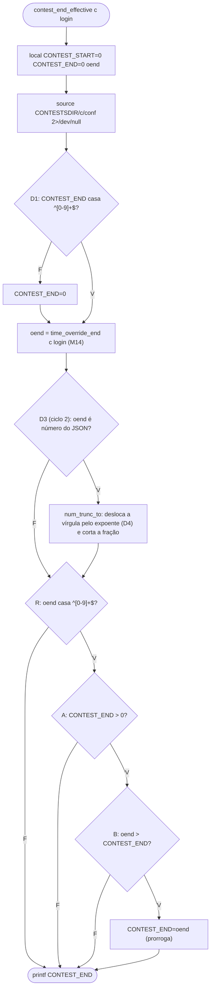

### MC/DC de D2 = R ∧ (A ∧ B)

| Par | Condição | R | A | B | D2 | Saída |
|---|---|---|---|---|---|---|
| **E02** × E01 | R | **V** | V | V | V | `1700000100` |
| E02 × **E01** | R | **F** (oend vazio) | – | – | F | `1700000000` |
| **E02** × E06 | A | V | **V** | V | V | `1700000100` |
| E02 × **E06** | A | V | **F** (END=0) | – | F | `0` |
| **E02** × E03 | B | V | V | **V** | V | `1700000100` |
| E02 × **E03** | B | V | V | **F** (oend == END) | F | `1700000000` |

"–" = não avaliado (curto-circuito). Par de D1: E01 (V) × E09 (F, `abc` vira `0`).

Os traces em `evidencias/traces/` foram gerados sobre o código atual (depois dos 2 ciclos de TDD), então neles a D2 aparece na linha 61, a D1 nas linhas `epoch_dec_to:36` e a D3/D4 nas linhas `num_trunc_to:45` e `num_trunc_to:47`. O xtrace mostra o R numa linha própria (`contest_end_effective:61: [[ 1700000100 =~ ^[0-9]+$ ]]`), mas o `(( CONTEST_END > 0 && oend > CONTEST_END ))` aparece **inteiro** numa linha só. O par de A e o de B são vistos pela linha seguinte: aparece `CONTEST_END=…` (D2=V) ou ela não aparece (D2=F). A separação entre A e B vem dos dados (E06 tem `END=0`; E03 tem `oend == END`), não do trace.

## 5. Resultados

Execução atual, de 2026-11-02, **depois dos 2 ciclos de TDD** (`evidencias/saida-2026-11-02.txt`, regerada depois do ciclo 2): **`RESULT: 22 passed, 0 failed, 0 xfail`**, exit 0. A execução com `--trace` e a execução sob kcov deram o mesmo resultado. É a mesma do fim do Refactor do ciclo 2 (`evidencias/tdd/ciclo2-3-refactor.txt`). Depois do ciclo 1 o resultado era `17 passed, 0 failed, 2 xfail` (`evidencias/tdd/ciclo1-3-refactor.txt`).

Execução de 2026-11-01, **antes do TDD** (`evidencias/saida-2026-11-01.txt`, mantida como histórico): **`RESULT: 13 passed, 0 failed, 4 xfail`**, exit 0. X3 e X4 viraram casos obrigatórios e passam, e T1/T2 foram criados no ciclo. Na tabela abaixo, a coluna "Obtido" de X3, X4, T1 e T2 mostra o antes e o depois.

| ID | Entrada (conf · override · login) | Esperado | Obtido | Status | Critério |
|---|---|---|---|---|---|
| E01 | END=1700000000 · sem arquivo · L | `1700000000` | rc0 `1700000000` | ok | V1 V3; MC/DC R=F; D1=V |
| E06 | END=0 · rule(1700000100) · L | `0` | rc0 `0` | ok | V2: sem fim não ganha fim; MC/DC A=F |
| E08 | sem `CONTEST_END` · rule(1700000100) · L | `0` | rc0 `0` | ok | I1 |
| E09 | END=abc · rule(1700000100) · L | `0` | rc0 `0` | ok | I2; D1=F |
| E10 | contest sem diretório · L | `0` | rc0 `0` | ok | I3 |
| E02 | END · rule(1700000100) · L | `1700000100` | rc0 `1700000100` | ok | V4: estende; MC/DC base |
| E03 | END · rule(1700000000) · L | `1700000000` | rc0 `1700000000` | ok | V5, limite `==`; MC/DC B=F |
| E04 | END · rule(1700000001) · L | `1700000001` | rc0 `1700000001` | ok | limite END+1 |
| E05 | END · rule(1699999999) · L | `1700000000` | rc0 `1700000000` | ok | V6, limite END−1: nunca encurta |
| E07 | END=1 · rule(1700000100) · L | `1700000100` | rc0 `1700000100` | ok | limite END 0 × 1 |
| E11 | END · rule(1700000100) · (sem login) | `1700000000` | rc0 `1700000000` | ok | I7 (`set -u`) |
| E12 | END · `CONTEST_MODULES=coortes` · rule(1700000100) · L | `1700000000` | rc0 `1700000000` | ok | módulo desligado: override não vale |
| E13 | END · `[end -1, end 1700000100]` · L | `1700000000` | rc0 `1700000000` | ok | I5: a 1ª que casa vence (bash = porteiro) |
| X1 | END · rule(1.7000001e9) · L | `1700000100` | antes: rc0 `1700000000` · depois do ciclo 2: rc0 `1700000100` | XFAIL → ok (ciclo 2) | só estende; paridade com o porteiro |
| X2 | END · `[1700000100.5, 1700000200]` · L | `1700000100` | antes: rc0 `1700000000` · depois do ciclo 2: rc0 `1700000100` | XFAIL → ok (ciclo 2) | idem; a 1ª regra vence, truncada |
| X3 | END=0100 · rule(99) · L | `100` | antes: rc0 `99` · depois: rc0 `100` | XFAIL → ok (TDD) | **nunca encurta** |
| X4 | END=09 · rule(1700000100) · L | `1700000100` | antes: rc0 `09` + stderr `value too great for base` · depois: rc0 `1700000100` | XFAIL → ok (TDD) | só estende; epoch |
| T1 | END=0001700000000 · rule(1699999999) · L | `1700000000` | Red: rc0 `1699999999` · depois: rc0 `1700000000` | FAIL → ok (TDD) | nunca encurta; epoch real |
| T2 | END=00 · sem arquivo · L | `0` | Red: rc0 `00` · depois: rc0 `0` | FAIL → ok (TDD) | `0` = sem limite (porteiro: `int`) |
| T3 | END · rule(1e10) · L | `10000000000` | Red do ciclo 2: rc0 `1700000000` · depois: rc0 `10000000000` | FAIL → ok (ciclo 2) | expoente sem fração (`1E+10`) |
| T4 | END · rule(1.70000015e9) · L | `1700000150` | Red do ciclo 2: rc0 `1700000000` · depois: rc0 `1700000150` | FAIL → ok (ciclo 2) | sobra fração depois do expoente: trunca |
| T5 | END · rule(1700000000.9) · L | `1700000000` | rc0 `1700000000` (no Red e depois) | ok | limite: truncado = END, não estende (proteção contra arredondar) |

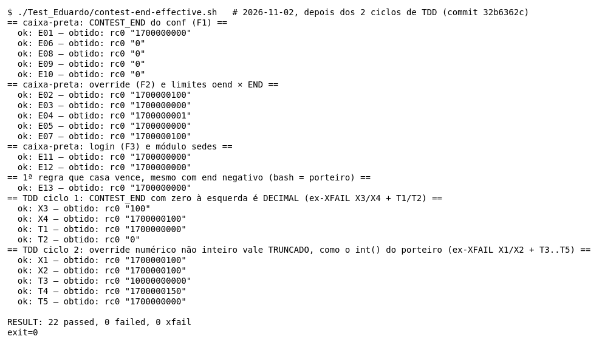

A execução antes do TDD (13 passed, 4 xfail) está na imagem do Red do ciclo 1 e em `evidencias/saida-2026-11-01.txt`; as imagens de X1–X4 na seção 6 são de antes do TDD.

### Traces dos pares MC/DC

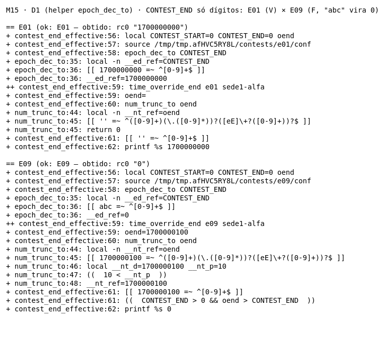

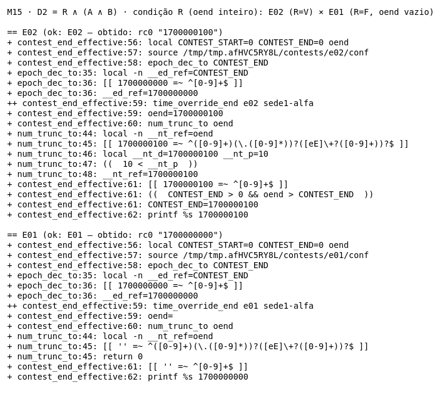

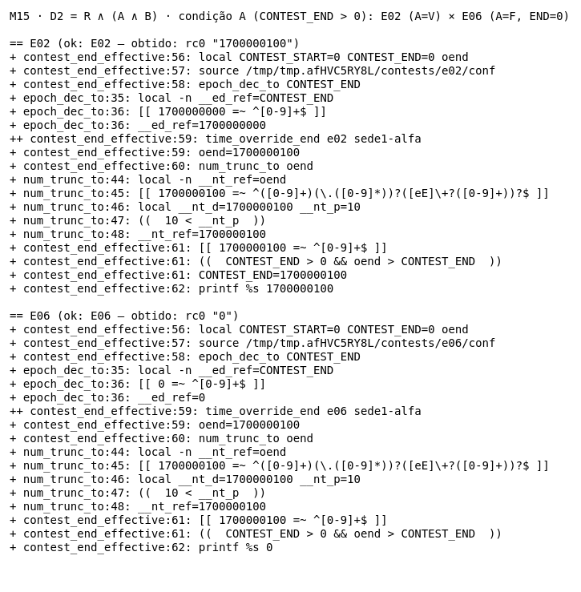

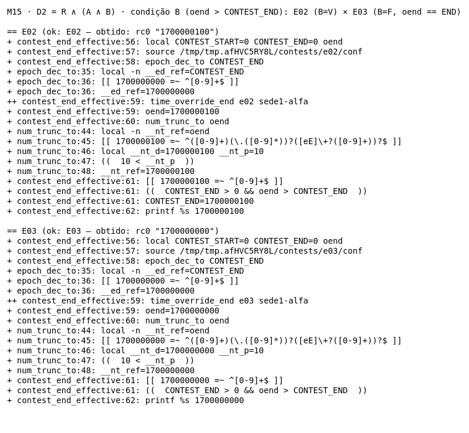

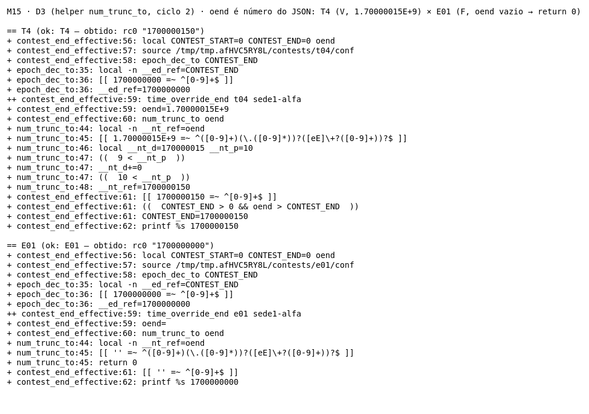

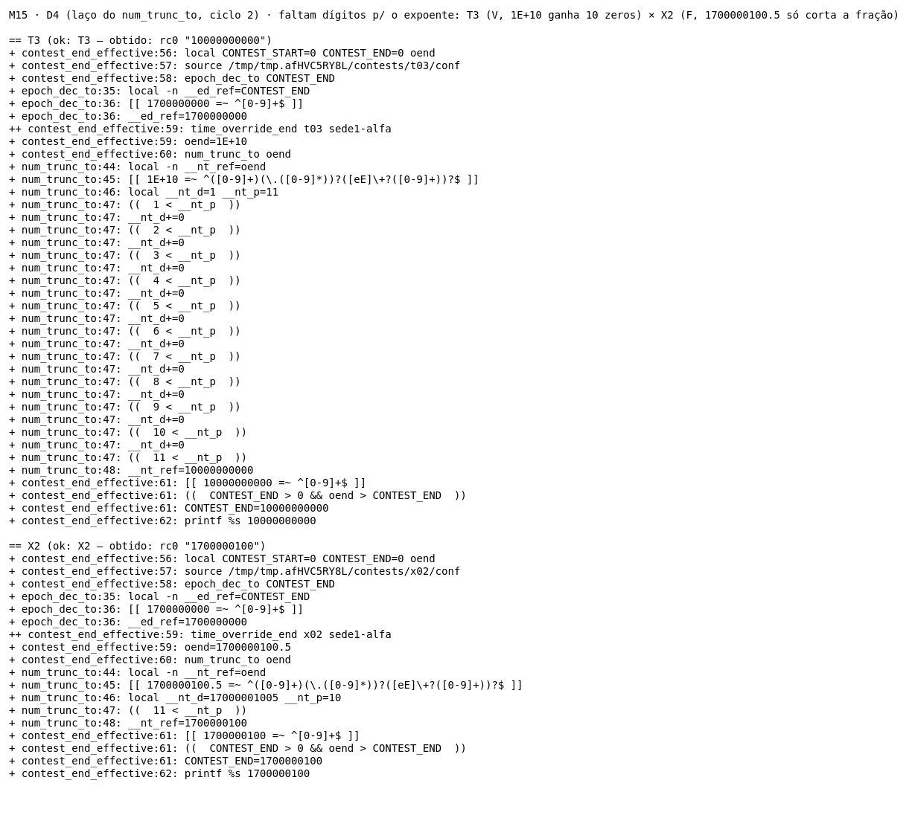

### Cobertura de linhas (kcov)

Comando: `kcov --include-path="$PWD/server/api/v1/lib/contest-gate.sh" Test_Eduardo/evidencias/cobertura ./Test_Eduardo/contest-end-effective.sh`. O kcov roda **o script** (executável, com shebang), e não `bash <script>`. O relatório fica em `evidencias/cobertura/contest-end-effective.sh.b4f6d613e03ef3f5/` (`cobertura.xml`, `coverage.json`, `index.html`); abra `evidencias/cobertura/index.html` no navegador. Ele foi gerado de novo em 2026-11-02 sobre o código **depois dos 2 ciclos de TDD**. O symlink que o kcov cria na raiz da pasta (caminho absoluto da máquina) foi apagado.

| Linha | Hits | Observação |
|---|---|---|
| 34 (`epoch_dec_to() {`), 37 (`}`) | não instrumentadas | definição de função |
| 35, 36 (`epoch_dec_to`) | 22, 44 | cobertas; a 36 tem o `if/else` da D1 |
| 43 (`num_trunc_to() {`), 49 (`}`) | não instrumentadas | definição de função |
| 44, 45, 46, 47 (`num_trunc_to`) | 22, 28, 16, 42 | cobertas; D3 na 45, D4 (laço) na 47 |
| 48 (`__nt_ref=$((10#…))`) | **não instrumentada** | ver abaixo |
| 55 (`contest_end_effective() {`), 63 (`}`) | não instrumentadas | definição de função |
| 56, 57, 58, 59, 60 | **não instrumentadas** | ver abaixo |
| 61, 62 | 46, 22 | cobertas; D2 na 61 |
| **Total** | | **8 de 8** linhas instrumentadas cobertas |

**Atenção: o número "8 de 8" esconde 6 linhas que o kcov deixou de instrumentar.** Depois do ciclo 2, o kcov não instrumentou a linha 48 nem as linhas 56–60, que são comandos comuns e que ele instrumentava antes do ciclo 2 (as linhas equivalentes eram 43–47). O motivo não foi investigado. O xtrace mostra que essas linhas **rodaram**: `num_trunc_to:48` aparece em 16 traces, e cada uma das linhas `contest_end_effective:56` a `:60` aparece nos 22 traces. Por isso a cobertura destas linhas vem do xtrace, não do kcov.

Depois do ciclo 1 (kcov de 2026-11-02, antes do ciclo 2) o resultado foi 8 de 8 linhas cobertas (35–36, 43–48). Antes do TDD (kcov de 2026-11-01, sobre o código analisado), 6 de 6 (36–41).

As linhas do M14 (`time_override_end`) também aparecem nesse relatório, porque o M15 o chama. Elas são avaliadas no relatório do M14. O kcov mede **linha**, não decisão nem MC/DC: as três condições de D2 estão na linha 61, que ele marca como coberta com qualquer caso.

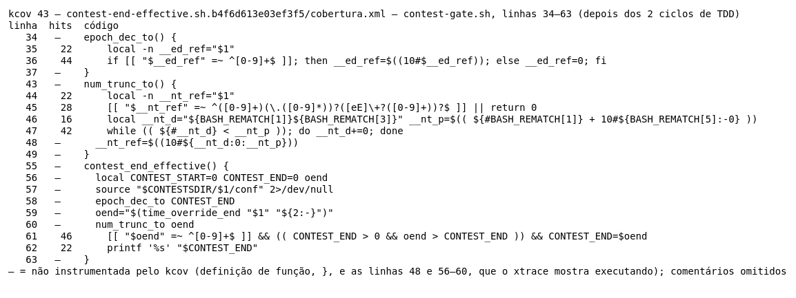

*Renderização via ImageMagick dos dados do `cobertura.xml` do kcov (linhas 34–63, depois dos 2 ciclos de TDD); não é captura de tela.*

## 6. Defeitos e hipóteses (XFAIL)

> **Situação atual:** os quatro defeitos desta seção foram **corrigidos por TDD**: X3/X4 no ciclo 1 e X1/X2 no ciclo 2 (seção 7). Hoje são casos obrigatórios que passam. O "obtido" abaixo é o de **antes** da correção, e as imagens `xfail-X*.png` foram mantidas de propósito, porque mostram o "antes". As linhas citadas são as do código analisado.

O oráculo é o contrato da seção 2. A paridade com o espelho do porteiro foi conferida **executando** a função Python `end_effective` sobre as mesmas entradas (`python3 -I Test_Eduardo/oraculo-porteiro.py`, saída em `evidencias/oraculo-porteiro-2026-11-01.txt`; a de 2026-11-02 inclui T1–T5):

```
M15 E13 end -1         porteiro.end_effective = 1700000000
M15 X1 1.7000001e9     porteiro.end_effective = 1700000100
M15 X2 float           porteiro.end_effective = 1700000100
M15 X3 END=0100        porteiro.end_effective = 100
M15 X4 END=09          porteiro.end_effective = 1700000100
```

Nos quatro XFAIL, antes do TDD, o bash e o porteiro **divergiam**. A mesma prova tem fins diferentes conforme a rota cair no porteiro ou no bash.

### X1 e X2: override numérico que não é inteiro "puro" é descartado (CORRIGIDO no ciclo TDD 2)

- **Obtido (antes do TDD):** X1 `end = 1.7000001e9` → `1700000000`. O M14 ecoa o literal `1.7000001E+9` (o jq 1.8.2 preserva o literal), e a regex `^[0-9]+$` da linha 40 o rejeita. X2 `end = 1700000100.5` → `1700000000` pela mesma causa. Como a 1ª regra é a que casa, a 2ª (`1700000200`) também não vale.
- **Por que viola o contrato:** a regra casa o login e o fim dela é maior que o `CONTEST_END`, então o fim deveria ser **prorrogado**. O espelho faz `int(e)` e prorroga para `1700000100`. A conferência de formato vem do bash e não existe no contrato nem no porteiro.
- **Como acontece em produção:** só com `time-overrides.json` editado fora da API (o writer aplica `floor`, e `floor` devolve um número novo, que o jq 1.8.2 imprime sem expoente abaixo de 1e16). Efeito: a sede prorrogada perde os minutos extras nas rotas servidas pelo bash (`/submit`) e os mantém nas servidas pelo porteiro (countdown).
- **Correção sugerida antes do TDD** (não aplicada assim): fazer o M14 devolver o inteiro, como o porteiro (`int(e)`):

```diff
--- a/server/api/v1/lib/contest-gate.sh
+++ b/server/api/v1/lib/contest-gate.sh
@@ time_override_end
           | select($rr != "" and ($e|type=="number") and (try ($l | test($rr)) catch false))
-          | $e) // empty' "$f" 2>/dev/null
+          | $e | floor) // empty' "$f" 2>/dev/null
```

`floor` e o `int()` do Python só diferem para negativos (`int(-1.5) = -1`, `floor = -2`), e negativo nunca prorroga (B=F). Essa correção mexeria na linha do M14, porque é lá que o formato nasce.
- **Correção aplicada (ciclo 2 do TDD, seção 7):** por decisão do Eduardo, a correção ficou **no próprio M15**, sem mexer no M14. O `contest_end_effective` passou a truncar o `oend` em bash puro, sem processo extra (helper `num_trunc_to`, com nameref). Assim o M14 continua ecoando o `end` como está no arquivo, como o contrato dele diz.

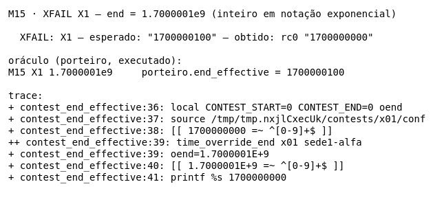

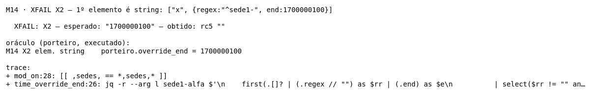

### X3 e X4: `CONTEST_END` com zero à esquerda é lido em octal (CORRIGIDO no ciclo TDD 1)

- **Obtido:** X3 `CONTEST_END=0100`, override `99` → `99`. O `(( ))` lê `0100` como octal (64), vê `99 > 64` e troca o fim por 99: o fim **encolheu** de 100 para 99. X4 `CONTEST_END=09` → saída `09` e, no stderr, `contest-gate.sh: line 40: ((: 09: value too great for base (error token is "09")`. O override não é aplicado.
- **Por que viola o contrato:** *"o override só ESTENDE — nunca encurta"*. A D1 (linha 38) aceita `0100` porque `^[0-9]+$` casa, mas a comparação da linha 40 usa outra base. O espelho lê em decimal (`int("0100") = 100`) e dá `100` e `1700000100`.
- **Como acontece em produção:** na criação, o `CONTEST_END` é gravado com `printf %q` de um epoch, sem zero à esquerda. Pela **leitura do código** (não executado ponta a ponta), o `POST /contest/admin/settings` aceita `{"end":"0100"}`: ele valida `jq -r .end` com `^[0-9]+$`, e uma string JSON `"0100"` passa e é gravada como `CONTEST_END=0100`. Um JSON com número `0100` não chega assim (o jq normaliza para `100`). Também acontece com conf editado à mão. Um epoch real com zero à esquerda é absurdo, mas o resultado (encurtar) é exatamente o que o contrato proíbe, e o erro do X4 vai parar no error.log do nginx.
- **Correção:** a sugerida abaixo foi **aplicada** como o Green do ciclo TDD 1 e depois refatorada para o helper `epoch_dec_to` (seção 7). O X1/X2 foi corrigido depois, no ciclo 2.

```diff
--- a/server/api/v1/lib/contest-gate.sh
+++ b/server/api/v1/lib/contest-gate.sh
@@ contest_end_effective
   source "$CONTESTSDIR/$1/conf" 2>/dev/null
-  [[ "$CONTEST_END" =~ ^[0-9]+$ ]] || CONTEST_END=0
+  [[ "$CONTEST_END" =~ ^[0-9]+$ ]] && CONTEST_END=$((10#$CONTEST_END)) || CONTEST_END=0
```

`10#` força a base decimal e reproduz o `int()` do porteiro. As duas correções desta seção, junto com a do M14, foram validadas numa **cópia descartável** da lib, fora do repo: `RESULT: 13 passed, 0 failed, 0 xfail`, com X1–X4 em XPASS. O script do M14 na mesma cópia deu `28 passed, 0 failed`. Nessa etapa o código de produção não foi alterado. A alteração veio depois, com autorização do Eduardo, nos ciclos de TDD (seção 7): X3/X4 no ciclo 1 e X1/X2 no ciclo 2, este com outra correção (no M15, não no M14).

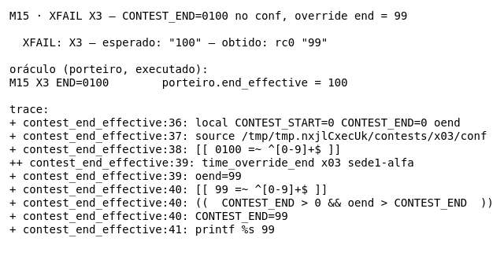

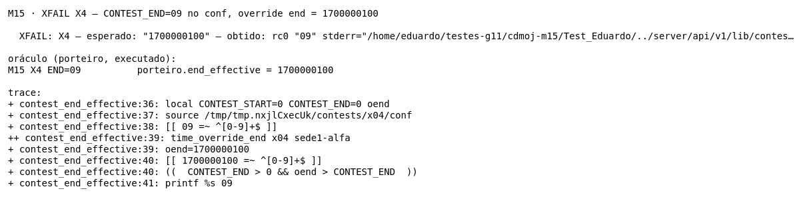

### Hipóteses do planejamento revistas

- **`end: -1` (E13) não é defeito.** O bash ignora o `-1` (R=F), e o porteiro faz `int(-1) = -1`, que não é maior que o END. Os dois ficam em `1700000000`. Nos dois a 1ª regra que casa vence, e a 2ª não é consultada. É caso que passa.
- **Octal.** O planejamento registrava como observado `09 → 1700000100 sem erro` e `0100 → 0100`. A execução real (bash 5.3.20) deu outra coisa (X3/X4 acima). Valem os resultados medidos aqui.

## 7. Aplicação de TDD (2 ciclos)

Dois ciclos Red → Green → Refactor, cada fase com um commit próprio. O ciclo 1 corrigiu o X3/X4 (octal); o ciclo 2, o X1/X2 (override float e exponencial). Os dois ciclos alteraram `server/api/v1/lib/contest-gate.sh` com autorização do Eduardo.

| Ciclo | Fase | Commit | Resultado real |
|---|---|---|---|
| 1 | Red | `863e72e0` | `13 passed, 4 failed, 2 xfail`, exit 1 |
| 1 | Green | `e2812ad9` | `17 passed, 0 failed, 2 xfail` |
| 1 | Refactor | `b8cf5b96` | `17 passed, 0 failed, 2 xfail` |
| 2 | Red | `994477e5` | `18 passed, 4 failed, 0 xfail`, exit 1 |
| 2 | Green | `65468927` | `22 passed, 0 failed, 0 xfail` |
| 2 | Refactor | `32b6362c` | `22 passed, 0 failed, 0 xfail` |

### Ciclo 1: `CONTEST_END` com zero à esquerda

**O que foi desenvolvido:** a correção do defeito X3/X4 (seção 6). Antes, `CONTEST_END` com zero à esquerda era lido em octal, o que podia **encurtar** o fim da prova ou dar erro de base. Escolhi esse defeito por quatro motivos:
- viola uma frase explícita do contrato (*"nunca encurta"*);
- deve ser alcançável pela API (`admin/settings`);
- tem um oráculo independente (o porteiro lê em decimal);
- a correção cabe numa linha e deixa espaço para um Refactor real.

Evidências do ciclo em `evidencias/tdd/ciclo1-*`: a saída `.txt` de cada fase e o `.diff` do que mudou nela.

| Fase | O que mudou | Resultado real | Evidência |
|---|---|---|---|
| **Red** | Só o teste. X3 e X4 passaram de XFAIL a casos obrigatórios. T1 e T2 foram criados. O oráculo do porteiro ganhou T1/T2. | `13 passed, 4 failed, 2 xfail`, exit 1 | `ciclo1-1-red.txt`, `ciclo1-1-red.diff` |
| **Green** | 1 linha em `contest-gate.sh`: `10#` força a base decimal | `17 passed, 0 failed, 2 xfail`, exit 0. Upstream `smoke-time-overrides.sh`: `12 passed, 0 failed` | `ciclo1-2-green.txt`, `ciclo1-2-green.diff`, `ciclo1-2-green-regressao.txt` |
| **Refactor** | A regra virou o helper `epoch_dec_to`, e a função passou a chamá-lo | `17 passed, 0 failed, 2 xfail`, exit 0. 4 smokes do upstream com 0 falhas | `ciclo1-3-refactor.txt`, `ciclo1-3-refactor.diff`, `ciclo1-3-refactor-regressao.txt` |

#### Evolução dos testes (Red)

- **X3 e X4 mudaram de tipo** (`caso X` → `caso C`). O esperado **não mudou**: continua sendo o que o contrato e o porteiro dizem (`100` e `1700000100`). O que mudou é que a falha agora quebra o exit code.
- **T1 (novo):** `CONTEST_END=0001700000000` com override `1699999999` (END−1), esperado `1700000000`. X3 usa um epoch de brinquedo (`0100`); T1 mostra o mesmo defeito com um epoch realista e no valor limite: o bash lia `0001700000000` em octal (≈ 2,5×10⁸), achava o override maior e **encurtava** a prova para `1699999999`.
- **T2 (novo):** `CONTEST_END=00` sem override, esperado `0`. "Sem limite" é `0`, como o porteiro devolve (`int("00") = 0`). O bash ecoava `"00"`. Esse caso prende que a correção também normaliza a saída, e não só a comparação.
- **Oráculo:** antes de rodar o Red, executei o porteiro com T1 e T2 (`python3 -I Test_Eduardo/oraculo-porteiro.py`). Ele deu `1700000000` e `0`, os mesmos esperados do teste (`evidencias/oraculo-porteiro-2026-11-01.txt`).
- X1 e X2 continuaram XFAIL neste ciclo. Eles foram corrigidos no ciclo 2, no próprio M15 (abaixo).

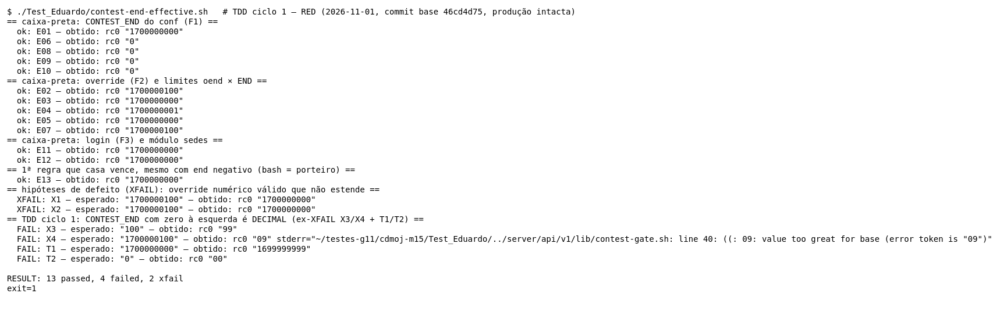

#### Evolução da implementação

**Green, a correção mínima.** Uma linha: a mesma regex decide e o `10#` converte para decimal.

```diff
@@ contest_end_effective
   source "$CONTESTSDIR/$1/conf" 2>/dev/null
-  [[ "$CONTEST_END" =~ ^[0-9]+$ ]] || CONTEST_END=0
+  [[ "$CONTEST_END" =~ ^[0-9]+$ ]] && CONTEST_END=$((10#$CONTEST_END)) || CONTEST_END=0
   oend="$(time_override_end "$1" "${2:-}")"
```

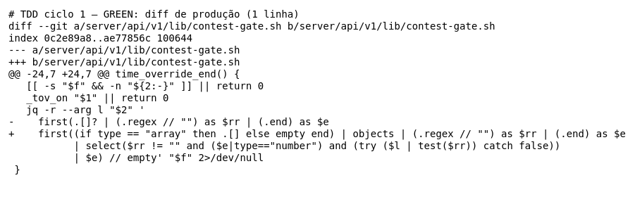

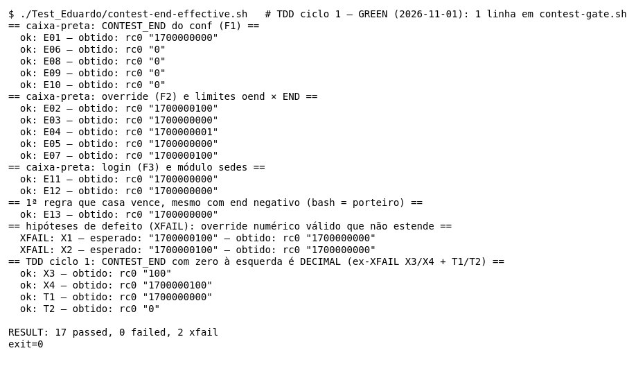

**Refactor, a regra com nome.**

```diff
+# epoch_dec_to <var> : normaliza a variável (nameref, zero fork) p/ inteiro DECIMAL — "0100" vale 100,
+# nunca o octal 64 que o (( )) leria — ou 0 se ela não for só dígitos. Mesma leitura do porteiro (conf_int).
+epoch_dec_to() {
+  local -n __ed_ref="$1"
+  if [[ "$__ed_ref" =~ ^[0-9]+$ ]]; then __ed_ref=$((10#$__ed_ref)); else __ed_ref=0; fi
+}
@@ contest_end_effective
   source "$CONTESTSDIR/$1/conf" 2>/dev/null
-  [[ "$CONTEST_END" =~ ^[0-9]+$ ]] || CONTEST_END=0
+  epoch_dec_to CONTEST_END
   oend="$(time_override_end "$1" "${2:-}")"
```

(Diff acumulado contra o `HEAD`, em `ciclo1-3-refactor.diff`.)

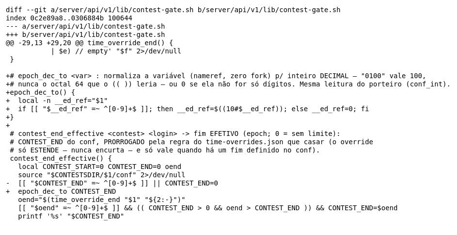

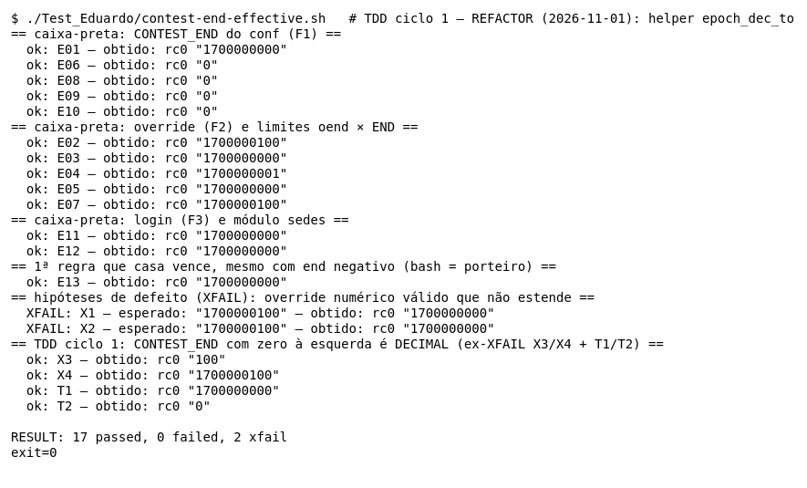

#### Refatorações realizadas

1. **Saiu o `a && b || c`.** No Green, o `|| CONTEST_END=0` rodaria também se a atribuição do meio falhasse, e não só quando a regex não casa. O `if/else` diz exatamente "casa → converte; não casa → 0".
2. **A regra ganhou nome e um comentário que diz por que ela existe** (octal, paridade com o `conf_int` do porteiro). Antes estava escondida no meio da função.
3. **Ficou reutilizável sem custo:** o nameref (`local -n`) normaliza a própria variável do chamador, sem `$(…)`, ou seja, sem fork. É o mesmo padrão do `conf_value_to` do `common.sh`, e o que o upstream pede para caminho quente (o `contest_phase` chama esta função a cada `/submit`).
4. **O que NÃO foi feito no Refactor:** trocar a linha igual da `contest_end_all` pelo helper. Isso **muda o comportamento** dela (hoje ela também encurta com `0100`; sondagem real: `contest_end_all` = `99`, `contest_end_effective` = `100`). Mudar comportamento pede um ciclo novo, começando por um teste vermelho. Ficou como próximo ciclo.

Regressão: os testes do upstream que exercitam essa lib foram rodados **sem alteração** depois do Refactor:
- `smoke-time-overrides.sh` (rota `/submit` e countdown com prorrogação);
- `smoke-porteiro.sh` (paridade com o espelho);
- `smoke-modules-off-rules.sh` (módulo `sedes` desligado);
- `smoke-contest-rounds.sh` (guarda do freeze, que usa o `contest_end_all`).

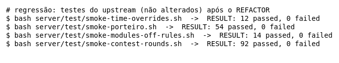

#### Dificuldades

- **O Red já existia, mas como XFAIL.** No trabalho de testes o defeito era registrado como XFAIL, que não quebra o exit code. Para o TDD foi preciso decidir conscientemente o momento de promovê-lo a caso obrigatório: só quando a correção passou a estar no escopo, e sem mexer no esperado.
- **A primeira hipótese estava errada.** O planejamento dizia que `09` passava sem erro e que `0100` devolvia `0100`. Só rodar de verdade mostrou o comportamento real (octal e erro de base). Sem a execução, o teste teria nascido com o oráculo errado.
- **Escolher o mínimo do Green.** O primeiro impulso era já criar o helper e consertar também a `contest_end_all`. Segurar isso para o Refactor, e a irmã para um ciclo próprio, foi o que deixou cada fase com um diff pequeno e explicável.
- **Medir a regressão.** O upstream tem 216 scripts em `server/test/`, e nem todos são offline ou rápidos. Escolhi os que exercitam esta lib, o que é uma amostra e não a suíte inteira (seção 8).

#### Benefícios observados

- **Teste antes da correção = prova de que o teste detecta o defeito.** Os 4 vermelhos do Red mostram que, se a correção for revertida, a suíte avisa.
- **O T1 surgiu por causa do TDD:** escrever o teste antes obrigou a pensar num caso realista. Foi ele que mostrou que o defeito não depende de epoch de brinquedo: um fim de prova real com zeros à esquerda perde tempo.
- **Refatorar sem medo.** O helper mudou a estrutura da função, e o mesmo `17 passed` antes e depois, mais a regressão do upstream, mostram que o comportamento ficou igual.
- **A refatoração revelou o próximo defeito.** Ao procurar onde reutilizar o helper apareceu a `contest_end_all` com o mesmo problema, já confirmado por execução.

### Ciclo 2: override com `end` float ou em notação exponencial

**O que foi desenvolvido:** a correção do X1/X2 (seção 6). Antes, um `end` numérico que o jq não ecoa como inteiro puro (`1.7000001E+9`, `1700000100.5`) era descartado pela regex `^[0-9]+$`, e a sede perdia a prorrogação nas rotas do bash. O porteiro faz `int(e)` e prorroga. O Eduardo escolheu este defeito para o 2º ciclo, porque eram os XFAIL que restavam no próprio M15, e decidiu que a correção ficaria no M15, sem mexer no M14.

Evidências em `evidencias/tdd/ciclo2-*`.

| Fase | O que mudou | Resultado real | Evidência |
|---|---|---|---|
| **Red** | Só o teste. X1 e X2 passaram de XFAIL a casos obrigatórios. T3, T4 e T5 foram criados. O oráculo do porteiro ganhou T3–T5. | `18 passed, 4 failed, 0 xfail`, exit 1 | `ciclo2-1-red.txt`, `ciclo2-1-red.diff` |
| **Green** | 5 linhas no `contest_end_effective`: se o `oend` é um número do JSON, desloca a vírgula pelo expoente e corta a fração | `22 passed, 0 failed, 0 xfail`, exit 0. 4 smokes do upstream com 0 falhas | `ciclo2-2-green.txt`, `ciclo2-2-green.diff`, `ciclo2-2-green-regressao.txt` |
| **Refactor** | A conta virou o helper `num_trunc_to` (nameref, como o `epoch_dec_to`), e a função passou a chamá-lo; comentário da função atualizado | `22 passed, 0 failed, 0 xfail`, exit 0. 4 smokes do upstream com 0 falhas; `jq-portability.sh` sem incompatibilidade | `ciclo2-3-refactor.txt`, `ciclo2-3-refactor.diff`, `ciclo2-3-refactor-regressao.txt` |

#### Evolução dos testes (Red)

- **X1 e X2 mudaram de tipo** (`caso X` → `caso C`). O esperado **não mudou**: `1700000100` nos dois, o que o porteiro devolve.
- **T3 (novo):** `end = 1e10`. O jq ecoa `1E+10`, sem parte fracionária. Esperado `10000000000` (no Red: `1700000000`). O X1 tem mantissa com fração; T3 mostra que o expoente sozinho já quebrava.
- **T4 (novo):** `end = 1.70000015e9` → `1.70000015E+9`. Depois de deslocar a vírgula 9 casas, ainda sobra fração (`1700000150,0`). Esperado `1700000150` (no Red: `1700000000`). É o caso que obriga a correção a **truncar** depois de aplicar o expoente.
- **T5 (novo, proteção):** `end = 1700000000.9`, com `END = 1700000000`. O porteiro trunca para `1700000000`, que não é maior que o fim, e não prorroga. Esperado `1700000000`. No Red ele já passava (o bash descartava o valor). Ele prende que a correção **trunca e não arredonda**: com arredondamento, daria `1700000001` e prorrogaria 1 segundo.
- **Oráculo:** antes do Red, executei o porteiro com T3–T5. Ele deu `10000000000`, `1700000150` e `1700000000`, os mesmos esperados do teste (`evidencias/oraculo-porteiro-2026-11-02.txt`).

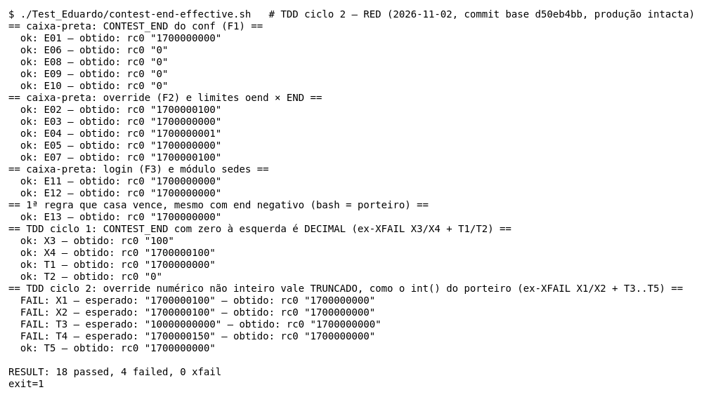

#### Evolução da implementação

**Green.** A menor correção que passa nos quatro casos, em bash puro, sem processo extra:

```diff
@@ contest_end_effective
   oend="$(time_override_end "$1" "${2:-}")"
+  if [[ "$oend" =~ ^([0-9]+)(\.([0-9]*))?([eE]\+?([0-9]+))?$ ]]; then
+    local d="${BASH_REMATCH[1]}${BASH_REMATCH[3]}" p=$(( ${#BASH_REMATCH[1]} + 10#${BASH_REMATCH[5]:-0} ))
+    while (( ${#d} < p )); do d+=0; done
+    oend=$((10#${d:0:p}))
+  fi
   [[ "$oend" =~ ^[0-9]+$ ]] && (( CONTEST_END > 0 && oend > CONTEST_END )) && CONTEST_END=$oend
```

A ideia: `d` são todos os dígitos sem a vírgula, e `p` é onde a vírgula fica depois do expoente. Se faltam dígitos, completa com zeros; depois corta em `p`, que é a truncagem. Não há conta em ponto flutuante.

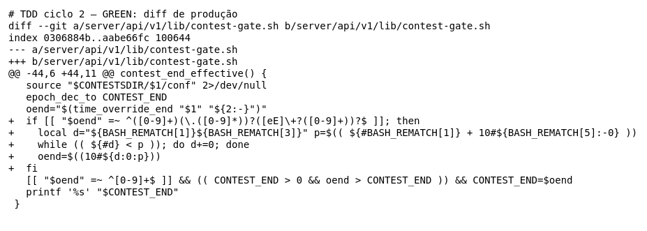

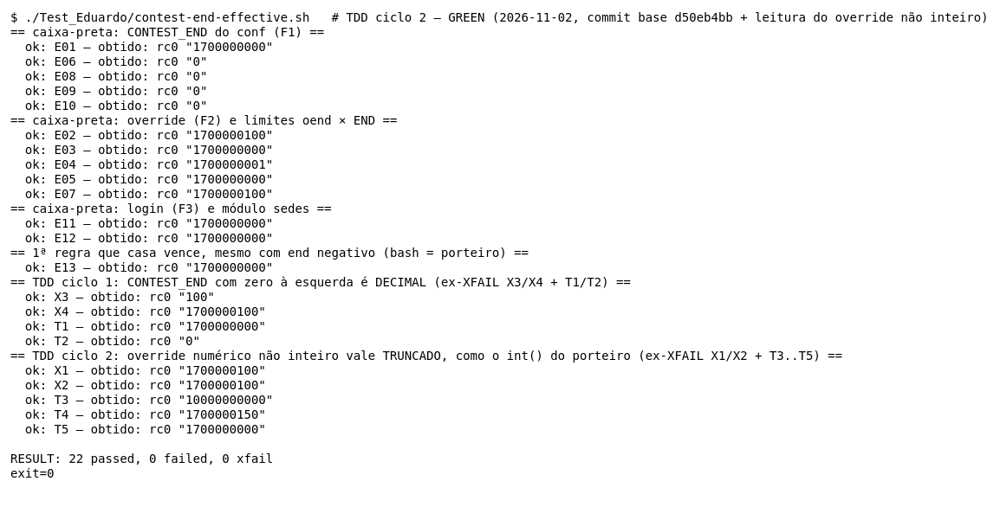

**Refactor.** A conta foi para um helper com nome, ao lado do `epoch_dec_to` do ciclo 1:

```diff
+# num_trunc_to <var> : número do JSON como o jq o ecoa ("1700000100.5", "1.7000001E+9", "1E+10") -> inteiro
+# TRUNCADO na própria variável (nameref, zero fork), como o int(e) do porteiro (override_end). …
+num_trunc_to() {
+  local -n __nt_ref="$1"
+  [[ "$__nt_ref" =~ ^([0-9]+)(\.([0-9]*))?([eE]\+?([0-9]+))?$ ]] || return 0
+  local __nt_d="${BASH_REMATCH[1]}${BASH_REMATCH[3]}" __nt_p=$(( ${#BASH_REMATCH[1]} + 10#${BASH_REMATCH[5]:-0} ))
+  while (( ${#__nt_d} < __nt_p )); do __nt_d+=0; done
+  __nt_ref=$((10#${__nt_d:0:__nt_p}))
+}
@@ contest_end_effective
   oend="$(time_override_end "$1" "${2:-}")"
+  num_trunc_to oend
```

(Diff acumulado do ciclo, em `ciclo2-3-refactor.diff`.)

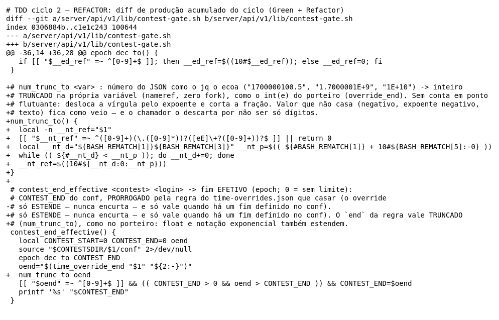

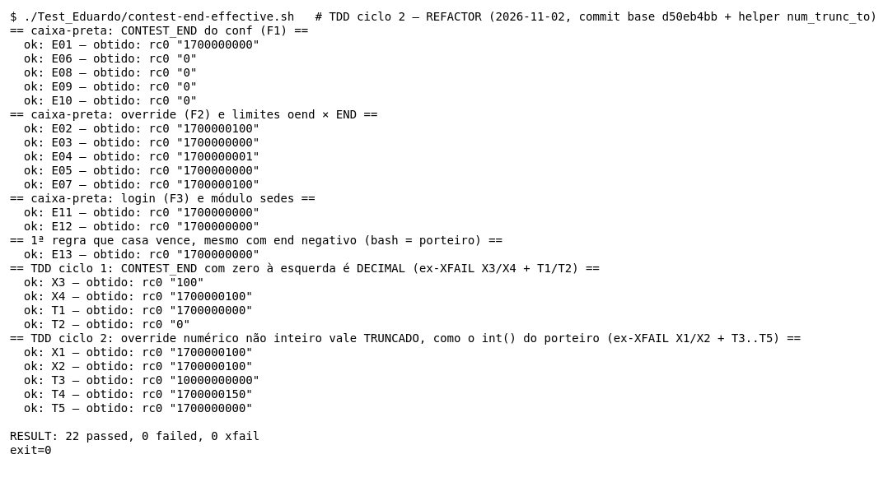

#### Refatorações realizadas

1. **Saiu o bloco `if` do meio da função.** O `contest_end_effective` voltou a ler como uma sequência de passos: ler o conf, normalizar o fim (`epoch_dec_to`), ler o override, normalizar o override (`num_trunc_to`), comparar.
2. **Mesmo padrão do ciclo 1.** O helper altera a variável do chamador por nameref (`local -n`), sem `$(…)`, ou seja, sem fork. É o caminho quente do `/submit`.
3. **Variáveis com prefixo** (`__nt_*`). Com nameref, uma variável local de mesmo nome que a do chamador causaria referência circular; o prefixo evita isso, como no `epoch_dec_to` (`__ed_ref`).
4. **O comentário documenta o contrato do helper**, inclusive o que ele **não** trata (negativo, expoente negativo, texto): o valor fica como veio, e a regex da D2 o descarta.
5. **O que NÃO foi feito:** usar o `num_trunc_to` na `contest_end_all`, que tem o mesmo descarte de float. Isso muda o comportamento dela e pede um ciclo próprio.

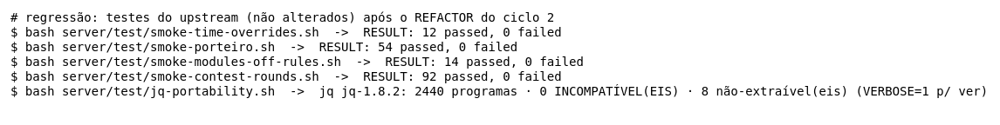

#### Dificuldades

- **Onde corrigir.** O formato nasce no M14 (o jq ecoa o literal), e a correção sugerida na seção 6 mexia lá. Mas o contrato do M14 diz que ele *ecoa* o `end`, e o relatório do M14 já tinha decidido que float não é defeito do M14. A decisão de corrigir no M15 foi do Eduardo, e ela exigiu uma correção sem processo extra.
- **Conhecer o que o jq imprime.** A correção depende do formato de saída do jq 1.8.2 (`1.7000001E+9`, `1E+10`, `1700000100.00`). Antes de escrever o Red, sondei esses formatos com o jq real. Outra versão do jq pode imprimir de outro jeito (ex.: `1.7000001e+09`); a regex aceita `e`/`E` e o `+` opcional, mas não foi testada com o jq 1.7 da imagem de produção.
- **Truncar ou arredondar.** O `printf '%.0f'` do bash seria a solução óbvia e arredonda. O T5 foi escrito antes da correção justamente para impedir isso.

#### Benefícios observados

- **Os XFAIL viraram o Red sem esforço**, e o oráculo do porteiro deu os esperados dos casos novos antes de qualquer código.
- **T4 mudou a correção.** Sem ele, uma correção que só tirasse a fração (`${oend%%.*}`) passaria no X2, e uma que só tratasse o expoente passaria no X1. O T4 exige as duas coisas juntas.
- **T5 tornou explícita uma regra que o contrato não escreve** (truncar, como o `int()` do porteiro).
- **Nenhum caso antigo mudou.** Os 17 casos do ciclo 1 continuaram passando em todas as fases.

### Próximos ciclos possíveis (não feitos)

- **`contest_end_all`** (mesmo arquivo, fora do escopo do M15): tem o defeito do octal (Red com `CONTEST_END=0100` e override `99`: esperado `100`, obtido `99`; o Green seria `epoch_dec_to CONTEST_END`) e o mesmo descarte de float do X1/X2 (o Green seria `num_trunc_to mx`).
- **Expoente muito grande** (`1E+400`): hoje estoura os 64 bits do bash (seção 8). Um caso de limite e um teto no `num_trunc_to` fechariam isso.

## 8. Lacunas e limitações

- **`(( A && B ))` numa linha só.** O xtrace não separa A de B. A independência delas vem dos dados (seção 4).
- **Expoente muito grande (ciclo 2).** O `num_trunc_to` completa zeros até o expoente pedir. Com um `end` como `1e400` (o jq imprime `1E+400`), ele montaria um número de 401 dígitos, e o `$((10#…))` do bash estouraria os 64 bits sem avisar. O porteiro, nesse caso, levanta `OverflowError` e declina. Não há caso para isso: é um epoch absurdo, que só chega por arquivo editado à mão.
- **Overflow de 64 bits.** Fora dos casos. Sondagem real com o bash 5.3.20: `end = 99999999999999999999` (20 dígitos) → a função devolveu `99999999999999999999` (prorrogou); `end = 9223372036854775808` (2^63) → devolveu `1700000000` (o valor vira negativo no `(( ))` e não prorroga). Pela API esses valores chegam com expoente (depois do `floor`, o jq 1.8.2 imprime `1e+16` em diante); depois do ciclo 2 eles passam pelo `num_trunc_to` (ver o item anterior). São epochs absurdos (anos acima de 3×10⁹), então ficam só como nota.
- **Alcance do X3/X4 pela API.** Foi deduzido da leitura do `admin/settings.sh` e do comportamento do `jq -r`, sem rodar o handler. Um teste de rota (fora do escopo de unidade) confirmaria.
- **`CONTEST_START` não é usado** pela função (o `local` só o isola do chamador). O `source` do conf poderia redefinir outras variáveis do chamador. O teste não cobre esse vazamento, porque a função roda em subshell nos chamadores (`$(…)`).
- **Integração com o M14.** O M15 foi testado com o M14 real. As partições do M14 (arquivo, módulo, regex) não foram repetidas aqui: E12 cobre só o módulo desligado.
- **Caminhos temporários nos traces.** Os traces trazem caminhos do `mktemp` (`/tmp/tmp.XXXX`), que mudam a cada execução.
- **Cobertura.** O kcov mede só linha. Não há medida automática de decisão nem de MC/DC. Depois do ciclo 2, o kcov deixou de instrumentar 6 linhas que rodam (seção 5); para elas, a evidência é o xtrace. O relatório do kcov, os traces e as imagens de execução e MC/DC foram gerados de novo em 2026-11-02 sobre o código depois dos 2 ciclos. As linhas citadas nas seções 4 e 6 são as do código analisado (`ec13d5cc`); a seção 4 traz a correspondência com as linhas atuais. Ficam de antes do TDD, de propósito: `evidencias/saida-2026-11-01.txt`, as imagens de X1–X4 e as evidências de cada Red em `evidencias/tdd/`.
- **`contest_end_all` continua com o defeito do octal.** Sondagem real depois do Refactor: `CONTEST_END=0100` com override `99` → `contest_end_effective` = `100` e `contest_end_all` = `99`. Ela não é método deste trabalho, e corrigi-la muda comportamento (não é refatoração), então ficou como próximo ciclo (seção 7).
- **Regressão limitada.** Rodei 4 smokes do upstream ligados à função (e, no ciclo 2, também o `jq-portability.sh`), não a suíte inteira do `server/test/`.
- **Branches separadas.** O ciclo 2 do M14 (branch `test/eduardo-m14`) também mexe em `contest-gate.sh` (na `contest_end_all` e no `time_override_end`). Esta branch não tem essas mudanças, e a do M14 não tem as deste relatório. Juntar as duas no repositório da equipe vai exigir resolver o merge desse arquivo.

## 9. Uso de Inteligência Artificial

- **Ferramentas:** Claude (chat) e Claude Code (agente no terminal).
- **Análise e planejamento:** a análise do código, as partições, os pares MC/DC e as hipóteses X1/X2 foram feitos com apoio de IA e registrados no planejamento (`planejamento-m15.txt`).
- **Implementação e evidências (Claude Code):** a escrita e a execução do `contest-end-effective.sh` e do `oraculo-porteiro.py`. A geração das evidências: saída, traces, imagens e cobertura com o kcov. A redação deste relatório, incluindo as correções sugeridas em diff. O X3/X4 surgiu nessa etapa: a sondagem real contradisse a observação do planejamento sobre octal.
- **TDD (Claude Code):** a escolha do defeito (X3/X4) foi sugerida pela IA e aprovada pelo Eduardo, que autorizou a alteração no código de produção. A IA escreveu os testes do Red, a correção do Green, o helper do Refactor e as evidências de cada fase, e rodou a regressão.
- **TDD ciclo 2 (Claude Code, 2026-11-02):** o Eduardo escolheu o defeito (X1/X2) e o lugar da correção (no M15, sem mexer no M14), entre opções apresentadas pela IA. A IA escreveu os casos do Red (T3–T5), a correção do Green, o helper do Refactor e as evidências, e rodou a regressão.
- **Revisão e decisões (Eduardo):** a revisão do material e as decisões sobre os oráculos e sobre o que entra neste relatório.
- **Autorização:** a professora da disciplina autorizou o uso de IA neste trabalho.
