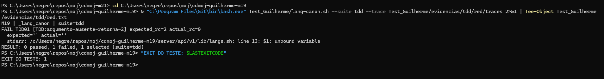
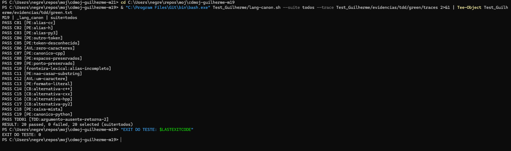
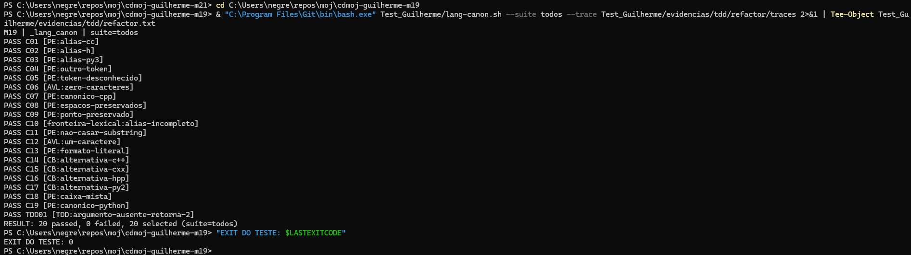

# Testes de unidade — M19 _lang_canon

## Identificacao e projeto

Guilherme Negreiros Pereira · Grupo 11. Branch: test/guilherme-19.
O cdmoj e uma plataforma de juiz online com API Bash. Esta contribuicao verifica uma unidade da biblioteca server/api/v1/lib/langs.sh, sem iniciar a aplicacao inteira.

## Contrato e planejamento

Recebe um token, converte para minusculas e resolve aliases: c++/cc/cxx/hpp -> cpp, h -> c, py3/py2 -> py. Os demais tokens permanecem em minusculas. O requisito TDD acrescenta rejeicao de argumento ausente com status 2, sem saida ou diagnostico; argumento presente e vazio continua valido.

Funcao de producao e utilitario tr reais, em novo Bash por caso. cmp compara bytes exatos, incluindo ausencia de newline indevido, alem do status e stderr. Nao ha HTTP, banco ou dados reais de contest.

O planejamento segue PTOSS-2 e os materiais de caixa-preta, caixa-branca, unidade e TDD, incluindo os dois percursos de derivacao. Valores esperados sao literais; nao se usa uma copia do algoritmo como oraculo.

| Classe / fronteira | Casos |
|---|---|
| Aliases C++ | C01, C14-C16, C18 |
| Aliases C/Python | C02-C03, C17 |
| Canonicos e desconhecidos | C04-C05, C07, C19 |
| Comprimento zero/um | C06, C12 |
| Ponto, espacos e fronteiras lexicais | C08-C11 |
| Formato literal | C13 |
| Ausencia de argumento | TDD01 |

AVL considera zero/um e primeira/ultima posicao onde existem essas fronteiras. Nao ha maximo inventado para tokens ou listas. Cada caso pode ter varias assertions, mas e contado uma vez.

## Complementaridade entre caixa-preta e caixa-branca

Partindo da especificacao, foram escolhidas classes e saidas esperadas; a leitura estrutural complementou ramos, alternativas e curto-circuitos. Partindo dos caminhos de codigo, os cenarios foram complementados com limites e formatos que executar uma linha nao valida sozinho.

Os aliases C++ compartilham um ramo. Cobrir esse ramo com cc nao garante cxx/hpp/c++, por isso ha casos funcionais para cada alternativa. O vazio explicito e a ausencia usam verificacoes distintas.

## Testes implementados e resultados

Script: Test_Guilherme/lang-canon.sh. 20 casos no total, incluindo TDD01. A suite regressao exclui o requisito novo; tdd executa apenas TDD01; todos executa ambos.

| ID | Tecnica / finalidade | Resultado apos Refactor |
|---|---|---|
| C01 | PE:alias-cc | PASS |
| C02 | PE:alias-h | PASS |
| C03 | PE:alias-py3 | PASS |
| C04 | PE:outro-token | PASS |
| C05 | PE:token-desconhecido | PASS |
| C06 | AVL:zero-caracteres | PASS |
| C07 | PE:canonico-cpp | PASS |
| C08 | PE:espacos-preservados | PASS |
| C09 | PE:ponto-preservado | PASS |
| C10 | fronteira-lexical:alias-incompleto | PASS |
| C11 | PE:nao-casar-substring | PASS |
| C12 | AVL:um-caractere | PASS |
| C13 | PE:formato-literal | PASS |
| C14 | CB:alternativa-c++ | PASS |
| C15 | CB:alternativa-cxx | PASS |
| C16 | CB:alternativa-hpp | PASS |
| C17 | CB:alternativa-py2 | PASS |
| C18 | PE:caixa-mista | PASS |
| C19 | PE:canonico-python | PASS |
| TDD01 | TDD:argumento-ausente-retorna-2 | PASS |

Os resultados foram executados pelo integrante no PowerShell/Git Bash e conferidos nos arquivos locais. O log foi normalizado para UTF-8/LF sem alterar seu conteudo.

## Cobertura

[Analise das decisoes e pares](evidencias/cobertura.md), com rastreabilidade para os arquivos em evidencias/tdd/refactor/traces/. A analise utiliza a estrutura final. Nao foi utilizado kcov; nao ha porcentagem automatica de linhas nem instrumentacao do jq.

## Processo TDD

| Etapa | Alteracao / resultado | Evidencia |
|---|---|---|
| Red | TDD01 falha pelo motivo esperado; exit 1 | red.txt e captura Red |
| Green | Implementacao minima; 20 PASS, 0 FAIL, exit 0 | green.diff, green.txt e captura Green |
| Refactor | Extracao de responsabilidade; mesmos 20 PASS, 0 FAIL, exit 0 | refactor.diff, refactor.txt e captura Refactor |

O Green adicionou apenas a guarda de quantidade de argumentos. O Refactor extraiu o case para _lang_alias_canon; _lang_canon manteve a validacao e a normalizacao.

Os testes e seus esperados permaneceram os mesmos entre as etapas de producao. A sequencia de commits registra teste, Red, correcao minima, Green, refatoracao e aprovacao posterior.







As tres imagens sao capturas reais feitas pelo integrante. Os logs e traces correspondentes estao em evidencias/tdd; as imagens nao substituem esses registros.

## Analise critica

O teste novo falhou antes da correcao e passou depois; isso demonstra sua capacidade de detectar o comportamento corrigido. A aprovacao dos mesmos casos depois da extracao estrutural evidencia preservacao nos cenarios selecionados. Esses resultados nao provam ausencia de defeitos em entradas nao exercitadas.

A estrutura da biblioteca permite carregar funcoes sem iniciar o servidor. O acoplamento com utilitarios externos exige um ambiente Bash/jq funcional; falha de configuracao nao deve ser confundida com Red. A separacao de responsabilidades no Refactor torna a regra localizada e facilita sua leitura.

Nao verifica disponibilidade da linguagem, rotas de submissao, lang_canon_ext sem argumento, argumentos adicionais, Unicode ou todos os locales. Nao confundir token desconhecido com linguagem autorizada.

## Conclusao

O ciclo Red -> Green -> Refactor foi executado e registrado. O requisito novo e os casos de regressao selecionados passam apos a refatoracao. A cobertura foi examinada por caminhos e pares de casos, com limites explicitados.

## Executar

```bash
bash Test_Guilherme/lang-canon.sh --suite todos
bash Test_Guilherme/lang-canon.sh --suite todos --trace Test_Guilherme/evidencias/execucao/traces
```

## Uso de Inteligência Artificial

**Ferramenta de apoio:** ChatGPT.

**Finalidades de apoio:**

- Esclarecer dúvidas conceituais sobre técnicas de teste de software, como particionamento de equivalência, análise de valor-limite, cobertura de testes e MC/DC.
- Consultar explicações gerais sobre mensagens de erro de compilação, execução ou configuração do ambiente de desenvolvimento.
- Revisar a clareza e a correção gramatical do relatório técnico, sem gerar ou reescrever sua análise crítica e suas conclusões.

**Exemplos de prompts:**

1. “Explique a diferença entre particionamento de equivalência e análise de valor-limite no contexto de entradas textuais.”
2. “Por que executar todos os ramos de um case não garante, por si só, que todas as alternativas de entrada estejam corretas?”
3. “O que significa a mensagem ‘unbound variable’ em Bash quando a opção set -u está habilitada?”
4. “Revise apenas a clareza e a correção gramatical deste trecho sobre normalização de tokens, sem alterar o conteúdo técnico, a análise crítica ou as conclusões.”
