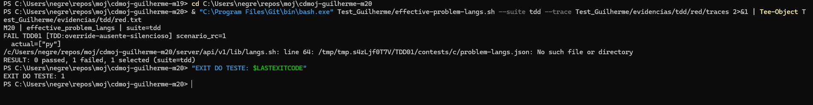
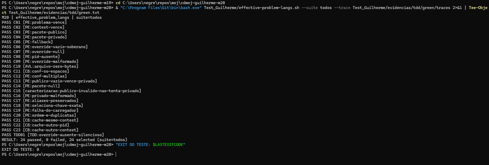
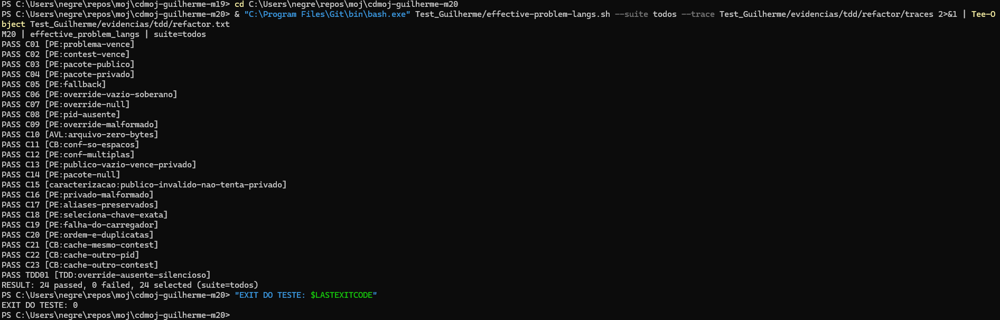

# Testes de unidade — M20 effective_problem_langs

## Identificacao e projeto

Guilherme Negreiros Pereira · Grupo 11. Branch: test/guilherme-m20.
O cdmoj e uma plataforma de juiz online com API Bash. Esta contribuicao verifica uma unidade da biblioteca server/api/v1/lib/langs.sh, sem iniciar a aplicacao inteira.

## Contrato e planejamento

Resolve whitelist por precedencia: problema > contest > pacote publico/privado > []. Override [] e explicito e soberano. Cache por processo/contest; o carregamento de conf deve ocorrer em subshell sem vazar globais. A leitura de override opcional ausente deve ser silenciosa.

Funcao e jq reais, JSON em fixtures temporarias. Somente load_contest_conf e duble, com observacao de chamadas e tentativa controlada de alterar globais. Cada caso tem cache novo; C21-C23 fazem duas chamadas dentro do mesmo cenario para testar o cache.

O planejamento segue PTOSS-2 e os materiais de caixa-preta, caixa-branca, unidade e TDD, incluindo os dois percursos de derivacao. Valores esperados sao literais; nao se usa uma copia do algoritmo como oraculo.

| Classe / fronteira | Casos |
|---|---|
| Precedencia e lista explicita vazia | C01-C06, C13 |
| Override null, chave ausente e invalido | C07-C09 |
| Arquivo com zero bytes | C10 |
| Conf com espacos e multiplos tokens | C11-C12 |
| Pacote null e invalido | C14-C16 |
| Preservacao de aliases, chave e ordem | C17-C18, C20 |
| Falha do carregador e isolamento | C19 e assertions dos demais |
| Cache e chave de contest/pid | C21-C23 |
| Arquivo opcional ausente sem stderr | TDD01 |

AVL considera zero/um e primeira/ultima posicao onde existem essas fronteiras. Nao ha maximo inventado para tokens ou listas. Cada caso pode ter varias assertions, mas e contado uma vez.

## Complementaridade entre caixa-preta e caixa-branca

Partindo da especificacao, foram escolhidas classes e saidas esperadas; a leitura estrutural complementou ramos, alternativas e curto-circuitos. Partindo dos caminhos de codigo, os cenarios foram complementados com limites e formatos que executar uma linha nao valida sozinho.

Os casos de precedencia, sozinhos, nao demonstram que o cache e reutilizado ou que o conf nao vaza globais. Os cenarios de cache/isolamento complementam essa lacuna. Os casos estruturais tambem precisam conferir qual lista efetivamente venceu.

## Testes implementados e resultados

Script: Test_Guilherme/effective-problem-langs.sh. 24 casos no total, incluindo TDD01. A suite regressao exclui o requisito novo; tdd executa apenas TDD01; todos executa ambos.

| ID | Tecnica / finalidade | Resultado apos Refactor |
|---|---|---|
| C01 | PE:problema-vence | PASS |
| C02 | PE:contest-vence | PASS |
| C03 | PE:pacote-publico | PASS |
| C04 | PE:pacote-privado | PASS |
| C05 | PE:fallback | PASS |
| C06 | PE:override-vazio-soberano | PASS |
| C07 | PE:override-null | PASS |
| C08 | PE:pid-ausente | PASS |
| C09 | PE:override-malformado | PASS |
| C10 | AVL:arquivo-zero-bytes | PASS |
| C11 | CB:conf-so-espacos | PASS |
| C12 | PE:conf-multiplas | PASS |
| C13 | PE:publico-vazio-vence-privado | PASS |
| C14 | PE:pacote-null | PASS |
| C15 | caracterizacao:publico-invalido-nao-tenta-privado | PASS |
| C16 | PE:privado-malformado | PASS |
| C17 | PE:aliases-preservados | PASS |
| C18 | PE:seleciona-chave-exata | PASS |
| C19 | PE:falha-do-carregador | PASS |
| C20 | PE:ordem-e-duplicatas | PASS |
| C21 | CB:cache-mesmo-contest | PASS |
| C22 | CB:cache-outro-pid | PASS |
| C23 | CB:cache-outro-contest | PASS |
| TDD01 | TDD:override-ausente-silencioso | PASS |

Os resultados foram executados pelo integrante no PowerShell/Git Bash e conferidos nos arquivos locais. O log foi normalizado para UTF-8/LF sem alterar seu conteudo.

## Cobertura

[Analise das decisoes e pares](evidencias/cobertura.md), com rastreabilidade para os arquivos em evidencias/tdd/refactor/traces/. A analise utiliza a estrutura final. Nao foi utilizado kcov; nao ha porcentagem automatica de linhas nem instrumentacao do jq.

## Processo TDD

| Etapa | Alteracao / resultado | Evidencia |
|---|---|---|
| Red | TDD01 falha pelo motivo esperado; exit 1 | red.txt e captura Red |
| Green | Implementacao minima; 24 PASS, 0 FAIL, exit 0 | green.diff, green.txt e captura Green |
| Refactor | Extracao de responsabilidade; mesmos 24 PASS, 0 FAIL, exit 0 | refactor.diff, refactor.txt e captura Refactor |

O Green agrupou a atribuicao para aplicar 2>/dev/null antes da expansao da leitura. O Refactor extraiu a leitura e o fallback {} para _problem_lang_overrides_json, separando-os de precedencia e cache.

Os testes e seus esperados permaneceram os mesmos entre as etapas de producao. A sequencia de commits registra teste, Red, correcao minima, Green, refatoracao e aprovacao posterior.







As tres imagens sao capturas reais feitas pelo integrante. Os logs e traces correspondentes estao em evidencias/tdd; as imagens nao substituem esses registros.

## Analise critica

O teste novo falhou antes da correcao e passou depois; isso demonstra sua capacidade de detectar o comportamento corrigido. A aprovacao dos mesmos casos depois da extracao estrutural evidencia preservacao nos cenarios selecionados. Esses resultados nao provam ausencia de defeitos em entradas nao exercitadas.

A estrutura da biblioteca permite carregar funcoes sem iniciar o servidor. O acoplamento com utilitarios externos exige um ambiente Bash/jq funcional; falha de configuracao nao deve ser confundida com Red. A separacao de responsabilidades no Refactor torna a regra localizada e facilita sua leitura.

Nao testa o parsing do conf pelo carregador verdadeiro, concorrencia, permissoes reais, arquivos grandes, travessia de diretorios ou FastCGI. C15 caracteriza a base: publico existente com JSON invalido nao provoca tentativa do privado. Isso nao e uma recomendacao de politica.

## Conclusao

O ciclo Red -> Green -> Refactor foi executado e registrado. O requisito novo e os casos de regressao selecionados passam apos a refatoracao. A cobertura foi examinada por caminhos e pares de casos, com limites explicitados.

## Executar

```bash
bash Test_Guilherme/effective-problem-langs.sh --suite todos
bash Test_Guilherme/effective-problem-langs.sh --suite todos --trace Test_Guilherme/evidencias/execucao/traces
```
