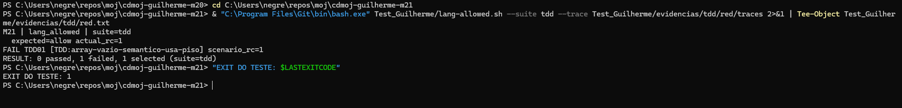
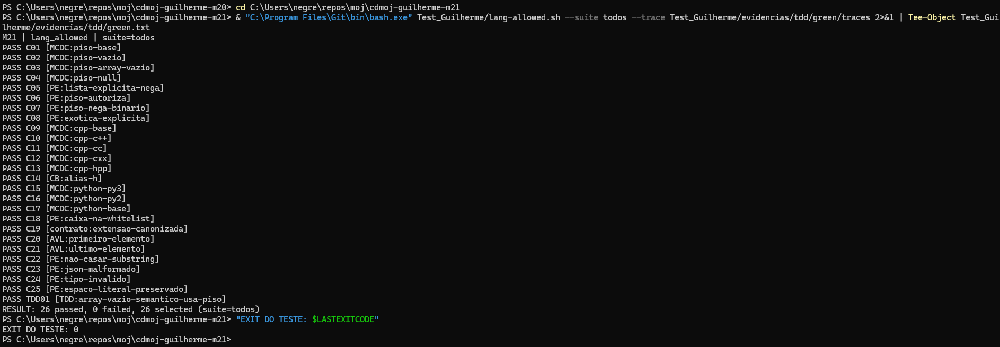
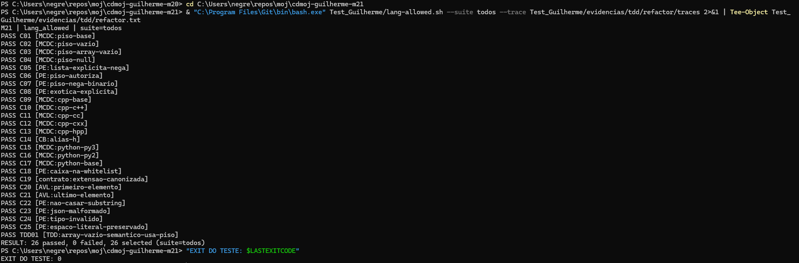

# Testes de unidade — M21 lang_allowed

## Identificacao e projeto

Guilherme Negreiros Pereira · Grupo 11. Branch: test/guilherme-m21.
O cdmoj e uma plataforma de juiz online com API Bash. Esta contribuicao verifica uma unidade da biblioteca server/api/v1/lib/langs.sh, sem iniciar a aplicacao inteira.

## Contrato e planejamento

Permite com status 0 e nega com status nao zero. Lista vazia usa o piso da plataforma; lista explicita e soberana. Os dois lados sao canonizados para comparar aliases. O requisito TDD exige que [ ] tenha a mesma politica de [] e use o piso.

Funcao e jq reais. _lang_canon e platform_langs_json sao dubles de retorno literal, com registro de argumentos e chamadas. A tabela de aliases dentro do jq e real. Isso isola M21 e nao comprova integracao com M19 ou PLATFORM_LANGS real.

O planejamento segue PTOSS-2 e os materiais de caixa-preta, caixa-branca, unidade e TDD, incluindo os dois percursos de derivacao. Valores esperados sao literais; nao se usa uma copia do algoritmo como oraculo.

| Classe / fronteira | Casos |
|---|---|
| Selecao do piso | C01-C04 |
| Permissao explicita e piso | C05-C08 |
| Aliases e bases falsas | C09-C17 |
| Caixa na whitelist | C18 |
| Uso do canonizador | C19 |
| Primeira/ultima posicao e substring | C20-C22 |
| JSON e tipo invalidos | C23-C24 |
| Espaco dentro de string preservado | C25 |
| Array vazio com espacos | TDD01 |

AVL considera zero/um e primeira/ultima posicao onde existem essas fronteiras. Nao ha maximo inventado para tokens ou listas. Cada caso pode ter varias assertions, mas e contado uma vez.

## Complementaridade entre caixa-preta e caixa-branca

Partindo da especificacao, foram escolhidas classes e saidas esperadas; a leitura estrutural complementou ramos, alternativas e curto-circuitos. Partindo dos caminhos de codigo, os cenarios foram complementados com limites e formatos que executar uma linha nao valida sozinho.

Os pares estruturais do piso nao cobrem, sozinhos, a normalizacao dos itens da whitelist ou seus formatos invalidos. Os casos funcionais complementam essas entradas e protegem a comparacao exata, sem substring.

## Testes implementados e resultados

Script: Test_Guilherme/lang-allowed.sh. 26 casos no total, incluindo TDD01. A suite regressao exclui o requisito novo; tdd executa apenas TDD01; todos executa ambos.

| ID | Tecnica / finalidade | Resultado apos Refactor |
|---|---|---|
| C01 | MCDC:piso-base | PASS |
| C02 | MCDC:piso-vazio | PASS |
| C03 | MCDC:piso-array-vazio | PASS |
| C04 | MCDC:piso-null | PASS |
| C05 | PE:lista-explicita-nega | PASS |
| C06 | PE:piso-autoriza | PASS |
| C07 | PE:piso-nega-binario | PASS |
| C08 | PE:exotica-explicita | PASS |
| C09 | MCDC:cpp-base | PASS |
| C10 | MCDC:cpp-c++ | PASS |
| C11 | MCDC:cpp-cc | PASS |
| C12 | MCDC:cpp-cxx | PASS |
| C13 | MCDC:cpp-hpp | PASS |
| C14 | CB:alias-h | PASS |
| C15 | MCDC:python-py3 | PASS |
| C16 | MCDC:python-py2 | PASS |
| C17 | MCDC:python-base | PASS |
| C18 | PE:caixa-na-whitelist | PASS |
| C19 | contrato:extensao-canonizada | PASS |
| C20 | AVL:primeiro-elemento | PASS |
| C21 | AVL:ultimo-elemento | PASS |
| C22 | PE:nao-casar-substring | PASS |
| C23 | PE:json-malformado | PASS |
| C24 | PE:tipo-invalido | PASS |
| C25 | PE:espaco-literal-preservado | PASS |
| TDD01 | TDD:array-vazio-semantico-usa-piso | PASS |

Os resultados foram executados pelo integrante no PowerShell/Git Bash e conferidos nos arquivos locais. O log foi normalizado para UTF-8/LF sem alterar seu conteudo.

## Cobertura

[Analise das decisoes e pares](evidencias/cobertura.md), com rastreabilidade para os arquivos em evidencias/tdd/refactor/traces/. A analise utiliza a estrutura final. Nao foi utilizado kcov; nao ha porcentagem automatica de linhas nem instrumentacao do jq.

## Processo TDD

| Etapa | Alteracao / resultado | Evidencia |
|---|---|---|
| Red | TDD01 falha pelo motivo esperado; exit 1 | red.txt e captura Red |
| Green | Implementacao minima; 26 PASS, 0 FAIL, exit 0 | green.diff, green.txt e captura Green |
| Refactor | Extracao de responsabilidade; mesmos 26 PASS, 0 FAIL, exit 0 | refactor.diff, refactor.txt e captura Refactor |

O Green acrescentou empty_check com remocao dos quatro whitespaces JSON apenas na copia usada para reconhecer []. O Refactor moveu esse predicado para _lang_uses_platform_floor e manteve a autorizacao no metodo principal com if explicito.

Os testes e seus esperados permaneceram os mesmos entre as etapas de producao. A sequencia de commits registra teste, Red, correcao minima, Green, refatoracao e aprovacao posterior.







As tres imagens sao capturas reais feitas pelo integrante. Os logs e traces correspondentes estao em evidencias/tdd; as imagens nao substituem esses registros.

## Analise critica

O teste novo falhou antes da correcao e passou depois; isso demonstra sua capacidade de detectar o comportamento corrigido. A aprovacao dos mesmos casos depois da extracao estrutural evidencia preservacao nos cenarios selecionados. Esses resultados nao provam ausencia de defeitos em entradas nao exercitadas.

A estrutura da biblioteca permite carregar funcoes sem iniciar o servidor. O acoplamento com utilitarios externos exige um ambiente Bash/jq funcional; falha de configuracao nao deve ser confundida com Red. A separacao de responsabilidades no Refactor torna a regra localizada e facilita sua leitura.

Nao valida o canonizador real, a lista real da plataforma, HTTP, Unicode ou todas as representacoes de whitespace. O xtrace nao instrumenta o interior do jq. C25 protege a preservacao de espaco em string; nao e um teste exaustivo de todas as strings JSON.

## Conclusao

O ciclo Red -> Green -> Refactor foi executado e registrado. O requisito novo e os casos de regressao selecionados passam apos a refatoracao. A cobertura foi examinada por caminhos e pares de casos, com limites explicitados.

## Executar

```bash
bash Test_Guilherme/lang-allowed.sh --suite todos
bash Test_Guilherme/lang-allowed.sh --suite todos --trace Test_Guilherme/evidencias/execucao/traces
```
